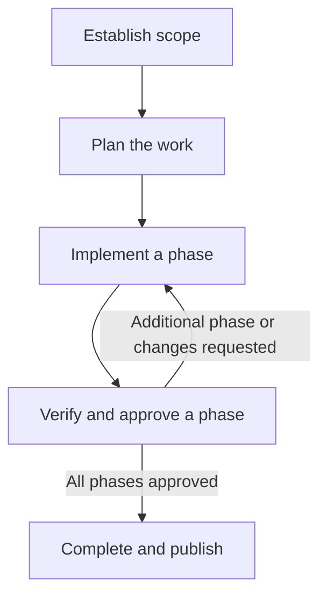
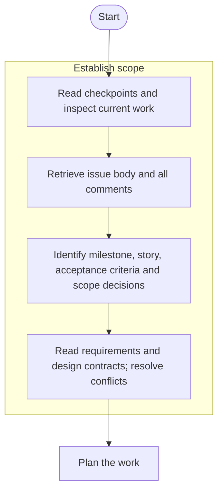
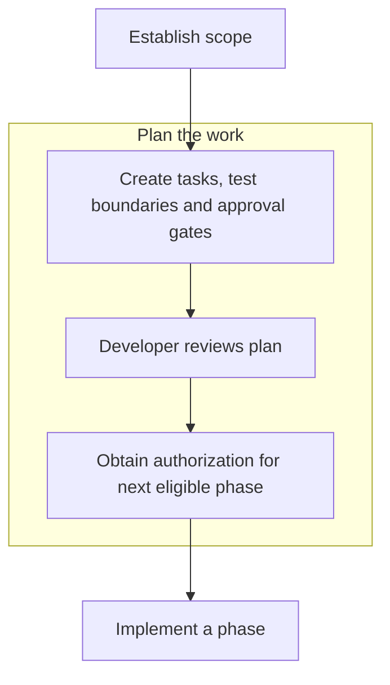
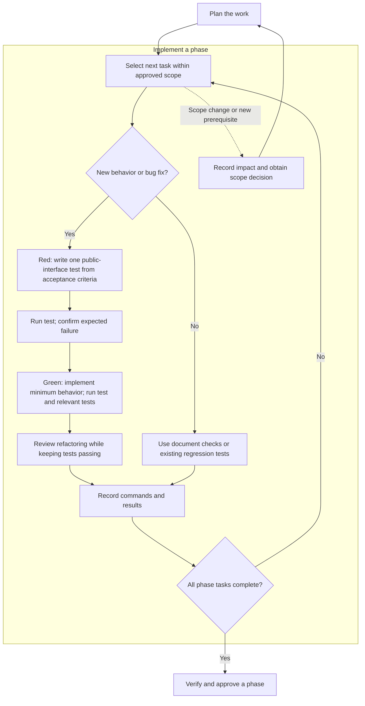
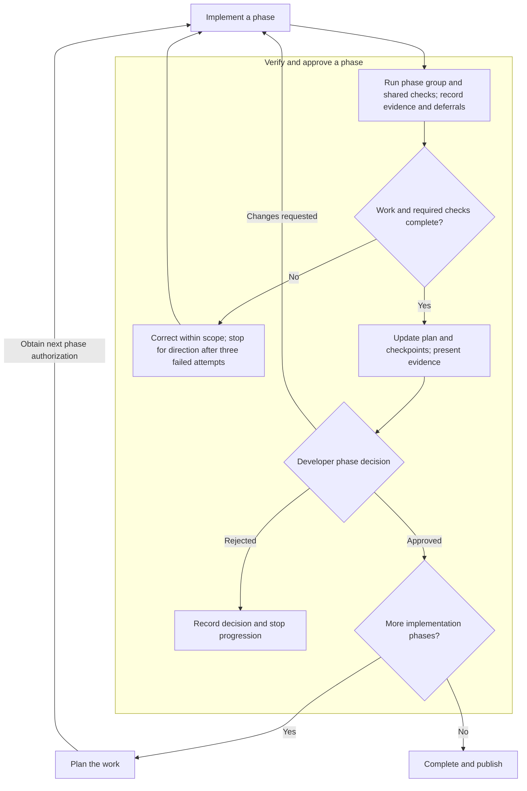
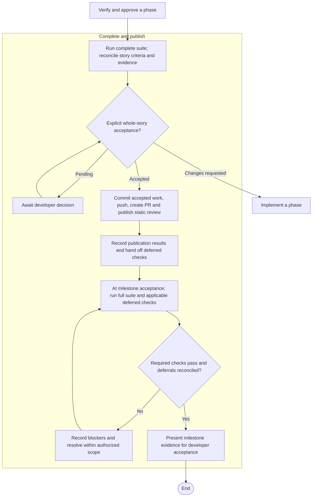

# Development workflow

The repository follows an **issue-driven workflow with explicit developer approval at each implementation phase**. This document summarizes the governing instructions; consult the linked sources for detailed requirements.

The diagram shows progression through the gates. Plan approval alone does not authorize implementation. A phase approval authorizes further work only when its progression decision or existing authorization covers that work. Corrective work also remains subject to the three-attempt limit described below.

## 1. Establish scope and resume state

Read [CHECKPOINTS.md](../CHECKPOINTS.md), then retrieve the GitHub issue's complete body and all comments using the [retrieve-github-issue skill](../.agents/skills/retrieve-github-issue/SKILL.md). The issue governs implementation scope; [user stories](specs/user-stories.md) provide milestone context, and the [harness design](specs/agentic-ml-harness-design.md) supplies supporting contracts through its reading map. Resolve conflicts before implementing affected behavior. If no issue is supplied or identifiable, request it before user-story implementation.

## 2. Create a reviewable implementation plan

Follow **milestone → user story → implementation phases → granular tasks**. Each phase identifies acceptance criteria, dependencies, public test boundaries, verification evidence, and an approval gate. Use the [plan template](templates/user-story-implementation-plan.md) and [planning terminology](../README.md#planning-terminology). Plan approval does **not** approve implementation gates or, by itself, authorize execution.

## 3. Implement one authorized phase at a time

Use Python 3.12 or newer, `uv`, and the committed lockfile. Follow the [development guide](development.md), including its task-specific reading map. Verification must not silently update the lockfile.

This part of the diagram is where the agent completes the tasks in the **currently authorized implementation phase**, working through one behavior at a time. Confirm public test boundaries with the developer through the plan or an explicit review.

For new behavior and bug fixes, this is a **closed-loop agentic TDD workflow**: the agent writes a test, observes its failure, changes the implementation, runs verification, and uses the results to choose its next action. Test results provide the feedback that closes the loop. The loop operates within the authorized implementation phase; scope decisions, the three-attempt limit, and developer approval gates bound the agent's autonomy.

1. **Red:** Write one behavior-focused test through a confirmed public interface, derived from the issue's acceptance criteria. Run it and confirm it fails because the behavior is missing or incorrect, rather than because of an unrelated setup error.
2. **Green:** Implement only enough behavior to pass that test. Run it and the relevant existing tests.
3. **Refactor:** Review the working code for improvements while keeping those tests passing.
4. **Repeat:** Select the next behavior needed to complete the implementation phase.

Record the red/green commands and results in the implementation-phase evidence. Stay within the approved scope; a newly discovered requirement may need a scope decision. Failed corrective attempts remain subject to the three-attempt limit described below.

For documentation-only changes or behavior-preserving refactoring, appropriate document checks or existing regression tests replace the red/green cycle. Record why TDD does not apply instead of manufacturing a failing test.

Once the implementation phase's tasks are complete, move to **phase verification**, followed by the developer approval gate.

## 4. Verify and preserve evidence

The [verification policy](development/verification.md#phase-and-story-verification) distinguishes three levels:

| Level | Required verification |
|---|---|
| Implementation phase | Direct tests of changed modules, plus shared development checks |
| Story acceptance | Reconcile acceptance criteria; reuse valid phase evidence and renew invalidated checks |
| Milestone acceptance | Full local suite, deferred caller regressions, and applicable distribution, installation, manual, and platform checks |

Shared executable checks cover locked synchronization, lock consistency, lint, formatting, strict typing, CLI version output, and whitespace. Record lock hashes before and after verification. Use the [documented commands](development.md#shared-development-commands). Documentation-only work uses document, link, and whitespace checks with a rationale instead of product tests.

At phase gates, record exact test selectors, changed-module mappings, acceptance criteria, public boundaries, selected/deselected counts, outcomes, and platform limitations. Run the entire phase group at each executable phase gate and both groups at user-story acceptance. Assign acceptance-group deferrals to a named story acceptance task; preserve separate milestone verification obligations. Known failures remain blockers. [CI](development/ci.md) runs the full suite on PRs and pushes to `main`; hosted success does not replace required local milestone verification.

Keep reviewed reports in `docs/verification/` and durable raw evidence in `.dev-records/verification/`. Follow the [records policy](development/records.md) for identities, logs, lifetime retention, and backup responsibility. Distinguish macOS evidence from separately verified Linux results and unverified platforms.

## 5. Stop at each developer gate

Complete the phase's work and verification, present evidence and limitations, update the owning plan and checkpoints, and await explicit developer approval. Requested changes remain within the current implementation phase. Record approvals only after explicit decisions.

Story acceptance is also explicit; it does not imply milestone acceptance. The final implementation gate may serve as story acceptance only when the developer explicitly says so. Development **implementation phases** are separate from the ML experiment **workflow phases** enforced by the harness.

## 6. Publish accepted work

The [execute-plan workflow](../.agents/skills/execute-plan/SKILL.md#publish-and-review-an-accepted-story) treats explicit whole-story acceptance as authorization to commit accepted work using Conventional Commits, push, create a PR using the repository's selected template, and publish a static review, unless the user limits authorization. Record publication results in the plan and checkpoints. Merging, branch cleanup, review fixes, and another story's implementation require separate authorization.

Milestone acceptance remains a separate review. Reconcile all deferred checks, run the full local suite and applicable shared, artifact, manual, and platform checks against the final milestone inputs, then present passing evidence for developer acceptance.

## Controls throughout the workflow

Scope changes go through the [scope-management procedure](../.agents/skills/manage-plan-scope/SKILL.md). Record the reason, impact, decisions, evidence needing renewal, and resume point in the affected plan. Pause dependent work until the necessary decision is recorded.

Make at most **three corrective attempts for the same unresolved problem**. Each attempt consists of a corrective change followed by verification against the original failure and relevant tests. After the third failed attempt, stop corrective work, preserve the original criteria and failure evidence, and present the attempts, current state, uncertainty, and possible next steps for developer direction. Do not weaken assertions, disable checks, or conceal failures.

The governing entry points are [AGENTS.md](../AGENTS.md), the [development guide](development.md), the [verification policy](development/verification.md#phase-and-story-verification), and [planning terminology](../README.md#planning-terminology).
