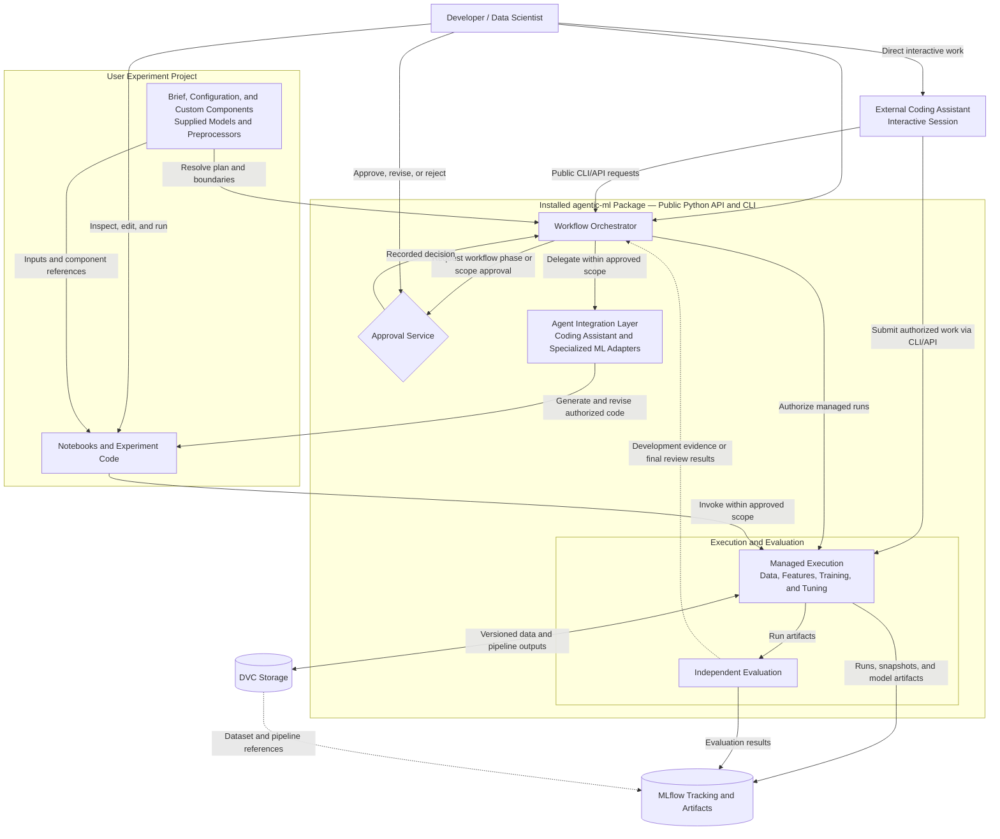
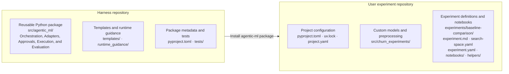
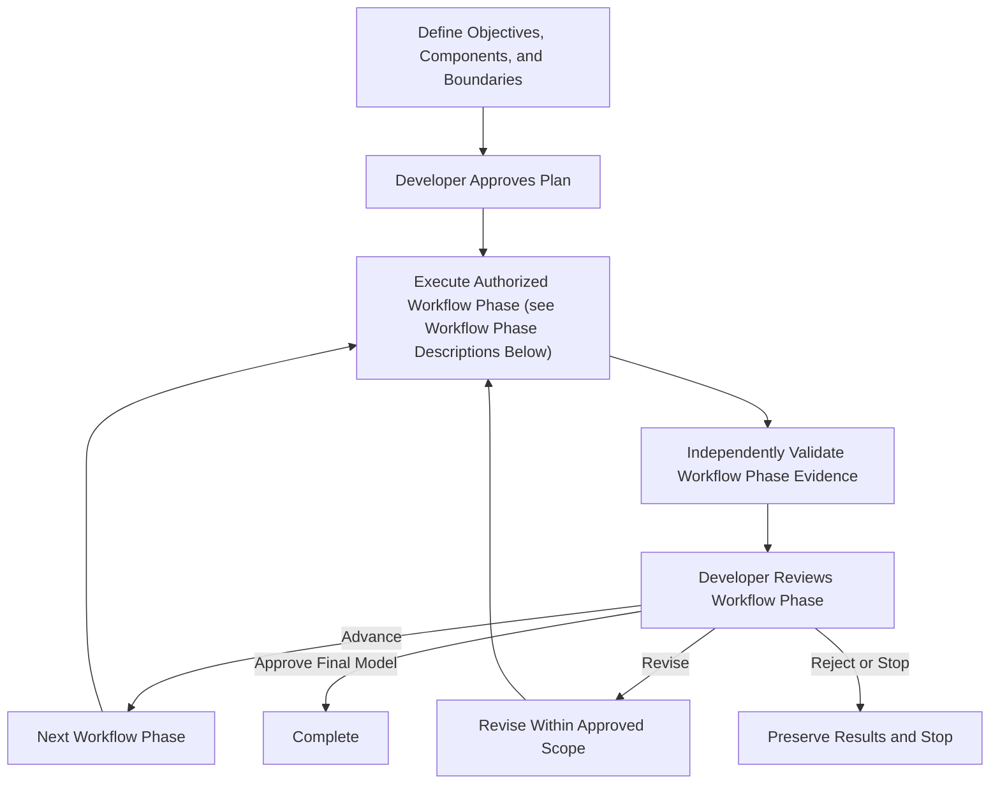

# Agentic ML Development Harness — Design

**Version:** 0.12
**Status:** Proposed specification; ADR-001 accepted; ADR-007 installation decisions accepted
**Date:** 2026-10-28

## 1. Executive Summary

Build an agent-independent machine learning development harness for tabular ML and deep learning. Coding assistants can invoke the harness interactively through its public CLI/API, while a workflow orchestrator within the installed package can delegate tasks through managed agent adapters; distinct execution and evaluation components independently execute, validate, and track experiments. Development is supervised: agents may iterate within approved workflow phases and budgets, while developers approve workflow phase transitions and expanded data-access scope.

The harness is a versioned Python dependency installed into a separate user experiment repository. That repository is the unit users own, review, version, and share: it contains experiment briefs, configuration, agent-generated notebooks and Python code, and data-versioning metadata. Notebooks are the primary user interface for inspecting, running, and refining experiments; the harness provides reusable capabilities and independent execution and evaluation controls.

A central design principle is **hierarchical closed-loop ML development**:

- **Inner loop — model improvement:** feature engineering, training, hyperparameter optimization, and evaluation.
- **Outer loop — data improvement:** data gap diagnosis, iterative acquisition, extraction, validation, dataset versioning, and retraining.

## 2. Scope and Design Decisions

| Dimension | Decision |
|---|---|
| Orchestration | Distinct orchestration and execution/evaluation components within the installed harness package |
| Agent integrations | Interactive coding-assistant use through the public CLI/API as the basic path; standardized managed adapters for harness-invoked coding assistants and specialized agents |
| ML frameworks | Initial scikit-learn, LightGBM, and PyTorch; extensible |
| Package management | Use `uv` for Python dependency management, lockfiles, and virtual environments |
| Initial distribution | Install the Python package directly from its GitHub repository using `uv`, pinned to a full Git commit SHA; package-registry distribution is future work |
| CLI and Python imports | Use `agent-ml` as the installed CLI name and retain `agentic_ml` as the Python import/package directory name |
| Repository boundary | Separate harness product repository and user experiment repositories; consume the harness as a versioned Python dependency through its public API and CLI |
| Jupyter notebooks | Agent-generated notebooks in the user experiment repository are the primary experiment interface; support interactive use and automatic harness-managed execution |
| Model types | Tabular classification/regression and deep learning |
| Autonomy | Supervised with developer approvals at workflow phase boundaries |
| Data | Extraction, EDA, feature engineering, and iterative acquisition are first-class |
| Execution | Local subprocesses for the proof of concept; Ray planned for later distributed and parallel execution; container/GPU backends incrementally |
| Experiment tracking | MLflow for runs, parameters, metrics, model artifacts, and experiment comparisons |
| Data versioning and pipelines | DVC for dataset and derived-data versioning, dependency tracking, and reproducible pipelines; Git versions DVC metadata and pipeline definitions |
| Agent instructions | Targeted `AGENTS.md` files in separate development and runtime guidance trees; runtime loading is explicit and versioned |
| Experiment guidance | Developer-authored Markdown brief plus versioned YAML algorithm and hyperparameter boundaries |
| Search autonomy | Agent searches only within declared boundaries; expansions are recommendations for subsequent experiments |
| Deployment | Outside initial scope |

### Principles

1. Agent and ML-framework independence through versioned interfaces.
2. Explicit separation of planning/delegation, execution, evaluation, and approval.
3. Independent, evidence-based validation; agent claims alone never establish success.
4. Reproducibility, provenance, and data-to-model lineage by design.
5. Budgeted, interruptible, resumable closed loops.
6. Controlled data access and protected evaluation datasets.
7. Extensible operations: standardized tasks plus sandboxed custom code.

## 3. Architecture



The installed harness package supplies orchestration, agent integration, approval handling, execution, and evaluation. Separation of orchestration from execution/evaluation means distinct component responsibilities within the package, rather than separate installations or repositories. Agent adapters connect to coding assistants or external agent services; those external systems need not run inside the package. Package boundaries show implementation ownership, not process or deployment boundaries.

These capabilities operate in the selected experiment project's environment using its configuration and project-associated state/storage. The orchestrator coordinates approved work; execution independently enforces boundaries, and evaluation assesses results. Project-owned models and preprocessors run through harness interfaces alongside built-in components. Interactive notebook use follows the same access rules and cannot establish acceptance by itself. Protected holdout access is reserved for independent final evaluation; its feedback cannot drive development iterations. Harness manifests link DVC and MLflow records to project snapshots, component identities, approvals, and durable project-associated workflow state.

### Component responsibilities

| Component | Responsibilities |
|---|---|
| Workflow orchestrator | Plans workflow phases, delegates tasks, maintains durable state, controls iterations, enforces approvals and budgets, resumes work |
| Agent integration | Capability discovery, structured task/result exchange, cancellation, CLI/SDK/tool adapters |
| Data extraction engine | Source discovery, approved queries, ingestion, snapshots, schema checks, lineage |
| Data acquisition planner | Diagnose gaps, propose additional samples/labels/sources, estimate costs and expected benefit |
| Data acquisition executor | Enforce recorded acquisition authorization, execute acquisition, validate and version results |
| EDA/validation | Profiling, missingness, class balance, anomalies, leakage diagnostics, split strategy |
| Feature engineering | Propose/fit/transform/select features, version pipelines, evaluate feature sets |
| Experiment runner | Backend-independent submission, status, cancellation, resources, logs, artifacts, and checkpoints; local execution initially, Ray-backed execution later |
| Framework adapters | Standardized and custom training entrypoints for scikit-learn, LightGBM, PyTorch |
| Evaluation engine | Metrics, baseline comparisons, scientific validity, robustness, reproducibility |
| Tracking and artifact store | MLflow records runs, parameters, metrics, and model artifacts; links to DVC dataset/pipeline versions and harness manifests for complete lineage |
| Data versioning and pipelines | DVC tracks source and derived datasets, dependencies, stage outputs, and reproducible pipeline definitions; integrates with harness execution |
| Approval service | Workflow phase and acquisition approvals, authorization scope, audit records |

### Harness and experiment project boundary

The harness repository contains reusable execution, evaluation, tracking, agent integration, orchestration, approval handling, templates, and default runtime guidance. Each user experiment repository contains objectives, notebooks, supplied and generated code, configuration, and versioning metadata. One experiment repository may contain multiple related experiments sharing project code and dependencies.



Directory contents are illustrative subsets; Section 12 provides fuller layouts. The installation arrow represents a pinned GitHub package dependency installed into the user project's Python environment.

Experiment agents operate within the experiment repository and use the installed harness through its public Python API and CLI. Routine experiment work does not modify the harness installation or source repository and must not require a neighboring harness checkout. Changes to shared harness capabilities follow a separate software-development review process.

### Interactive and managed agent use

- **Interactive mode:** The developer works with an external coding assistant, such as Codex, GitHub Copilot, or Claude Code, which prepares project files and invokes the harness CLI/API. No agent adapter is required, and the harness does not own the assistant session.
- **Managed mode:** The orchestrator delegates bounded tasks through a configured agent adapter, receives structured results, and coordinates evaluation and further revisions. Managed support requires verification of a concrete product, interface, and version; a product name alone does not establish adapter capabilities.

Both modes use the same harness-owned experiment state, plan validation, approvals, managed execution, budgets, artifact records, and independent evaluation. The assistant proposes changes and requests work; only recorded harness evidence and authorized developer decisions establish acceptance or workflow phase progression. The architecture diagram shows both directions: managed delegation through the agent integration layer and interactive CLI/API requests from an external assistant.

The orchestrator operates on an explicitly selected experiment project and environment. Durable workflow state and run artifacts are stored in configured locations associated with that project, independently of the harness source tree.

## 4. Hierarchical Closed-Loop Workflow



The diagram summarizes the workflow phase cycle. The individual workflow phases are:

1. **Problem definition:** Define the objective, target, metrics, data sources, allowed algorithms, supplied components, constraints, and budgets. Approve the task contract and plan.
2. **Data extraction and EDA:** Obtain and version data, inspect its quality and distributions, and establish training/validation/test splits. Approve the dataset assessment and split protocol.
3. **Feature engineering:** Use supplied preprocessing or develop transformations and feature sets. Fit stateful preprocessing only on training data. Compare predictive performance against an approved baseline feature set with a fixed approved reference estimator and validation protocol. This limited training/evaluation is authorized within feature engineering; broader baseline modeling follows in the next workflow phase. Review the validated pipeline, comparison evidence, and lineage.
4. **Baseline modeling:** Train simple, reproducible reference models. Approve baseline results for later comparisons.
5. **Model development:** Train and compare candidate models, including user-supplied algorithms, and improve them within approved boundaries. Review candidate evidence.
6. **Optimization:** Tune hyperparameters within the declared search space and budgets. Approve the optimization summary and candidate for final evaluation.
7. **Final evaluation:** Evaluate the selected model on the protected holdout, check robustness and reproducibility, and produce the final report. Approve or reject the model.

**Each workflow phase transition requires approval.** Agents can iterate within an approved workflow phase. Valid existing artifacts can support skipping a workflow phase when that is approved in the plan. Section 5 defines the gate evidence for each workflow phase.

Data acquisition is an activity that can trigger a return to earlier workflow phases, rather than an eighth workflow phase. Supplied components and authorized data acquisition fit within “Execute Authorized Workflow Phase”; their detailed requirements appear in Sections 6–8. The following rules apply:

- **Workflow phases:** Initial plan approval completes problem definition. Execution then follows the configured workflow phases in Section 5: data extraction and EDA → feature engineering → baseline modeling → model development → optimization → final evaluation. Each workflow phase approval authorizes entry to the next workflow phase and its recorded scope.
- **Iteration:** Agents may iterate within the current approved workflow phase, component permissions, parameter boundaries, access scope, and budgets without approval for every run. Evidence is independently validated against requirements specific to the workflow phase before developer review; only sufficient evidence permits advancement.
- **Scope changes:** Workflow phase returns, expanded permissions, and changes to immutable components require authorization before execution. Authorized changes are recorded durably; changes to immutable code, allowed algorithms, or data-access scope create a new versioned experiment configuration. Acquisition requires recorded authorization covering its source, strategy, and limits, followed by authorized validation/EDA and downstream work.
- **Final evaluation:** Protected-test evaluation occurs only in its authorized final workflow phase. Its results cannot feed feature, model, or acquisition improvement loops, so the revision arrow does not apply to protected-test feedback. Unsuccessful final evaluation ends in rejection or review; any further development requires a separately approved evaluation protocol that preserves holdout protection. Completion requires developer approval of successful final evaluation.

**Inner loop:** feature engineering → training/tuning → evaluation → evidence-based revision.  
**Outer loop:** diagnose data limitations → propose acquisition → approve where required → acquire/validate/version → retrain and compare.

Both loops must terminate on success, budget exhaustion, lack of improvement, unrecoverable failure, policy violation, or developer cancellation. Budget exhaustion preserves evidence and produces a reviewable status.

### Notebook-centered user workflow

The steps below describe the workflow with integrated agent support. Before milestone 4, developers can prepare inputs and notebooks themselves or with an external coding assistant such as Codex, GitHub Copilot, or Claude Code; no agent adapter is required for interactive use. In managed mode, configure a verified adapter. Harness-managed agent proposals, execution, and revision loops begin in milestone 4. The harness validates, records, and executes supplied inputs without requiring an agent.

1. Install `uv` and Git, create a separate user repository and Python project, install the harness from a pinned GitHub commit, and run `uv run agent-ml init` to add experiment scaffolding and configure its environment.
2. Configure local data access, tracking, storage, and an agent adapter; optionally register supplied algorithms and preprocessors with their parameter specifications and modification permissions. Write the experiment brief, feature pipeline configuration, and search-space configuration.
3. Ask the agent to generate readable notebooks that invoke supplied or built-in components. Generate new experiment-specific implementations or helper code only as needed and authorized.
4. Inspect the notebooks and approve the resolved task contract, workflow phase plan, component selection, evaluation protocol, access scope, and budgets through the applicable gates before dependent execution. Validate component interfaces, parameters, and evaluation compatibility before training.
5. Open the notebooks in JupyterLab, execute approved work, and inspect results. The agent may also execute and revise notebooks automatically within the current approved workflow phase, component permissions, parameter boundaries, and budgets. Workflow phase returns and scope changes require authorization; changes to immutable supplied code require approval and a new versioned experiment configuration.
6. Record experiments through harness-managed execution of saved notebook and code snapshots, followed by independent evaluation. Interactive exploration alone does not establish acceptance.
7. Review evidence at every workflow phase boundary and approve entry to the next workflow phase or request changes. Review final evaluation separately to approve or reject the final model. Preserved state supports interruption and resumption.

Reviewing every notebook edit is optional unless configured as an additional gate; workflow phase approvals and scope controls remain mandatory.

## 5. Standard Workflow Phases and Gates

| Workflow phase | Activities | Required gate evidence |
|---|---|---|
| 1. Problem definition | Objective, target, metrics, sources, budgets, constraints | Approved ML task contract |
| 2. Data extraction and EDA | Source discovery, snapshots, profiling, quality, split strategy | Approved dataset assessment and split protocol |
| 3. Feature engineering | Transformations, selection, fitted pipelines, predictive feature comparison using a fixed approved reference estimator | Validated feature pipeline, predictive comparison evidence, and lineage |
| 4. Baseline modeling | Train reproducible simple baselines | Approved baseline results |
| 5. Model development | Candidate architectures, training, iterative improvement | Candidate comparison and experiment evidence |
| 6. Optimization | Hyperparameter search within budgets | Approved optimization summary |
| 7. Final evaluation | Protected holdout, robustness, reproducibility, reporting | Final model approval/rejection |

Workflow phases may be configured or skipped when valid preexisting artifacts are supplied. Agents can iterate within approved workflow phase scope; workflow phase transitions require approval. Additional data acquisition may trigger an explicit scope approval and a return to earlier workflow phases.

## 6. Data Extraction and Iterative Acquisition

### Data extraction requirements

- Connect to local CSV/Parquet, SQL, and object storage initially; add APIs later.
- Discover source schemas and metadata without unrestricted data exposure.
- Execute approved extraction queries and sampling plans.
- Version extracted datasets with DVC; capture source identity, query, parameters, extraction time, checksums, and permissions metadata in associated manifests. Commit DVC metadata to Git; store dataset content in the DVC cache and configured remote storage.
- Validate schema, row counts, nulls, types, duplicates, and other configured quality rules.
- Enforce least-privilege access, source allowlists, network restrictions, and cost/record limits.

### Acquisition strategies

- Additional observations from approved sources.
- Targeted sampling for underrepresented classes or data slices.
- Additional feature columns or related datasets.
- Human or external labeling workflows.
- Active learning: select informative unlabeled examples.
- Data augmentation and synthetic data, explicitly labeled and tracked as distinct from observed data.

### Acquisition proposal contract

```yaml
proposal:
  id: acquisition-001
  reason: underrepresented_class
  evidence:
    affected_class: minority_class
    current_samples: 250
    observed_recall: 0.61
  acquisition:
    strategy: targeted_sampling
    source: approved_training_database
    target_additional_samples: 500
  expected_benefit:
    hypothesis: improve_minority_class_recall
    metric: recall
  constraints:
    max_records: 500
    max_runtime_minutes: 15
  approval:
    required: true
```

The predicted benefit is a hypothesis, not a guarantee. Compare before/after training with consistent evaluation protocols. Never use protected final-test feedback to guide acquisition. Changes to evaluation protocols require separate approval.

## 7. Feature Engineering

The feature engineering engine must:

- Propose and execute missing-value handling, encoding, scaling, feature construction, selection, and dimensionality reduction.
- Support domain-specific transformations and custom code.
- Track feature definitions, fitted preprocessors, parameters, versions, and dependencies.
- Fit stateful transformations only on training data; apply unchanged to validation/test data.
- Compare candidate feature sets for predictive performance against a fixed approved baseline feature set using the same fixed approved reference estimator, estimator settings, metric, and split protocol. Record gains, ties, or regressions according to the metric optimization direction.
- Support deep-learning preprocessing, image augmentation, tokenization, and PyTorch datasets where relevant.
- Make transformations reusable for inference without requiring model deployment in the initial release.

Milestone 2 supplies the minimal estimator training, prediction, and independent validation-metric computation needed for feature comparison. Approve and record the baseline feature set, reference estimator/settings, metric/direction, and split protocol before candidate comparison. Fit preprocessing and the estimator only on approved training partitions, score only on approved validation partitions, and enforce protected-test isolation for experiment code and exploratory kernels. Apply execution authorization, resource budgets, independent leakage/result checks, and existing run-evidence contracts to these runs. Preserve baseline/candidate feature identities, estimator code/dependency identities and settings, fitted artifacts, predictions, scores, and data/split lineage so comparisons can be reviewed and reproduced. A candidate need not improve to produce a valid comparison; an improvement claim must follow the recorded metric direction. Algorithm selection and hyperparameter search remain in Milestone 3.

Experiment-specific transformations belong in the experiment repository's notebooks or helper modules. Code shared across experiments in that repository belongs in its own Python package. Generic feature-engineering capabilities belong in the harness package; promoting project code into the harness is a separate development change.

Feature preparation supports user-supplied stateless transformations and stateful preprocessors. Stateful preprocessors expose separate fitting and transformation operations: fitting receives only the approved training partition, and the fitted state is reused unchanged for validation, test, and inference.

Users may require a supplied preparation pipeline or explicitly delegate selection and modification to the agent. The resolved feature plan records component order, effective parameters, input/output schemas, fitting scope, and whether agent modifications are permitted.

Preserve the preparation code, fitted state, dependencies, and output feature schema as run artifacts. Supplied pipelines must satisfy the same leakage, reproducibility, and lineage checks as generated pipelines.

## 8. Interfaces and Contracts

All contracts should have versioned JSON Schemas and typed Python models. `AgentAdapter` applies to managed delegation; interactive assistants use the public CLI/API for plan validation, submission, status, artifact retrieval, evaluation feedback, and cancellation without implementing this interface. These conceptual interfaces require further design for asynchronous operations, error handling, and authorization. Submission idempotency and recovery must satisfy the behavioral contract below; exact schemas and persistence mechanisms remain implementation decisions.

```python
from typing import Protocol, Any

class AgentAdapter(Protocol):
    def capabilities(self) -> set[str]: ...
    def execute(self, task: "AgentTask") -> "AgentResult": ...
    def cancel(self, task_id: str) -> None: ...

class DataSourceAdapter(Protocol):
    def discover(self) -> "DataSourceMetadata": ...
    def extract(self, spec: "ExtractionSpec") -> "DatasetRef": ...
    def validate(self, dataset: "DatasetRef") -> "ValidationReport": ...

class DataAcquisitionPlanner(Protocol):
    def diagnose(self, dataset: "DatasetRef", evaluation: "EvaluationReport") -> "DataGapReport": ...
    def propose(self, gaps: "DataGapReport") -> "DataAcquisitionProposal": ...

class DataAcquisitionExecutor(Protocol):
    def execute(self, proposal: "DataAcquisitionProposal", authorization: "ApprovalRecord") -> "DatasetRef": ...

class FeatureEngineeringAdapter(Protocol):
    def propose(self, dataset: "DatasetRef", context: "FeatureContext") -> "FeaturePlan": ...
    def transform(self, dataset: "DatasetRef", plan: "FeaturePlan") -> "FeatureSetRef": ...
    def evaluate(self, feature_set: "FeatureSetRef") -> "FeatureEvaluationReport": ...

class ExperimentRunner(Protocol):
    def submit(self, spec: "ExperimentSpec", submission_key: str) -> str: ...
    def lookup_submission(self, submission_key: str) -> "SubmissionStatus": ...
    def status(self, run_id: str) -> "RunStatus": ...
    def cancel(self, run_id: str) -> None: ...
    def artifacts(self, run_id: str) -> list[str]: ...

class ModelAdapter(Protocol):
    def train(self, context: "TrainingContext") -> Any: ...
    def predict(self, model: Any, data: Any) -> Any: ...
    def save(self, model: Any, path: str) -> None: ...
    def load(self, path: str) -> Any: ...

class Evaluator(Protocol):
    def evaluate(self, run_id: str, criteria: "AcceptanceCriteria") -> "EvaluationReport": ...

class ApprovalService(Protocol):
    def request(self, phase_id: str) -> str: ...
    def decide(self, approval_id: str, decision: str) -> None: ...
```

Managed adapter capability discovery must identify supported task types, invocation interface/version, guidance delivery, result retrieval, cancellation behavior, and available usage accounting before delegation. Unsupported required capabilities block managed delegation. The common contract describes verified behavior rather than assuming every assistant exposes equivalent session control.

### PyTorch checkpoint restoration

PyTorch integrations must provide a documented checkpoint restore path through the supplied or built-in model implementation, separately from final-model `save`/`load` persistence. The model implementation defines the checkpoint format, declares the state it contains, and restores that declared state. Preserve emitted checkpoints as run artifacts together with model, executed-code, configuration, and dependency identities needed to load them in the recorded environment. The experiment runner captures and preserves these artifacts; it does not interpret framework-specific checkpoint payloads.

Restoration recovers the state declared by the checkpoint. Exact training continuation is not guaranteed by checkpoint capture or restoration alone; it requires explicit support for the necessary optimizer, scheduler, random-number, and data-loader state. Concrete restore API signatures and checkpoint payloads remain framework-specific implementation decisions subject to this contract.

### Primary contracts

| Contract | Key fields |
|---|---|
| `MLTaskSpec` | Objective, target, task type, data, feature guidance, delegated decisions, algorithm mode, metrics, budgets, policies, source brief reference |
| `ExperimentProjectConfig` | Schema version, project root and environment reference, tracking/storage/state locations, access policy references, interactive/managed mode, optional managed adapter and verified product/interface/version, explicit project guidance mapping, project-local component declarations |
| `ComponentSpec` | Identifier, kind, Python entrypoint, interface version, supported tasks/prediction outputs where applicable, parameter types/defaults/constraints, code or dependency identity, agent modification permission |
| `ExperimentConfig` | Schema version, experiment identifier, brief/search-space references, notebook entrypoints, data references, feature pipeline component references and parameters, working directory, execution settings; resolved into the approved `ExperimentSpec` |
| `RuntimeInstructionBundle` | Harness-supplied shared/task-specific guidance snapshots, audience, task mapping, ordered source paths, versions/checksums; separately identified additional assistant context where observable, with capture limitations |
| `SearchSpaceSpec` | Schema version, registered algorithm identifiers, fixed parameters, typed choices/ranges, scales, configuration checksum |
| `WorkflowPlan` | Workflow phases, dependencies, gates, iteration limits |
| `AgentTask` / `AgentResult` | Durable task/attempt identifiers, scope, approved plan and guidance references, allowed tools, proposed changes, output/artifact references, status, available usage evidence, cancellation outcome |
| `ExtractionSpec` / `DatasetRef` | Source, query, snapshot, checksum, schema, lineage |
| `DataGapReport` / `DataAcquisitionProposal` | Evidence, acquisition hypothesis, scope, cost, approval |
| `FeaturePlan` / `FeatureSetRef` | Ordered component references, effective parameters, input/output schemas, fitting scope, modification permissions, fitted state, versions, provenance |
| `ExperimentSpec` / `ExperimentResult` | Project/experiment identity, model, data, notebook/code snapshots, experiment Git revision, harness repository URL/full commit SHA/package version, build identity where available, environment/lockfile identity, effective parameters, source configuration references, runtime instruction bundle reference, resolved decisions, resources, metrics, artifacts |
| `EvaluationReport` | Metrics, validity checks, baseline comparison, evidence |
| `ApprovalRecord` | Authenticated developer identity, scope and plan/configuration identity, decision, timestamp, verification evidence, audit trail; submission by an agent does not establish developer approval |
| `WorkflowRecoveryRecord` | Project/workflow/phase identity and progress, task/attempt associations, submission key, approved configuration and input-manifest checksum, guidance and approval references, harness/runner/MLflow run identities, evidence/artifact references, budget reservations and accounted usage, terminal or reviewable outcomes, recovery ownership/version |
| `SubmissionStatus` | Submission key and bound input identity, acceptance state (accepted, definitively not accepted, or unknown), runner run identity and execution status where known, evidence supporting the observation; lookup failure is unknown, not proof of non-acceptance |

### Submission identity and recovery contracts

Before runner submission, persist a project-associated recovery record with a stable submission key for that task attempt, the approved configuration and immutable input-manifest checksum, applicable approval/guidance references, and a reservation against applicable execution budgets. If this record cannot be persisted, do not submit. Preserve workflow phase progress and dataset lineage, including across acquisition and subsequent downstream work.

Repeated submission with the same key and identical bound inputs returns the existing run identity without starting another execution. Reusing a key with different inputs fails. The runner must durably associate the key and input identity with the execution before starting work and support lookup by that key after restart. Concurrent submissions with the same key must obey the same rule. Retain this association for as long as the workflow can be resumed; lost or unavailable associations produce an unknown status rather than making the key eligible for fresh execution.

`lookup_submission` must distinguish accepted work, definitive evidence that submission was never accepted, and uncertainty. A timeout, missing MLflow record, or unavailable runner alone is insufficient evidence of non-acceptance. Backend-specific implementations must meet these semantics; inability to establish status leads to review under §9, not blind resubmission. A permitted retry after a failed or cancelled execution is a new attempt with a new submission key linked to its predecessor; a transport retry of the original submission keeps its original key.

Recovery reconciles runner status, durable workflow records, and MLflow evidence as specified in §9. Publishing tracking records and terminal manifests must also tolerate retries: durably associate the tracking identity with the harness run, reconcile uncertain publication, and reuse existing records and identical immutable manifests rather than create duplicate logical results or overwrite conflicting evidence. Conflicting or uncertain identities require review. Explicit reproduction under the restoration lifecycle remains a new linked run, distinct from recovery of an existing attempt.

### User-supplied ML components

Users may supply existing model implementations, training routines, and feature-preparation code in their experiment repository or as pinned Python dependencies. Using these components must not require modifying the harness.

Project configuration declares each component's identifier, Python entrypoint, interface version, supported tasks where applicable, and parameter specification. The harness combines these declarations with its built-in registry for that project. Duplicate identifiers and incompatible interfaces are rejected before execution.

User-supplied components receive the same execution controls, parameter validation, independent evaluation, provenance tracking, and resource limits as built-in components.

Users may designate supplied components as immutable or authorize agents to modify them. Supplied code is immutable by default; agents may configure and invoke it within approved boundaries. Changes to immutable components require explicit developer approval and a new versioned experiment configuration. Permission to modify code does not expand the approved component, data-access, parameter, or evaluation boundaries.

The following capabilities become versioned public interfaces, refining the conceptual adapters above:

| Component | Required capabilities |
|---|---|
| Custom model | Train using approved training/validation inputs; predict through an interface usable by the independent evaluator; save and restore the fitted model |
| Stateful preprocessor | Fit on training inputs; transform using fitted state; save and restore that state |
| Stateless transformation | Transform inputs without fitting; declare output schema |

Framework-native implementations may be integrated through project-local wrappers. Training routines may return framework-specific models, provided the wrapper exposes the required prediction and persistence operations. The existing `FeatureEngineeringAdapter` plans and evaluates feature work; supplied preprocessors and transformations provide the execution capabilities listed above. Exact preprocessor method signatures remain subject to interface design.

Component declarations include supported prediction outputs, such as labels, probabilities, or regression values. Before training, the harness rejects components that cannot provide the outputs required by the approved evaluation metrics. Protected test data remains accessible only through independent evaluation.

The following configuration illustrates the intended workflow; the precise schemas remain subject to interface design:

```yaml
# project.yaml
components:
  models:
    custom_churn_model:
      interface_version: "0.1"
      entrypoint: churn_experiments.models:ChurnModelAdapter
      task_types: [classification]
      prediction_outputs: [labels, probabilities]
      agent_may_modify: false
      parameters:
        regularization:
          type: float
          default: 0.1
          minimum: 0.0

  preprocessors:
    domain_features:
      interface_version: "0.1"
      entrypoint: churn_experiments.features:DomainFeatureAdapter
      kind: stateful
      agent_may_modify: false
      parameters: {}
```

```yaml
# search-space.yaml
schema_version: "0.1"
algorithms:
  custom_churn_model:
    search:
      regularization:
        type: float
        min: 0.001
        max: 1.0
        scale: logarithmic
```

```yaml
# experiment.yaml — additional fields
features:
  pipeline:
    - component: domain_features
      parameters: {}
```

Component parameter specifications define valid types, defaults, and constraints. Experiment search spaces define the narrower values agents may explore. Declaring a component does not automatically authorize its use or parameter tuning. Feature pipeline parameters are fixed by the approved feature plan; changes require the applicable feature-engineering workflow phase authorization and a recorded plan revision.

Run lineage preserves component declarations, exact project-code snapshots or pinned dependency identities, effective parameters, and fitted artifacts. Component code changes authorized within a workflow phase are captured in each run's source snapshot.

### Project initialization and installation

Provide a documented bootstrap path starting with a vanilla Python interpreter and local raw data. Users first install `uv` and Git, then install the harness as a Python package directly from its GitHub repository into the user project's environment. Pin the Git dependency to a full commit SHA and use a normal package installation, rather than an editable installation. Package-registry distribution is future work.

Users do not need to manually clone or maintain a harness working checkout. The installer may fetch the pinned source into its managed cache to build and install the package. Downloads require network access and, for a private repository, configured Git credentials; keep credentials outside committed configuration.

The intended installation and initialization sequence is:

```bash
# After installing uv and Git:
mkdir customer-churn
cd customer-churn

git init
uv init
uv add "git+https://github.com/OWNER/HARNESS-REPO.git" --rev FULL_COMMIT_SHA

uv run agent-ml init
uv run jupyter lab
```

The repository URL and commit SHA are placeholders. These commands specify the intended product interface; the harness and CLI still require implementation. There is no separate initializer-tool installation: `agent-ml init` runs from the harness already installed in the project's `.venv`.

`agent-ml init` must:

1. Add project configuration, ignore rules, an initial experiment brief, search-space and execution configuration, notebook templates, and any project-package scaffolding to the existing user repository.
2. Preserve existing files and report conflicts rather than silently overwriting them. Preserve the declared harness Git dependency and pinned commit.
3. Add required ML, notebook-execution, and interactive JupyterLab dependencies to the project's `pyproject.toml` and synchronize its `uv` environment and lockfile. Users commit their project files and `uv.lock` to Git.
4. Initialize project-local DVC metadata and configure local DVC storage, MLflow tracking/artifact storage, and durable workflow-state storage. Remote backend choices remain configurable.
5. Generate explicit settings or prompts for raw-data paths/permissions, agent adapter/authentication, and the mechanism for presenting and recording approvals. Authentication and experiment-specific choices remain explicit setup steps; initialization does not authorize data access or execution. Keep credentials outside committed configuration.

After initialization, users register existing raw data, including approved sources outside the repository, and resolve experiment-specific inputs before dependent work begins. Existing inputs are snapshotted and versioned without requiring external acquisition.

The harness repository's root `pyproject.toml` must define its build system, package metadata, supported Python versions, dependencies, and `agent-ml` CLI entrypoint. Package the `src/agentic_ml/` implementation, initialization templates, and default runtime guidance. Load resources from the installed package without relying on a source checkout. The Python import name remains `agentic_ml`; the distribution name and actual GitHub URL require implementation decisions.

The project lockfile records the resolved harness Git revision and library versions. Harness upgrades explicitly change the declared full commit SHA and project lockfile, creating a new environment identity; package version alone does not identify Git revisions. Resumed runs use the preserved compatible configuration and instruction bundle. The harness repository's own lockfile is for product development and does not replace the experiment project's environment record.

### Developer experiment inputs

Developers provide two complementary inputs: a Markdown experiment brief describing intent and constraints, and a YAML configuration defining the allowed algorithms and hyperparameter search spaces. These inputs are distinct from the resolved `ExperimentSpec` submitted for execution.

Store these as `experiments/<name>/experiment.md` and `search-space.yaml` in the user repository. An adjacent `experiment.yaml` identifies notebook entrypoints, data references, feature pipeline components and parameters, and execution settings; it does not replace the brief or expand the search space. A project-root `project.yaml` holds project-wide environment, tracking, storage, agent, guidance settings, and user-supplied component declarations. Relative paths in these declarative inputs resolve against the experiment repository root; notebook working directories are explicitly recorded. The schemas and CLI/API commands beyond the selected `agent-ml init` interface require further design.

The Markdown brief uses recognizable sections with natural-language guidance for:

- Dataset location and target variable.
- Task type, initially classification or regression for tabular experiments.
- Features to include or exclude, or explicit delegation of feature selection to the agent; include information-availability and leakage constraints.
- Evaluation metric and optimization direction, or delegation to the agent to propose them.
- Evaluation split strategy and constraints, including time or group boundaries where applicable.
- Algorithm mode: **use** a specified algorithm, **select** an algorithm from a declared allowed set, or **compare** every algorithm in that set.
- Trial counts, runtime limits, and other experiment budgets.

Example developer brief:

```markdown
# Experiment: Predict customer churn

## Data
Dataset: ./data/customers.parquet
Target: churned
Task: classification

## Features
Choose suitable features.
Exclude customer_id and information unavailable at prediction time.

## Evaluation
Propose a metric appropriate for an imbalanced target and its direction.
Use a time-based split on signup_date.

## Algorithms
Compare all classification algorithms declared in ./experiments/churn/search-space.yaml.

## Budget
Run at most 50 hyperparameter trials per algorithm.
```

Before integrated agent support, developers supply experiment decisions through the brief and configuration files, optionally prepared with an external coding assistant. The harness validates these inputs and records the effective, versioned plan, including supplied decisions, defaults, source references, input checksums, and approval evidence, before dependent execution. Unresolved delegated choices and ambiguous or conflicting requirements block affected execution; delegated decisions require approval before use. The resolved plan identifies the allowed algorithm set, selected features, metric and direction, split protocol, and budgets as those capabilities are introduced.

Milestone 4 adds harness-managed agent proposals and iteration. The agent proposes delegated decisions and records its reasoning; those proposals use the same harness validation, plan recording, and applicable problem-definition and evaluation approval gates before use.

### Development and runtime agent instructions

Use `AGENTS.md` for coding agents and ML experiment agents, with separate repository ownership and an explicit audience in each file. Ship default runtime guidance as resources in the installable harness distribution; the paths below identify their locations in the harness source repository.

| Instruction location | Audience and scope |
|---|---|
| Harness repository `AGENTS.md` | Harness development conventions |
| Harness `src/agentic_ml/AGENTS.md` and targeted component files | Coding agents implementing and maintaining the harness; component responsibilities, invariants, relevant contracts, and verification guidance |
| Harness `runtime_guidance/AGENTS.md` | Packaged shared scientific and operational practices for experiment agents |
| Harness `runtime_guidance/{data,features,modeling}/AGENTS.md` | Packaged task-specific practices for data assessment, feature engineering, and training/tuning |
| Experiment repository `AGENTS.md` | Project development conventions; excluded from the harness runtime loader, but an external assistant may load it independently |
| Experiment repository `runtime_guidance/` (optional) | Project-authored runtime practices, selected only through an explicit configured mapping |

Add deeper development files only where a component needs distinct instructions. Keep shared rules in their common parent and load task-specific runtime guidance only when relevant.

The runtime instruction loader must:

1. Select packaged shared/task-specific guidance and any configured project guidance through an explicit task-to-guidance mapping. Record source ownership, package version or project path, and load order; the filename alone does not activate instructions. Neither repository's development files are automatically included by the harness runtime loader. This restriction does not assert control over instructions independently loaded by an external assistant.
2. Assemble shared guidance before task-specific guidance. Task-specific instructions may specialize shared practices within the experiment's constraints; incompatible requirements require clarification before affected work begins rather than silent override.
3. Keep input authority explicit: runtime guidance describes how to work, the resolved experiment brief defines objectives and experiment-specific constraints, and YAML defines allowed algorithms and hyperparameter boundaries. Guidance cannot broaden data access, bypass approval gates, change evaluation criteria, or expand the search boundary. Harness-enforced policies apply to every task.
4. Snapshot the exact contents, paths, versions/checksums, and loading order of all harness-supplied runtime guidance when the experiment plan is resolved. Preserve the instruction bundle with run lineage and use it for subsequent tasks and resumed execution in that experiment.
5. Treat adoption of changed runtime guidance as a new versioned experiment configuration subject to the existing gates. Record conflicting instructions as a validation error or clarification request before dependent execution.

The preserved bundle identifies what the harness supplied, not the assistant's complete instruction context. Record additional instructions, session configuration, and assistant identity/version where observable, and explicitly record capture limitations. Interactive use presents the preserved bundle for the developer/assistant to consume; managed adapters must demonstrate delivery of the referenced bundle. Neither mode claims complete prompt capture or deterministic reproduction of assistant reasoning. Conflicts visible to the harness block affected execution; unavailable context cannot be certified conflict-free.

Runtime instruction files contain reusable practices. Dataset locations, targets, chosen metrics, budgets, and algorithm search spaces remain in the experiment brief, resolved plan, and YAML configuration. Executable validation and access controls enforce these constraints independently of agent compliance with Markdown instructions.

### Algorithm and hyperparameter configuration

The YAML configuration references supported algorithm identifiers from the project's combined built-in and user-supplied component registry. It separates fixed parameters from tunable parameters and supports categorical choices, integer ranges, and floating-point ranges. Numeric ranges declare minimum and maximum bounds and a linear (raw-value) or logarithmic sampling scale.

```yaml
schema_version: "0.1"
algorithms:
  random_forest_classifier:
    fixed:
      random_state: 42
    search:
      n_estimators:
        type: integer
        min: 100
        max: 1000
        scale: linear
      max_depth:
        type: categorical
        choices: [null, 5, 10, 20, 40]
      min_samples_leaf:
        type: integer
        min: 1
        max: 20
        scale: linear

  logistic_regression:
    fixed:
      max_iter: 2000
    search:
      C:
        type: float
        min: 0.0001
        max: 100
        scale: logarithmic
      class_weight:
        type: categorical
        choices: [null, balanced]
```

Configuration rules:

- The YAML is a **hard allowed boundary for the current experiment**, not an initial space the agent may expand. The brief may narrow that boundary but cannot expand it.
- Fixed parameters retain their declared values. Search parameters may take only declared choices or values within their inclusive bounds. Integer ranges produce integers; logarithmic ranges require strictly positive bounds.
- The harness validates algorithm/task compatibility, parameter names and types, nonempty choices, ordered bounds, and parameter combinations before execution. Initial configurations should use mutually compatible combinations; a conditional-parameter schema is deferred.
- Parameters omitted from the YAML use registry-defined defaults, recorded with the adapter/library version in the resolved run configuration. Omission does not authorize the agent to tune them.
- Every candidate, including candidates submitted through custom code or notebooks, is subject to the same boundary validation. Invalid candidates are rejected before training.
- Search-space definitions specify where to search; the resolved trial and runtime budgets specify how much work may occur. Comparing all algorithms does not require exhaustively enumerating every parameter combination.
- The agent may recommend new algorithms, choices, ranges, or fixed values based on evidence. It records these recommendations for a subsequent experiment without modifying the current inputs or expanding the current run. A developer-adopted revision creates a new versioned experiment configuration subject to the existing gates.
- Preserve the original Markdown, YAML, their versions/checksums, the resolved plan, and effective parameters with run lineage so that delegated decisions and boundary compliance are auditable.

### Resolved experiment example

```yaml
schema_version: "0.1"
experiment:
  id: experiment-001
  task_type: classification
  hypothesis: "A neural network improves macro F1 over baseline"
dataset:
  uri: data/training.parquet
  version: sha256:...
  target: label
  split_manifest: splits/v1.json
model:
  framework: pytorch
  entrypoint: experiments/image-classification/notebooks/03_model_development.ipynb
  parameters:
    hidden_layers: [128, 64]
    learning_rate: 0.001
    batch_size: 128
    epochs: 50
evaluation:
  primary_metric: f1_macro
  direction: maximize
  baseline_run_id: baseline-001
  min_relative_improvement: 0.03
  protected_test_set: true
resources:
  accelerator: gpu
  gpu_count: 1
  max_runtime_minutes: 30
  max_memory_gb: 16
reproducibility:
  seed: 42
  repetitions: 3
  experiment_git_revision: "<experiment-repository-commit>"
  source_snapshot: "sha256:<notebook-and-code-snapshot>"
  harness_version: "<installed-version>"
  harness_repository_url: "https://github.com/OWNER/HARNESS-REPO.git"
  harness_git_commit: "<full-harness-commit-sha>"
  harness_build_identity: "sha256:<distribution-hash-if-available>"
  project_lockfile: uv.lock
  project_lockfile_checksum: "sha256:<lockfile-hash>"
governance:
  phase: model_development
  approval_required_to_advance: true
```

## 9. Execution, Evaluation, and Governance

### Execution

- Declare dependencies separately in the harness and experiment repositories' `pyproject.toml` files and commit their respective `uv.lock` files. Execute user experiments in the selected experiment project's environment, including its installed harness version and project package.
- Support local Python subprocesses, followed by containerized and GPU execution.
- Support automatic execution of Jupyter notebooks as experiment entrypoints using `nbclient` and an `ipykernel` kernel in the experiment's `uv`-managed environment; provide JupyterLab for interactive development.
- Execute notebooks from a fresh kernel, in cell order, with explicit input parameters and a recorded working directory. Apply experiment timeouts, cancellation, resource budgets, and filesystem/network restrictions to notebook execution.
- Preserve the source notebook, supplied parameters, executed notebook with cell outputs, execution errors, and generated artifacts in the run record. Cell errors fail execution; successful notebooks remain subject to independent evaluation and protected-data rules.
- Keep experiment-specific preprocessing, models, and training logic in the experiment repository's notebooks, helpers, or project package. Both notebook and Python entrypoints import generic capabilities from the installed harness public API; they must not import through paths into the harness source checkout.
- Enforce timeouts, cancellation, experiment counts, memory/GPU quotas where supported.
- Cancellation stops managed training and preserves already available checkpoints, logs, and terminal status under the original run identity. Record the outcome using the cancellation contract below. Forced termination does not promise a new checkpoint; already emitted checkpoints remain retrievable with the restoration metadata defined in §8.
- Capture logs, exit status, project environment/lockfile identity, experiment Git revision, exact executed notebook/code snapshots including uncommitted changes, harness repository URL/full commit SHA/package version, build identity where available, datasets, checkpoints, and artifacts.
- Treat unsuccessful model performance as a valid experiment result, distinct from execution failure.
- Restrict filesystem, network, and credential access for agent-generated code. Separately define access for the assistant process, its tools, and its workspace in each integration mode; restrictions on a notebook subprocess alone do not constrain the assistant.
- Resolve paths against the selected experiment project and record the working directory. Explicitly authorize writable project paths, storage locations, and access to external raw data. Routine experiment execution must not modify the harness installation or source repository.

### Execution backend evolution

The proof of concept executes experiments locally through the `ExperimentRunner` interface, covering submission, status monitoring, cancellation, resource limits where supported, and artifact collection. Keep orchestration and independent evaluation separate from backend-specific scheduling and transport. Implement the local runner first; introduce additional backend abstractions when integration requires them.

Ray is the planned backend for later distributed and parallel execution. Initial Ray support will run independent experiments and hyperparameter trials in parallel. Distributing a single model-training job is a separate, subsequent capability requiring framework-specific design as needed.

Ray dependencies, integration, cluster provisioning, distributed scheduling, and distributed training are outside proof-of-concept scope. Future Ray execution must preserve the existing search boundaries, aggregate experiment budgets, approval gates, cancellation semantics, and provenance requirements. The proof of concept does not require Ray installation or a cluster to execute or validate its local workflow.

### Experiment tracking, data versioning, and pipelines

- Use **MLflow** as the experiment tracking system for Python and notebook runs. Record effective parameters, metrics, execution status, model artifacts, and references to dataset, feature, environment, and instruction provenance.
- Use **DVC** to version raw datasets, extracted snapshots, split manifests, and derived feature datasets. Use `dvc.yaml` to declare pipeline stages and their dependencies, parameters, and outputs; preserve resolved dependency/output hashes in `dvc.lock`.
- Track DVC metadata, pipeline definitions, and lockfiles in the experiment repository's Git history. Exclude dataset contents and large generated artifacts from Git. Configure DVC storage for sharing and restoring versioned data; support local storage initially and choose remote backends/access configuration during implementation.
- The workflow orchestrator retains responsibility for agent delegation, approvals, budgets, and recovery. DVC executes reproducible data and training stages under harness control; it does not replace workflow governance or independent evaluation.
- Link each MLflow run to the experiment Git revision, exact executed notebook/helper/project-code snapshots, harness repository URL/full commit SHA/package version and build identity where available, project lockfile/environment identity, DVC data/output hashes, applicable stage definitions and lockfile snapshot, and harness run identifier. Preserve uncommitted source and resolved metadata in immutable run snapshots. Record the MLflow run identifier in the harness result for bidirectional lookup.
- Keep ownership explicit: DVC manages versioned data and pipeline outputs, MLflow manages experiment records and model artifacts, and harness manifests connect both to approvals and runtime instruction bundles.
- Store executed notebook snapshots and model artifacts in configured MLflow artifact storage, versioned datasets in DVC storage, and durable workflow state in configured project-associated state storage. These locations may be local or external; preserve references and nonsecret configuration in the experiment repository and exclude generated stores from Git.
- DVC stage reuse must preserve producer provenance and remain subject to current evaluation and authorization checks. A cached stage does not establish that an experiment meets acceptance criteria.

### Run evidence capture and restoration

Every recorded Python or notebook run has a schema-versioned harness manifest connecting immutable input evidence to its execution and results. MLflow artifact storage holds manifests, source/configuration bundles, and result evidence; DVC storage holds versioned dataset content. Git retains project sources, DVC metadata, and nonsecret storage configuration. The manifest records artifact locations and content checksums so restoration can verify content rather than trust a location or Git revision alone.

Capture these evidence groups:

| Evidence | Required record |
|---|---|
| Source and configuration | Saved notebook or Python entrypoint, project helpers/package code, effective configuration, and required external file dependencies; preserve project-relative paths and file checksums, including modified and required untracked files. Retain the experiment Git revision as context, not as a substitute for the snapshot. |
| Environment | Harness repository URL/full commit SHA/package version and build identity where available; snapshots of project `pyproject.toml` and `uv.lock`; Python version and relevant platform details. Resolve project-local package code from the captured source. |
| Data | DVC metadata snapshots, dataset content identities, nonsecret configured storage references, and mappings from logical inputs to execution paths. Required dataset content must be available in configured DVC storage. Include stage definitions and `dvc.lock` when pipelines are introduced. |
| Execution | Harness run identifier, recorded entrypoint, working directory relative to the restored project, effective parameters, seeds, and declared nonsecret environment settings. Credentials are supplied separately through authorized access and are never embedded in the evidence bundle. |
| Guidance and authorization | Applicable runtime guidance snapshots, recorded scope/order and checksums, and references to scoped approval evidence. External assistant context is captured only where observable; this does not claim complete external instruction capture. |
| Results and verification | Execution status, exit information, logs, executed notebook where applicable, output artifact references and checksums, declared output checks/tolerances, and independent check results. Metric tolerances apply when modeling is introduced. |

The harness owns this lifecycle:

1. **Prepare:** Resolve required inputs, verify dataset content hashes, and freeze the source/configuration bundle and declared output checks. Persist the immutable input manifest and referenced evidence before launching execution. For milestone 1, snapshot declared project source roots rather than infer coverage through Python import tracing. Exclude credentials, datasets, environments, and generated stores from the source bundle; required external code/file inputs must be explicitly registered and captured or versioned. Failure to resolve or preserve a required input blocks execution.
2. **Execute:** Materialize the frozen bundle in a separate execution directory and execute that source with the recorded environment and verified dataset inputs. The input bundle remains immutable; outputs go to declared writable locations. Later edits to the developer's working tree do not change the submitted run. Apply current execution authorization, access boundaries, and budgets to this directory and its inputs.
3. **Finalize:** Preserve available results and verification evidence in MLflow artifact storage. Write an immutable terminal manifest referencing the input manifest by checksum, output evidence, harness run identifier, and MLflow run identifier. Failed or cancelled runs retain available evidence and their outcome; incomplete evidence must not be reported as successful verification. The input manifest remains available if execution is interrupted before finalization; reconcile submission and finalization through the §8 submission identity contract and §9 workflow recovery rules.
4. **Restore:** Starting from an experiment checkout and recorded run manifest, retrieve the pinned harness revision, project dependency files, source/configuration bundle, applicable guidance, and DVC inputs. Verify required evidence checksums and restored dataset content hashes before execution. Rebuild the locked environment without a manually maintained harness checkout and materialize the recorded source, including preserved uncommitted changes. Missing source, dependencies, dataset content, or mismatched required evidence produces an explicit restoration failure identifying the affected input; never substitute a current working-tree file, newer dependency, or alternate dataset silently. Access credentials and current execution authorization remain required; historical approval evidence does not grant new access.
5. **Compare:** Execute the recorded entrypoint from its recorded relative working directory as a new run linked to the original manifest. Independently assess the new outputs against the original declared checks/tolerances, recording comparison results and retaining both runs. Output checksums identify evidence; declared checks determine whether reproduction succeeds when byte equality is not required.

Milestone 1 provides this restoration path without an agent. Demonstrate it in a clean second-machine environment with an uncommitted notebook edit and a required untracked helper, verify that working-tree edits after capture cannot affect execution, and verify explicit failures for removed or corrupted required inputs. Configured storage must be accessible from the second machine; initially local stores may be transferred with their recorded content identities preserved. Exact manifest serialization and CLI/API signatures remain implementation decisions.

### Notebook development and execution contract

- Use `experiments/<name>/notebooks/` in the user repository as the primary interface for data assessment, feature/baseline work, model development, and results analysis. Agents generate and revise these notebooks; users inspect, edit, and run them in JupyterLab. Python entrypoints remain available for advanced use.
- Provide numbered notebook templates for these activities; allow fewer or additional notebooks as appropriate. Include explanatory Markdown describing objectives, assumptions, generated code, results, and proposed next steps.
- Declare JupyterLab and `ipykernel` in the experiment project's dependencies or an explicitly installed interactive dependency group managed by `uv`. Include `nbclient` and `ipykernel` in the installed harness notebook-execution dependencies. Users do not need the harness development environment.
- Use an explicit parameter cell for dataset/configuration references and run identifiers. Require saved notebooks to execute from a fresh kernel in cell order with a defined working directory and locked environment; do not depend on hidden interactive state.
- Exchange artifacts across notebooks through recorded versioned references rather than variables in another notebook's kernel. Snapshot imported experiment helpers and project code with each recorded run.
- Import project-specific shared logic from the experiment repository's own Python package and generic capabilities from the installed harness. Promoting project code into the harness requires a separate development review.
- Users may execute cells interactively for exploration. Recorded experiment results require harness-managed execution of saved source snapshots and independent evaluation; successful interactive execution alone does not establish acceptance.
- Training cells submit work through harness APIs so candidate validation, budgets, approvals, and tracking apply. Interactive and automated work follow the same split, protected-test, and acquisition rules.
- Define the interactive-kernel isolation and protected-data boundary under ADR-006. API checks alone cannot constrain arbitrary Python in an unrestricted kernel. Protected test data must remain inaccessible to experiment-agent and exploratory kernels; approved final evaluation occurs through the independent evaluator.
- Record notebook runs in MLflow with the same configuration, source snapshots, dual harness/experiment identities, dataset versions, feature lineage, and environment provenance as Python entrypoints.

### Independent evaluation

1. **Execution correctness:** code completes and expected artifacts exist.
2. **Scientific validity:** split boundaries, preprocessing fitting, and leakage rules are respected.
3. **Model quality:** agreed metrics and baseline comparisons are computed consistently.
4. **Generalization/robustness:** folds, data slices, or stress tests satisfy defined criteria.
5. **Reproducibility:** reruns meet explicit metric tolerances, acknowledging GPU nondeterminism where applicable.

### Workflow states

`Planned → Running → Evaluating → AwaitingApproval → Approved → NextPhase/Completed`.

Additional terminal or reviewable states: `Failed`, `Cancelled`, `BudgetExhausted`, and `NeedsReview`. A rejection or revision request returns work to an authorized workflow phase; it does not silently bypass gates.

#### Recovery and reconciliation

On restart, acquire exclusive recovery ownership for the workflow and reconcile its durable records with runner submission/execution status and MLflow evidence before issuing new work or accepting results. State transitions and submission authority must reject stale owners, for example through an ownership epoch checked at submission and state update; a lock timeout alone must not allow an old owner to continue advancing work. Exact locking, fencing, and transaction mechanisms remain milestone 5 design decisions.

| Reconciled finding | Required action |
|---|---|
| Completed run with sufficient independently verified evidence | Reuse the original run identity and evidence; continue through any remaining evaluation and approval gates. Do not rerun completed work. |
| Active run | Reattach and monitor the existing run. |
| Submission definitively never accepted | Recheck applicable authorization and budget reservation, then retry using the original submission key and identical inputs. |
| Failed or cancelled run | Preserve its outcome and available evidence. A retry requires permission under existing policy/scope and remaining budgets, and creates a new linked attempt. |
| Unknown submission/execution status, conflicting identities, or insufficient completion evidence | Enter `NeedsReview`; block automatic resubmission and dependent advancement. Reconcile available evidence without rerunning completed execution. |

Preserve consumed budgets across restart and account for each usage record once. Keep reservations for uncertain work until reconciliation establishes actual usage or non-execution; uncertainty must not release capacity for duplicate spending. Settling a reservation into consumed usage must not count both against the budget. Cancellation, failure, budget exhaustion, and review do not silently authorize further work. Any review decision and subsequent authorized action are durable and auditable.

Reused evidence retains its original producer, configuration/input and guidance identities, dataset lineage, artifacts, and approval history. Record the decisions authorizing subsequent use separately. Recovery grants no additional authorization, does not bypass pending gates, and applies current access restrictions. Results from stale, cancelled, or superseded attempts cannot silently advance the workflow. Apply these rules to recovery after acquisition as well as other workflow phases.

### Agent cancellation, usage, and resumption

Cancelling an experiment run and cancelling a managed agent task are distinct operations. Record both outcomes, including whether cancellation was requested, acknowledged, or confirmed terminal. Interactive mode can stop harness-managed work and reject further unauthorized submissions; it does not promise to terminate an externally owned assistant session. Managed adapters document and verify their cancellation behavior, including handling of child work and late results. Results from cancelled or superseded attempts cannot silently advance the workflow.

Enforce harness-run runtime, trial, and resource budgets independently of assistant usage. Record assistant token/cost usage and enforce configured assistant limits where the integration supports measurement and control; label unavailable accounting explicitly rather than claiming a complete assistant cost bound. Admission of new managed tasks requires remaining applicable budgets. Reaching a limit stops the relevant work and preserves a reviewable outcome.

Resume from durable task/attempt and run identities, approved plan and guidance references, captured artifacts, recorded approvals, and consumed budgets. Reconcile in-flight work under the submission identity and workflow recovery contracts before retrying or accepting results; a conversation transcript or assistant memory is not the workflow state. Concrete persistence and coordination mechanisms remain implementation decisions subject to those contracts.

### Governance

Controls are rules and checks enforced by the harness to govern what an experiment may do and whether its results are accepted. They include developer approvals, access restrictions, runtime/trial/resource budgets, independent validation of expected artifacts and results, and boundaries on agent revisions. For example, an execution authorization may permit a notebook to read a specified dataset for at most ten minutes; the harness records that authorization and enforces both limits. Instructions alone do not establish enforcement.

- Approvals are durable, scoped, and auditable. Bind each decision to an authenticated developer and the reviewed plan/configuration and scope. Agent requests and assistant tool-execution permissions do not establish experiment approval. The approval channel must distinguish developer decisions from agent actions; agents cannot approve their own scope expansions or final acceptance.
- Approval records, evaluator credentials, and protected-test data must be inaccessible for unauthorized reading or modification by assistant tools as well as experiment code. Define accessible resources for both modes under ADR-006. An unrestricted assistant workspace cannot be described as enforcing these boundaries; instruction text and CLI/API validation alone do not provide isolation.
- New data sources, expanded permissions, changed evaluation criteria, and workflow phase transitions require authorization.
- Protected test sets cannot be used for iterative tuning or data acquisition decisions.
- Resource limits and stopping conditions apply to both inner and outer loops.

## 10. Acceptance Criteria Traceability

[User stories](user-stories.md) define the authoritative product acceptance criteria and own their stable IDs. This design document describes architectural support for those requirements; it does not define a separate product acceptance-criteria list.

The table groups criterion links by story increment and milestone. Each link resolves to the criterion definition in the user stories. Design references identify relevant mechanisms, not proof of complete coverage, implementation, or successful verification. Pending design decisions remain subject to satisfying the story criteria.

The former proposal-local `AC-01` through `AC-54` identifiers are retired. Historical versions retain those definitions; current requirements and future references use the story-owned IDs below.

| Milestone | Story increment | Authoritative acceptance criteria | Supporting design sections |
|---|---|---|---|
| 1 | US-01: Install a pinned harness version | [US-01-AC-01](user-stories.md#us-01-ac-01), [US-01-AC-02](user-stories.md#us-01-ac-02), [US-01-AC-03](user-stories.md#us-01-ac-03), [US-01-AC-04](user-stories.md#us-01-ac-04) | §8 Project initialization and installation; §9 Execution |
| 1 | US-02: Initialize an experiment project | [US-02-AC-01](user-stories.md#us-02-ac-01), [US-02-AC-02](user-stories.md#us-02-ac-02), [US-02-AC-03](user-stories.md#us-02-ac-03), [US-02-AC-04](user-stories.md#us-02-ac-04), [US-02-AC-05](user-stories.md#us-02-ac-05) | §8 Project initialization and installation |
| 1 | US-03: Define experiment objectives and boundaries | [US-03-AC-01](user-stories.md#us-03-ac-01), [US-03-AC-02](user-stories.md#us-03-ac-02), [US-03-AC-03](user-stories.md#us-03-ac-03), [US-03-AC-04](user-stories.md#us-03-ac-04), [US-03-AC-05](user-stories.md#us-03-ac-05) | §8 Developer experiment inputs; §8 Algorithm and hyperparameter configuration |
| 1 | US-05: Reject invalid configurations before execution | [US-05-AC-01](user-stories.md#us-05-ac-01), [US-05-AC-02](user-stories.md#us-05-ac-02), [US-05-AC-03](user-stories.md#us-05-ac-03), [US-05-AC-04](user-stories.md#us-05-ac-04), [US-05-AC-05](user-stories.md#us-05-ac-05) | §8 Algorithm and hyperparameter configuration; §8 User-supplied ML components |
| 1 | US-09: Execute saved notebooks reproducibly | [US-09-AC-01](user-stories.md#us-09-ac-01), [US-09-AC-02](user-stories.md#us-09-ac-02), [US-09-AC-03](user-stories.md#us-09-ac-03), [US-09-AC-04](user-stories.md#us-09-ac-04), [US-09-AC-05](user-stories.md#us-09-ac-05) | §9 Execution; §9 Notebook development and execution contract |
| 1 | US-10: Control and inspect runs | [US-10-AC-01](user-stories.md#us-10-ac-01), [US-10-AC-02](user-stories.md#us-10-ac-02), [US-10-AC-03](user-stories.md#us-10-ac-03), [US-10-AC-04](user-stories.md#us-10-ac-04), [US-10-AC-05](user-stories.md#us-10-ac-05) | §8 ExperimentRunner interface; §9 Execution; §9 Workflow states |
| 1 | US-11: Extract approved source data | [US-11-AC-01](user-stories.md#us-11-ac-01), [US-11-AC-02](user-stories.md#us-11-ac-02), [US-11-AC-03](user-stories.md#us-11-ac-03), [US-11-AC-04](user-stories.md#us-11-ac-04), [US-11-AC-05](user-stories.md#us-11-ac-05) | §6 Data extraction requirements |
| 1 | US-12: Validate extracted data | [US-12-AC-01](user-stories.md#us-12-ac-01), [US-12-AC-05](user-stories.md#us-12-ac-05) | §6 Data extraction requirements; §9 Independent evaluation |
| 1 | US-13: Version and restore datasets | [US-13-AC-01](user-stories.md#us-13-ac-01), [US-13-AC-02](user-stories.md#us-13-ac-02), [US-13-AC-03](user-stories.md#us-13-ac-03), [US-13-AC-04](user-stories.md#us-13-ac-04) | §9 Experiment tracking, data versioning, and pipelines |
| 1 | US-26: Record run artifacts and provenance | [US-26-AC-01](user-stories.md#us-26-ac-01), [US-26-AC-02](user-stories.md#us-26-ac-02), [US-26-AC-03](user-stories.md#us-26-ac-03), [US-26-AC-04](user-stories.md#us-26-ac-04), [US-26-AC-05](user-stories.md#us-26-ac-05) | §3 Component responsibilities; §9 Experiment tracking, data versioning, and pipelines; §9 Independent evaluation |
| 1 | US-27: Reproduce a basic run in a clean environment | [US-27-AC-01](user-stories.md#us-27-ac-01), [US-27-AC-02](user-stories.md#us-27-ac-02), [US-27-AC-03](user-stories.md#us-27-ac-03), [US-27-AC-04](user-stories.md#us-27-ac-04) | §8 Project initialization and installation; §9 Experiment tracking, data versioning, and pipelines; §9 Independent evaluation |
| 2 | US-12: Assess data quality and define splits | [US-12-AC-02](user-stories.md#us-12-ac-02), [US-12-AC-03](user-stories.md#us-12-ac-03), [US-12-AC-04](user-stories.md#us-12-ac-04) | §4 Data extraction and EDA; §5 Workflow phases and gates; §6 Data extraction requirements; §9 Independent evaluation |
| 2 | US-14: Generate and compare feature pipelines | [US-14-AC-01](user-stories.md#us-14-ac-01), [US-14-AC-02](user-stories.md#us-14-ac-02), [US-14-AC-03](user-stories.md#us-14-ac-03), [US-14-AC-04](user-stories.md#us-14-ac-04), [US-14-AC-05](user-stories.md#us-14-ac-05) | §7 Feature Engineering; §5 Workflow phases and gates |
| 2 | US-15: Preserve training-only preprocessing | [US-15-AC-01](user-stories.md#us-15-ac-01), [US-15-AC-02](user-stories.md#us-15-ac-02), [US-15-AC-03](user-stories.md#us-15-ac-03), [US-15-AC-04](user-stories.md#us-15-ac-04) | §7 Feature Engineering; §8 User-supplied ML components |
| 2 | US-16: Register supplied preprocessing components | [US-16-AC-01](user-stories.md#us-16-ac-01), [US-16-AC-02](user-stories.md#us-16-ac-02), [US-16-AC-03](user-stories.md#us-16-ac-03), [US-16-AC-04](user-stories.md#us-16-ac-04), [US-16-AC-05](user-stories.md#us-16-ac-05) | §7 Feature Engineering; §8 User-supplied ML components; §9 Independent evaluation |
| 2 | US-27: Reproduce and reuse pipeline stages | [US-27-AC-05](user-stories.md#us-27-ac-05), [US-27-AC-06](user-stories.md#us-27-ac-06), [US-27-AC-07](user-stories.md#us-27-ac-07), [US-27-AC-08](user-stories.md#us-27-ac-08), [US-27-AC-09](user-stories.md#us-27-ac-09) | §8 Project initialization and installation; §9 Experiment tracking, data versioning, and pipelines; §9 Independent evaluation |
| 3 | US-06: Choose an algorithm execution mode | [US-06-AC-01](user-stories.md#us-06-ac-01), [US-06-AC-02](user-stories.md#us-06-ac-02), [US-06-AC-03](user-stories.md#us-06-ac-03), [US-06-AC-04](user-stories.md#us-06-ac-04) | §8 Developer experiment inputs; §8 Algorithm and hyperparameter configuration |
| 3 | US-16: Register supplied models | [US-16-AC-06](user-stories.md#us-16-ac-06), [US-16-AC-07](user-stories.md#us-16-ac-07), [US-16-AC-08](user-stories.md#us-16-ac-08), [US-16-AC-09](user-stories.md#us-16-ac-09), [US-16-AC-10](user-stories.md#us-16-ac-10) | §7 Feature Engineering; §8 User-supplied ML components; §9 Independent evaluation |
| 3 | US-18: Train across supported frameworks | [US-18-AC-01](user-stories.md#us-18-ac-01), [US-18-AC-02](user-stories.md#us-18-ac-02), [US-18-AC-03](user-stories.md#us-18-ac-03), [US-18-AC-04](user-stories.md#us-18-ac-04) | §4 Baseline modeling and Model development; §8 ModelAdapter interface; §9 Experiment tracking, data versioning, and pipelines |
| 3 | US-19: Manage PyTorch execution | [US-19-AC-01](user-stories.md#us-19-ac-01), [US-19-AC-02](user-stories.md#us-19-ac-02), [US-19-AC-03](user-stories.md#us-19-ac-03), [US-19-AC-04](user-stories.md#us-19-ac-04) | §9 Execution; §8 ModelAdapter interface |
| 3 | US-20: Tune within declared limits | [US-20-AC-01](user-stories.md#us-20-ac-01), [US-20-AC-02](user-stories.md#us-20-ac-02), [US-20-AC-03](user-stories.md#us-20-ac-03), [US-20-AC-04](user-stories.md#us-20-ac-04) | §8 Algorithm and hyperparameter configuration; §5 Optimization; §9 Execution |
| 3 | US-21: Independently assess experiment results | [US-21-AC-01](user-stories.md#us-21-ac-01), [US-21-AC-02](user-stories.md#us-21-ac-02), [US-21-AC-03](user-stories.md#us-21-ac-03), [US-21-AC-04](user-stories.md#us-21-ac-04), [US-21-AC-05](user-stories.md#us-21-ac-05) | §9 Independent evaluation |
| 3 | US-24: Protect final holdout evaluation | [US-24-AC-01](user-stories.md#us-24-ac-01), [US-24-AC-02](user-stories.md#us-24-ac-02), [US-24-AC-03](user-stories.md#us-24-ac-03), [US-24-AC-04](user-stories.md#us-24-ac-04), [US-24-AC-05](user-stories.md#us-24-ac-05) | §4 Final evaluation; §9 Notebook development and execution contract; §9 Governance; ADR-006 |
| 3 | US-26: Compare runs and review the final report | [US-26-AC-06](user-stories.md#us-26-ac-06), [US-26-AC-07](user-stories.md#us-26-ac-07), [US-26-AC-08](user-stories.md#us-26-ac-08), [US-26-AC-09](user-stories.md#us-26-ac-09) | §3 Component responsibilities; §9 Experiment tracking, data versioning, and pipelines; §9 Independent evaluation |
| 4 | US-04: Approve delegated experiment decisions | [US-04-AC-01](user-stories.md#us-04-ac-01), [US-04-AC-02](user-stories.md#us-04-ac-02), [US-04-AC-03](user-stories.md#us-04-ac-03), [US-04-AC-04](user-stories.md#us-04-ac-04) | §8 Developer experiment inputs; §4 Problem definition |
| 4 | US-07: Generate reviewable experiment notebooks | [US-07-AC-01](user-stories.md#us-07-ac-01), [US-07-AC-02](user-stories.md#us-07-ac-02), [US-07-AC-03](user-stories.md#us-07-ac-03), [US-07-AC-04](user-stories.md#us-07-ac-04) | §9 Notebook development and execution contract; §3 Harness and experiment project boundary |
| 4 | US-08: Explore interactively under the same controls | [US-08-AC-01](user-stories.md#us-08-ac-01), [US-08-AC-02](user-stories.md#us-08-ac-02), [US-08-AC-03](user-stories.md#us-08-ac-03), [US-08-AC-04](user-stories.md#us-08-ac-04) | §9 Notebook development and execution contract; §8 Project initialization and installation; ADR-006 |
| 4 | US-17: Respect immutable supplied components | [US-17-AC-01](user-stories.md#us-17-ac-01), [US-17-AC-02](user-stories.md#us-17-ac-02), [US-17-AC-03](user-stories.md#us-17-ac-03), [US-17-AC-04](user-stories.md#us-17-ac-04) | §8 User-supplied ML components; §4 Scope changes |
| 4 | US-22: Improve models using development feedback | [US-22-AC-01](user-stories.md#us-22-ac-01), [US-22-AC-02](user-stories.md#us-22-ac-02), [US-22-AC-03](user-stories.md#us-22-ac-03), [US-22-AC-04](user-stories.md#us-22-ac-04), [US-22-AC-05](user-stories.md#us-22-ac-05) | §4 Hierarchical Closed-Loop Workflow; §9 Independent evaluation |
| 4 | US-30: Connect the first agent with preserved runtime guidance | [US-30-AC-01](user-stories.md#us-30-ac-01), [US-30-AC-02](user-stories.md#us-30-ac-02), [US-30-AC-03](user-stories.md#us-30-ac-03), [US-30-AC-04](user-stories.md#us-30-ac-04), [US-30-AC-05](user-stories.md#us-30-ac-05) | §8 AgentAdapter interface; §8 Development and runtime agent instructions |
| 5 | US-23: Approve workflow phase progression and scope changes | [US-23-AC-01](user-stories.md#us-23-ac-01), [US-23-AC-02](user-stories.md#us-23-ac-02), [US-23-AC-03](user-stories.md#us-23-ac-03), [US-23-AC-04](user-stories.md#us-23-ac-04), [US-23-AC-05](user-stories.md#us-23-ac-05) | §4 Hierarchical Closed-Loop Workflow; §5 Workflow phases and gates; §9 Governance |
| 5 | US-25: Resume interrupted workflows | [US-25-AC-01](user-stories.md#us-25-ac-01), [US-25-AC-02](user-stories.md#us-25-ac-02), [US-25-AC-03](user-stories.md#us-25-ac-03), [US-25-AC-04](user-stories.md#us-25-ac-04) | §3 Component responsibilities; §9 Workflow states; §8 Development and runtime agent instructions |
| 5 | US-30: Use interchangeable agent adapters | [US-30-AC-06](user-stories.md#us-30-ac-06), [US-30-AC-07](user-stories.md#us-30-ac-07), [US-30-AC-08](user-stories.md#us-30-ac-08), [US-30-AC-09](user-stories.md#us-30-ac-09) | §8 AgentAdapter interface; §8 Development and runtime agent instructions |
| 5 | US-26: Audit workflow decisions and evidence | [US-26-AC-10](user-stories.md#us-26-ac-10), [US-26-AC-11](user-stories.md#us-26-ac-11), [US-26-AC-12](user-stories.md#us-26-ac-12), [US-26-AC-13](user-stories.md#us-26-ac-13) | §3 Component responsibilities; §9 Experiment tracking, data versioning, and pipelines; §9 Independent evaluation |
| 6 | US-28: Diagnose data gaps and propose acquisition | [US-28-AC-01](user-stories.md#us-28-ac-01), [US-28-AC-02](user-stories.md#us-28-ac-02), [US-28-AC-03](user-stories.md#us-28-ac-03), [US-28-AC-04](user-stories.md#us-28-ac-04) | §6 Acquisition strategies and Acquisition proposal contract; §4 Outer loop |
| 6 | US-29: Acquire data and measure its effect within approved limits | [US-29-AC-01](user-stories.md#us-29-ac-01), [US-29-AC-02](user-stories.md#us-29-ac-02), [US-29-AC-03](user-stories.md#us-29-ac-03), [US-29-AC-04](user-stories.md#us-29-ac-04), [US-29-AC-05](user-stories.md#us-29-ac-05), [US-29-AC-06](user-stories.md#us-29-ac-06), [US-29-AC-07](user-stories.md#us-29-ac-07) | §6 Data Extraction and Iterative Acquisition; §4 Scope changes and stopping conditions; §9 Governance |

### Reference acceptance-test datasets
- Small tabular classification dataset (scikit-learn/LightGBM).
- Milestone 2 predictive feature-comparison fixtures using a fixed approved baseline feature set, reference estimator/settings, metric/direction, and split protocol. Verify recorded gains/ties/regressions, reproducible scores within declared tolerances, training-only fitting, preserved run evidence and lineage, and rejection of unapproved estimator/protocol changes, protected-test access, and budget violations.
- Tabular regression dataset (metrics and objective direction).
- Small image classification dataset (PyTorch CPU; optional GPU).
- Milestone 3 PyTorch checkpoint fixtures restoring an emitted checkpoint through the documented model-implementation path in the recorded environment and verifying its declared state is usable (for example, restored weights produce expected predictions within declared tolerances). Cancel a managed training run after a checkpoint is available; verify training stops and the existing checkpoint, restoration metadata, logs, and terminal cancellation status remain retrievable. Verify preservation after forced termination without requiring a newly emitted checkpoint.
- Notebook fixtures covering successful parameterized execution, cell errors, timeouts, and cancellation.
- Negative fixtures for leakage, schema errors, missing artifacts, unauthorized access, and skipped approval gates.
- Runtime-guidance fixtures covering task selection, conflicting instructions, harness-loader development/runtime separation, observable external-context capture and its limitations, managed bundle delivery, and resumption after source guidance changes.
- Coding-assistant fixtures covering interactive CLI/API use without an adapter; a verified managed product/interface/version receiving a task, editing project code or notebooks, submitting managed execution, consuming development feedback, and stopping at an approval boundary; separate run/task cancellation, late results, unavailable assistant accounting, and rejection of agent-authored approvals or unauthorized access to protected resources.
- Milestone 5 recovery fixtures covering interruption after intent persistence but before submission, runner acceptance with a lost acknowledgement, completion before workflow persistence, tracking outages and interrupted finalization, repeated/concurrent submissions, concurrent recovery and stale owners, and conflicting or unknown status. Verify reuse of completed identities, review without blind resubmission, preserved reservations/consumed budgets without double counting, producer provenance and acquisition dataset lineage, and pending approval gates across restart.
- Experiment-input fixtures covering delegated decisions, all three algorithm modes, numeric/categorical search spaces, and rejected boundary violations.
- User-supplied component fixtures covering project-local and pinned-dependency implementations, model persistence/restoration, stateful and stateless preparation, training-only fitting, duplicate identifiers, incompatible interfaces/prediction outputs, parameter validation, immutable-code approval, and component lineage.
- Separate experiment-project fixtures covering pinned GitHub installation, agent-ml init and file conflicts, installed CLI/resources, generated notebooks, project-package imports, uncommitted source snapshots, interactive access boundaries, and restoration in a clean environment.
- Milestone 1 run-evidence fixtures covering capture before execution, frozen-source execution despite later working-tree edits, clean second-machine restoration with an uncommitted notebook edit and a required untracked helper, checksum verification, explicit missing/corrupted source/dependency/data failures, and independent output comparison linked to the original run.

## 11. Milestone Delivery Plan

Use the [repository planning terminology](../../README.md#planning-terminology). Milestones 1–6 correspond to the authoritative user-story milestones; Milestone 7 is optional future scope. Detailed plans divide each user story into implementation phases with granular tasks, required evidence, and an explicit developer approval gate at the end of each implementation phase. Label them with the story ID and local phase number, plus the milestone when a story spans milestones. Workflow phases in Sections 4–5 describe ML experiment execution.

Each milestone delivers the controls required by its assigned user stories before the capability they govern becomes available. Early approvals may be developer-driven, but must be recorded, scoped, and enforced. Milestone 1 includes execution/extraction authorization, access restrictions, budget enforcement, and independent artifact checks. Milestone 2 adds dataset-assessment and split-protocol approval, approval of the baseline feature set and fixed reference estimator/settings and metric, training-only preprocessing/estimator fitting, independent validation scoring, and enforced protected-test isolation for predictive feature comparison. Milestone 3 adds approval of broader model baselines, authorized final evaluation using independently enforced protected-test access, and developer approval of successful final evaluation. Milestone 4 applies these controls to agent work, including component permissions, parameter boundaries, and stopping conditions. Milestone 5 completes durable coordination across workflow phases and recovery using the controls delivered earlier.

| Milestone | Deliverables | Exit criteria |
|---|---|---|
| 1. Data and harness foundation | GitHub-installable package pinned by full commit SHA, agent-ml CLI/init, packaged templates/guidance, bootstrap documentation, project configuration and locked environment, validation of developer-supplied brief/configuration decisions and versioned plan recording without an agent dependency, YAML search-space validation, schemas, local Python/notebook execution, extraction, immutable source/configuration bundles and versioned run manifests, verified dataset restoration and agent-free replay, basic validation and review, recorded scoped execution/extraction approvals, filesystem/credential/source access restrictions, runtime/experiment-count and applicable resource/cost/record limits, independent expected-artifact checks, MLflow tracking, local DVC/state storage, public API | Basic validation results approved; unauthorized access and unapproved work blocked for Python and notebooks, configured limits enforced, and expected artifacts independently checked before run acceptance; clean-environment GitHub install and initialization followed by validated, versioned plan recording and repeatable extraction/notebook execution in a separate project without agents or a manually maintained harness checkout; clean second-machine replay executes captured uncommitted notebook changes and a required untracked helper, verifies required evidence/data checksums, fails explicitly for missing or corrupted inputs, and passes the recorded output checks |
| 2. EDA and feature pipelines | Dataset profiling (distributions, class balance where relevant, anomalies, and leakage diagnostics), versioned training/validation/protected-test split manifests respecting approved time/group constraints, dataset-assessment and split-protocol approval before dependent feature or modeling work, transformations, project-local registration of user-supplied stateful/stateless preparation, fitted-state persistence/restoration, DVC pipeline stages and lockfiles, lineage, minimal reference-estimator training/prediction and independent validation scoring for predictive feature comparison, approved baseline feature set and fixed estimator/settings and metric, protected-test isolation | Approved dataset assessment and split protocol; validated, reproducible feature artifacts with training-only fitting, including supplied preprocessing without harness modifications; reproducible baseline/candidate predictive comparisons under the fixed approved estimator and validation protocol with recorded gains/ties/regressions, preserved run evidence, enforced budgets, and protected-test access blocked |
| 3. Model experimentation | Broader model experimentation beyond the milestone 2 fixed reference estimator: scikit-learn, LightGBM, basic PyTorch, project-local custom model registration and parameter validation, model persistence/restoration, documented PyTorch checkpoint restoration with declared-state metadata and cancellation preservation, bounded hyperparameter evaluation, algorithm use/select/compare modes, approved baseline before candidate comparisons, independent protected-test isolation, authorized final evaluation, final-model review | Baseline approved before candidate comparisons; protected test data inaccessible to training code and exploratory kernels and accessible only to the independent evaluator for authorized final evaluation; successful final evaluation approved by the developer before completion; tabular and basic deep-learning runs tracked and assessed; emitted PyTorch checkpoints restored and verified usable through the model implementation; cancellation stops training and preserves available checkpoints, restoration metadata, logs, and terminal status, including after forced termination; supplied models run and undergo independent evaluation without harness modifications |
| 4. Agent integration | Verified first managed coding-assistant adapter and documented interactive CLI/API use, project-local notebook/code generation, packaged/project runtime instruction loading and snapshots, structured feedback, inner-loop iteration with recorded approvals, enforced component/parameter/access boundaries, budgets, and stopping conditions | Agent revisions independently evaluated within approved scope; scope expansions blocked pending authorization; a concrete managed integration receives a task, edits project code/notebooks, submits managed execution, consumes development feedback, and stops at a developer approval boundary; run/task cancellation and guidance delivery verified; agent improves a model through user-reviewable notebooks within approved harness budgets, with assistant usage coverage explicit, without modifying the harness |
| 5. Orchestration and approvals | Durable workflow spanning multiple ML workflow phases coordinating existing approvals and gates, submission identity and recovery contracts, second adapter; define concrete schemas, persistence, ownership/fencing, and runner/tracking reconciliation mechanisms | Supervised workflow spanning multiple ML workflow phases preserves and coordinates earlier controls through interruption and recovery; recovery fixtures demonstrate duplicate-free submission/completed-run reuse, safe review of uncertainty, retry-safe finalization, preserved budgets/provenance, and rejection of stale recovery owners |
| 6. Iterative data acquisition | Gap diagnosis, proposals, approved extraction, retraining comparisons | Outer-loop improvement with lineage and budgets |
| 7. Advanced capabilities (after proof of concept) | Ray-backed runner for parallel experiments and hyperparameter trials, followed by distributed training as needed; Optuna, active learning, labeling, augmentation, specialized agents, containers | Ray execution preserves harness governance and lineage; extensible multi-agent workflow with advanced compute/data strategies |

Milestone 1 delivers reproducible extraction, basic validation and review, recorded Python/notebook execution, and source-data/run restoration without requiring an agent. Developers may use external coding assistants to prepare inputs and code; harness-managed agent proposals and iteration are introduced in milestone 4. Detailed profiling and split manifests are introduced in milestone 2, before dependent feature or modeling work.

The milestone order is a product delivery sequence; workflow phases describe execution within an ML experiment. Basic PyTorch is included early; advanced distributed deep learning comes later.

## 12. Proposed Repository Layout

### Harness product repository

This repository contains the installable product, templates, examples, and product tests. Example projects and fixtures demonstrate usage; user experiment repositories are created separately.

```text
agent-ml-harness/
├── AGENTS.md
├── README.md
├── pyproject.toml             # Build metadata, dependencies, agent-ml entrypoint
├── uv.lock
├── docs/
│   └── specs/
├── templates/                # Separate-project and notebook scaffolding
├── runtime_guidance/         # Included as resources in the distribution
│   ├── AGENTS.md
│   ├── data/AGENTS.md
│   ├── features/AGENTS.md
│   └── modeling/AGENTS.md
├── src/agentic_ml/
│   ├── AGENTS.md
│   ├── contracts/
│   ├── orchestrator/
│   │   └── AGENTS.md
│   ├── agents/adapters/
│   ├── approvals/            # Approval service and scoped decision handling
│   ├── data/
│   │   ├── sources/
│   │   ├── acquisition/
│   │   └── validation/
│   ├── features/
│   │   └── AGENTS.md
│   ├── harness/
│   │   ├── execution/
│   │   ├── evaluation/
│   │   └── resources/
│   ├── frameworks/
│   │   ├── sklearn/
│   │   ├── lightgbm/
│   │   └── pytorch/
│   ├── tracking/
│   ├── storage/
│   └── cli/
├── examples/
│   ├── tabular-classification/
│   │   ├── experiment.md
│   │   ├── search-space.yaml
│   │   ├── experiment.yaml
│   │   └── notebooks/
│   ├── tabular-regression/
│   └── image-classification/
└── tests/
    ├── unit/
    ├── integration/
    ├── acceptance/
    └── fixtures/
```

### Separate user experiment repository

The following is an illustrative initialized project, not a directory inside the harness repository. Its project package name and experiment names are user-selected.

```text
customer-churn/
├── README.md
├── AGENTS.md                 # Project development conventions
├── pyproject.toml            # Project package and harness Git dependency/full SHA
├── uv.lock                   # Resolved experiment environment
├── project.yaml              # Storage, tracking, state, agent, guidance, components
├── .gitignore
├── .dvc/
├── data/                     # DVC-managed content; excluded from Git
├── data.dvc                  # Illustrative data-version metadata tracked in Git
├── runtime_guidance/         # Optional explicitly mapped project practices
├── src/churn_experiments/    # Shared project code, custom models/preprocessors
└── experiments/
    └── baseline-comparison/
        ├── experiment.md
        ├── search-space.yaml
        ├── experiment.yaml   # Entrypoints, data, feature pipeline, execution
        ├── dvc.yaml
        ├── dvc.lock
        ├── notebooks/
        │   ├── 01_data_assessment.ipynb
        │   ├── 02_features_and_baseline.ipynb
        │   ├── 03_model_development.ipynb
        │   └── 04_results.ipynb
        └── helpers/          # Optional experiment-specific Python
```

Project configuration and experiment-input paths resolve against the user repository root. DVC stage paths follow DVC's declared stage working-directory semantics; pipeline templates must make those paths explicit and consistent with harness execution. Raw sources may remain outside the repository under approved access rules; `data/` represents versioned project snapshots.

Executed notebook snapshots, model artifacts, DVC content/cache, and durable workflow state live in configured project-associated storage and are excluded from Git when stored beneath the project root. Track source notebooks, generated Python, briefs, configuration, project dependency lockfiles, DVC metadata/pipeline definitions, and artifact references in the experiment repository. Preserve immutable source snapshots for runs even when the working tree has uncommitted changes.

## 13. Risks and Mitigations

| Risk | Mitigation |
|---|---|
| Validation/test leakage | Split manifests, training-only fitting, protected holdout policies |
| Overfitting through repeated experimentation | Iteration budgets, fixed validation protocol, independent final evaluation |
| Agent coupling | Versioned task contracts, capability discovery, multiple adapter acceptance tests |
| Unsafe generated code | Sandboxing, least privilege, constrained network/filesystem access |
| Irreproducible results | Dataset snapshots, dependency lockfiles, seeds, hardware metadata, tolerances |
| Data acquisition drift or cost | Scoped approval, source allowlists, acquisition budgets, controlled before/after comparisons |
| Workflow inconsistency | Durable state, idempotent jobs, audit trail, recovery tests |
| Restrictive framework abstraction | Standard operations plus custom training entrypoints |
| Hidden dependency on harness checkout | Installed public API, separate-project acceptance fixtures, project lockfile, explicit harness build identity |
| Notebook state or source drift | Fresh-kernel execution, explicit artifact references, immutable notebook/helper snapshots including uncommitted changes |

## 14. Architecture Decision Records

### ADR-001 — Hierarchical Closed-Loop ML Development

**Status: Accepted**

**Decision:** The harness will implement a model-improvement inner loop and data-improvement outer loop. The orchestrator coordinates both, while the harness executes and independently validates actions. Developers approve workflow phase boundaries and acquisition scope changes.

**Rationale:** Poor model performance can reflect insufficient or unrepresentative data, not just inadequate features, architecture, or hyperparameters. Feedback must support both model and dataset improvement.

**Consequences:** Requires data-gap diagnostics, acquisition contracts, dataset versioning, authorization, consistent before/after evaluation, and termination conditions for both loops.

### ADR-007 — GitHub Package Installation and Project Initialization

**Status: Installation decisions accepted; remaining interface details pending**

**Decision:** Initially install the harness as a normal Python package directly from its GitHub repository using `uv`, pinned to a full commit SHA. Use `agent-ml` as the installed CLI name and retain `agentic_ml` as the Python import name. Users install `uv` and Git, initialize a separate Git/Python project, install the harness into that project's environment, and then run `uv run agent-ml init`. No separate initializer-tool installation is required. Package-registry distribution is future work.

**Rationale:** Direct GitHub installation supports the separate-repository workflow without requiring package-registry publishing. A full commit pin identifies the exact harness source used by an experiment.

**Consequences:** The repository must build an installable package containing the CLI, templates, and runtime guidance. The initializer preserves existing project files and the pinned dependency. Run provenance records the harness repository URL, full commit SHA, package version, and project lockfile identity. Users need GitHub access at installation/restoration time; the installer may fetch source into its cache, but runtime use requires no manually maintained harness checkout.

**Remaining decisions:** Actual GitHub URL and distribution name, supported Python versions, API compatibility/versioning policy, project/experiment configuration schemas, and CLI/API details beyond `agent-ml init`.

### Pending decisions

- **ADR-002:** Expose harness through Python API and CLI initially for developer and interactive coding-assistant use without an adapter. Managed delegation uses verified adapters; consider an MCP server later. Exact commands and managed product/interface choices remain pending.
- **ADR-003:** Start with a lightweight durable state-machine orchestrator; evaluate agent orchestration frameworks if complexity requires.
- **ADR-004:** Hybrid ML operations: standardized capabilities plus sandboxed custom Python code, with project-local registration of user-supplied algorithms and feature preparation through versioned public interfaces. Components may come from project code or pinned dependencies; using them requires no harness modifications. Supplied code is immutable by default, with explicit developer approval required to change immutable components. This proposed decision remains pending.
- **ADR-005:** Choose configurable project-associated DVC storage, MLflow backend/artifact storage, and durable workflow-state configuration, including single-machine local defaults; DVC data versioning/pipelines and MLflow experiment tracking are selected stack components.
- **ADR-006:** Define the authorization and isolation model for data connectors, generated code, and interactive notebook kernels, including protected-test isolation, project/harness filesystem boundaries, assistant-process/tool/workspace access in interactive and managed modes, protected approval/evaluator resources, and a developer-authenticated approval channel. The mechanism remains pending; it must enforce each milestone’s required access and authorization controls before the governed capability is delivered. Milestone 1 requires execution/extraction boundaries, milestone 3 requires protected-test isolation, and milestone 4 extends these boundaries to agent and interactive work.
- **ADR-007 remaining details:** Finalize the repository URL/distribution name, supported Python versions, API compatibility/versioning, configuration schemas, and remaining CLI/API commands; GitHub installation, full commit pinning, and the agent-ml CLI/init sequence are selected above.

## 15. Next Steps

1. Ratify pending architectural decisions and clarify nonfunctional targets.
2. Reconcile this design document against the authoritative [user stories and acceptance criteria](user-stories.md), recording design gaps and unresolved decisions.
3. Define JSON Schemas and Python models for core contracts.
4. Build the Milestone 1 in a separate user project: initialize/install → extract → validate → snapshot → run notebook → evaluate → track, recording both experiment and harness identities.
5. Add inner-loop agent iteration, supervised orchestration, and then outer-loop acquisition.

**Guiding principle:** Build an ML experimentation and data-development harness that agents can use, rather than a framework that hardcodes one particular agent's reasoning or workflow.
