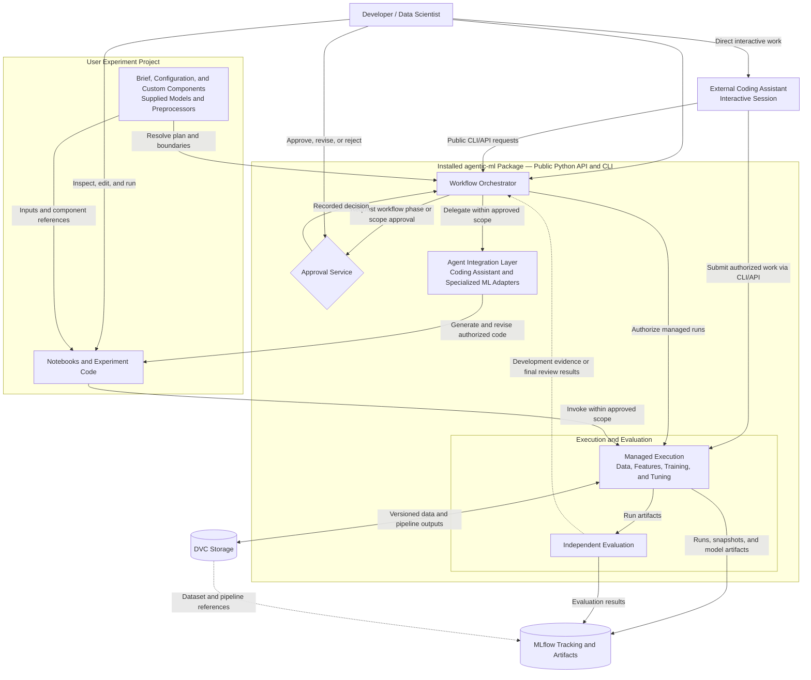
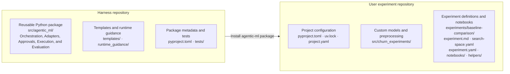
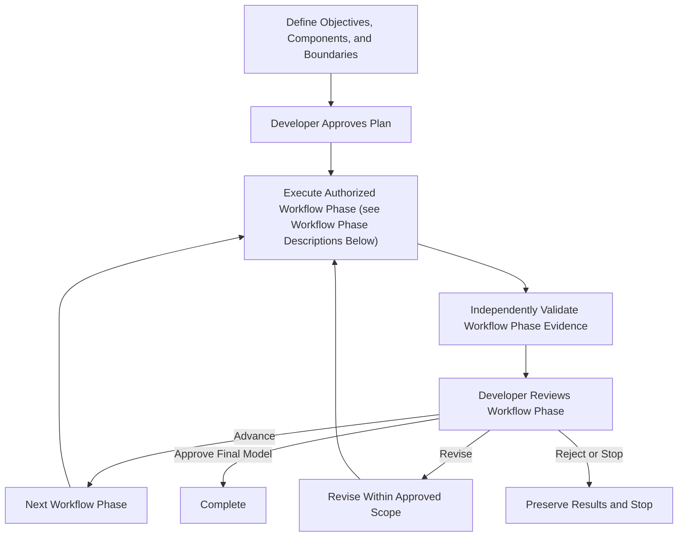

# Agentic ML Development Harness — Design

**Version:** 0.13
**Status:** Proposed specification; ADR-001 accepted; ADR-007 installation decisions accepted
**Date:** 2026-10-28

## Reading map and document authority

Start with this overview for scope, architecture, and workflow phases. Before implementing a capability, read its topic documents below and follow their related-contract links for affected behavior. Read the applicable milestone, acceptance-criteria mapping, and accepted or pending architecture decisions as well.

GitHub issues govern implementation scope and recorded scope decisions. [User stories](user-stories.md) define product requirements and stable acceptance-criterion IDs. This design and its topic documents provide supporting contracts; examples remain proposed unless explicitly settled. Resolve conflicts before implementing affected behavior.

| Task or question | Required topic documents |
|---|---|
| Installation, initialization, configuration, public interfaces, custom components, runtime guidance | [Interfaces and configuration](design/interfaces-and-configuration.md); [execution and governance](design/execution-and-governance.md) |
| Execution, notebook isolation, evaluation, tracking, restoration, cancellation, recovery, approvals, agent integration | [Execution and governance](design/execution-and-governance.md); [interfaces and configuration](design/interfaces-and-configuration.md) |
| Extraction, acquisition, splits, feature engineering | [Data and features](design/data-and-features.md); [interfaces and configuration](design/interfaces-and-configuration.md); [execution and governance](design/execution-and-governance.md) |
| Acceptance coverage and verification datasets | [Acceptance traceability](design/acceptance-traceability.md), then the linked contracts for the affected criteria |
| Delivery scope, prerequisites, sequencing | [Milestone delivery](design/milestone-delivery.md) |
| Package, resource, and experiment-project locations | [Repository layout](design/repository-layout.md); [interfaces and configuration](design/interfaces-and-configuration.md) |
| Accepted choices and unresolved mechanisms | [Architecture decisions](design/architecture-decisions.md) |

Each detailed section has one authoritative location. Section numbers are retained for continuity with earlier reviews; historical line numbers refer to the versions reviewed. Topic documents share the design version and status above. Reorganization does not approve pending decisions or change delivery scope.

## 1. Executive Summary

Build an agent-independent machine learning development harness for tabular ML and deep learning. Coding assistants can invoke the harness interactively through its public CLI/API, while a workflow orchestrator within the installed package can delegate tasks through managed agent adapters; distinct execution and evaluation components independently execute, validate, and track experiments. Development is supervised: agents may iterate within approved workflow phases and budgets, while developers approve workflow phase transitions and expanded data-access scope.

The harness is a versioned Python dependency installed into a separate user experiment repository. That repository is the unit users own, review, version, and share: it contains experiment briefs, configuration, agent-generated notebooks and Python code, and data-versioning metadata. Notebooks are the primary user interface for inspecting, running, and refining experiments; the harness provides reusable capabilities and independent execution and evaluation controls.

A central design principle is **hierarchical closed-loop ML development**:

- **Inner loop — model improvement:** feature engineering, training, hyperparameter optimization, and evaluation.
- **Outer loop — data improvement:** data gap diagnosis, iterative acquisition, extraction, validation, dataset versioning, and retraining.

## 2. Scope and Design Decisions

| Dimension | Decision |
|---|---|
| Orchestration | Distinct orchestration and execution/evaluation components within the installed harness package |
| Agent integrations | Interactive coding-assistant use through the public CLI/API as the basic path; standardized managed adapters for harness-invoked coding assistants and specialized agents |
| ML frameworks | Initial scikit-learn, LightGBM, and PyTorch; extensible |
| Package management | Use `uv` for Python dependency management, lockfiles, and virtual environments |
| Initial distribution | Install the Python package directly from its GitHub repository using `uv`, pinned to a full Git commit SHA; package-registry distribution is future work |
| CLI and Python imports | Use `agentic-ml` as the installed CLI name and retain `agentic_ml` as the Python import/package directory name |
| Repository boundary | Separate harness product repository and user experiment repositories; consume the harness as a versioned Python dependency through its public API and CLI |
| Jupyter notebooks | Agent-generated notebooks in the user experiment repository are the primary experiment interface; support interactive use and automatic harness-managed execution |
| Model types | Tabular classification/regression and deep learning |
| Autonomy | Supervised with developer approvals at workflow phase boundaries |
| Data | Extraction, EDA, feature engineering, and iterative acquisition are first-class |
| Execution | Local subprocesses for the proof of concept; Ray planned for later distributed and parallel execution; container/GPU backends incrementally |
| Experiment tracking | MLflow for runs, parameters, metrics, model artifacts, and experiment comparisons |
| Data versioning and pipelines | DVC for dataset and derived-data versioning, dependency tracking, and reproducible pipelines; Git versions DVC metadata and pipeline definitions |
| Agent instructions | Targeted `AGENTS.md` files in separate development and runtime guidance trees; runtime loading is explicit and versioned |
| Experiment guidance | Developer-authored Markdown brief plus versioned YAML algorithm and hyperparameter boundaries |
| Search autonomy | Agent searches only within declared boundaries; expansions are recommendations for subsequent experiments |
| Deployment | Outside initial scope |

### Principles

1. Agent and ML-framework independence through versioned interfaces.
2. Explicit separation of planning/delegation, execution, evaluation, and approval.
3. Independent, evidence-based validation; agent claims alone never establish success.
4. Reproducibility, provenance, and data-to-model lineage by design.
5. Budgeted, interruptible, resumable closed loops.
6. Controlled data access and protected evaluation datasets.
7. Extensible operations: standardized tasks plus sandboxed custom code.

## 3. Architecture

The installed harness package supplies orchestration, agent integration, approval handling, execution, and evaluation. Separation of orchestration from execution/evaluation means distinct component responsibilities within the package, rather than separate installations or repositories. Agent adapters connect to coding assistants or external agent services; those external systems need not run inside the package. Package boundaries show implementation ownership, not process or deployment boundaries.

These capabilities operate in the selected experiment project's environment using its configuration and project-associated state/storage. The orchestrator coordinates approved work; execution independently enforces boundaries, and evaluation assesses results. Project-owned models and preprocessors run through harness interfaces alongside built-in components. Interactive notebook use follows the same access rules and cannot establish acceptance by itself. Protected holdout access is reserved for independent final evaluation; its feedback cannot drive development iterations. Harness manifests link DVC and MLflow records to project snapshots, component identities, approvals, and durable project-associated workflow state.

### Component responsibilities

| Component | Responsibilities |
|---|---|
| Workflow orchestrator | Plans workflow phases, delegates tasks, maintains durable state, controls iterations, enforces approvals and budgets, resumes work |
| Agent integration | Capability discovery, structured task/result exchange, cancellation, CLI/SDK/tool adapters |
| Data extraction engine | Source discovery, approved queries, ingestion, snapshots, schema checks, lineage |
| Data acquisition planner | Diagnose gaps, propose additional samples/labels/sources, estimate costs and expected benefit |
| Data acquisition executor | Enforce recorded acquisition authorization, execute acquisition, validate and version results |
| EDA/validation | Profiling, missingness, class balance, anomalies, leakage diagnostics, split strategy |
| Feature engineering | Propose/fit/transform/select features, version pipelines, evaluate feature sets |
| Experiment runner | Backend-independent submission, status, cancellation, resources, logs, artifacts, and checkpoints; local execution initially, Ray-backed execution later |
| Framework adapters | Standardized and custom training entrypoints for scikit-learn, LightGBM, PyTorch |
| Evaluation engine | Metrics, baseline comparisons, scientific validity, robustness, reproducibility |
| Tracking and artifact store | MLflow records runs, parameters, metrics, and model artifacts; links to DVC dataset/pipeline versions and harness manifests for complete lineage |
| Data versioning and pipelines | DVC tracks source and derived datasets, dependencies, stage outputs, and reproducible pipeline definitions; integrates with harness execution |
| Approval service | Workflow phase and acquisition approvals, authorization scope, audit records |

### Harness and experiment project boundary

The harness repository contains reusable execution, evaluation, tracking, agent integration, orchestration, approval handling, templates, and default runtime guidance. Each user experiment repository contains objectives, notebooks, supplied and generated code, configuration, and versioning metadata. One experiment repository may contain multiple related experiments sharing project code and dependencies.

Directory contents are illustrative subsets; [Section 12](design/repository-layout.md#12-proposed-repository-layout) provides fuller layouts. The installation arrow represents a pinned GitHub package dependency installed into the user project's Python environment.

Experiment agents operate within the experiment repository and use the installed harness through its public Python API and CLI. Routine experiment work does not modify the harness installation or source repository and must not require a neighboring harness checkout. Changes to shared harness capabilities follow a separate software-development review process.

### Interactive and managed agent use

- **Interactive mode:** The developer works with an external coding assistant, such as Codex, GitHub Copilot, or Claude Code, which prepares project files and invokes the harness CLI/API. No agent adapter is required, and the harness does not own the assistant session.
- **Managed mode:** The orchestrator delegates bounded tasks through a configured agent adapter, receives structured results, and coordinates evaluation and further revisions. Managed support requires verification of a concrete product, interface, and version; a product name alone does not establish adapter capabilities.

Both modes use the same harness-owned experiment state, plan validation, approvals, managed execution, budgets, artifact records, and independent evaluation. The assistant proposes changes and requests work; only recorded harness evidence and authorized developer decisions establish acceptance or workflow phase progression. The architecture diagram shows both directions: managed delegation through the agent integration layer and interactive CLI/API requests from an external assistant.

The orchestrator operates on an explicitly selected experiment project and environment. Durable workflow state and run artifacts are stored in configured locations associated with that project, independently of the harness source tree.

## 4. Hierarchical Closed-Loop Workflow

The diagram summarizes the workflow phase cycle. The individual workflow phases are:

1. **Problem definition:** Define the objective, target, metrics, data sources, allowed algorithms, supplied components, constraints, and budgets. Approve the task contract and plan.
2. **Data extraction and EDA:** Obtain and version data, inspect its quality and distributions, and establish training/validation/test splits. Approve the dataset assessment and split protocol.
3. **Feature engineering:** Use supplied preprocessing or develop transformations and feature sets. Fit stateful preprocessing only on training data. Compare predictive performance against an approved baseline feature set with a fixed approved reference estimator and validation protocol. This limited training/evaluation is authorized within feature engineering; broader baseline modeling follows in the next workflow phase. Review the validated pipeline, comparison evidence, and lineage.
4. **Baseline modeling:** Train simple, reproducible reference models. Approve baseline results for later comparisons.
5. **Model development:** Train and compare candidate models, including user-supplied algorithms, and improve them within approved boundaries. Review candidate evidence.
6. **Optimization:** Tune hyperparameters within the declared search space and budgets. Approve the optimization summary and candidate for final evaluation.
7. **Final evaluation:** Evaluate the selected model on the protected holdout, check robustness and reproducibility, and produce the final report. Approve or reject the model.

**Each workflow phase transition requires approval.** Agents can iterate within an approved workflow phase. Valid existing artifacts can support skipping a workflow phase when that is approved in the plan. [Section 5](agentic-ml-harness-design.md#5-standard-workflow-phases-and-gates) defines the gate evidence for each workflow phase.

Data acquisition is an activity that can trigger a return to earlier workflow phases, rather than an eighth workflow phase. Supplied components and authorized data acquisition fit within “Execute Authorized Workflow Phase”; their detailed requirements appear in Sections 6–8. The following rules apply:

- **Workflow phases:** Initial plan approval completes problem definition. Execution then follows the configured workflow phases in [Section 5](agentic-ml-harness-design.md#5-standard-workflow-phases-and-gates): data extraction and EDA → feature engineering → baseline modeling → model development → optimization → final evaluation. Each workflow phase approval authorizes entry to the next workflow phase and its recorded scope.
- **Iteration:** Agents may iterate within the current approved workflow phase, component permissions, parameter boundaries, access scope, and budgets without approval for every run. Evidence is independently validated against requirements specific to the workflow phase before developer review; only sufficient evidence permits advancement.
- **Scope changes:** Workflow phase returns, expanded permissions, and changes to immutable components require authorization before execution. Authorized changes are recorded durably; changes to immutable code, allowed algorithms, or data-access scope create a new versioned experiment configuration. Acquisition requires recorded authorization covering its source, strategy, and limits, followed by authorized validation/EDA and downstream work.
- **Final evaluation:** Protected-test evaluation occurs only in its authorized final workflow phase. Its results cannot feed feature, model, or acquisition improvement loops, so the revision arrow does not apply to protected-test feedback. Unsuccessful final evaluation ends in rejection or review; any further development requires a separately approved evaluation protocol that preserves holdout protection. Completion requires developer approval of successful final evaluation.

**Inner loop:** feature engineering → training/tuning → evaluation → evidence-based revision.  
**Outer loop:** diagnose data limitations → propose acquisition → approve where required → acquire/validate/version → retrain and compare.

Both loops must terminate on success, budget exhaustion, lack of improvement, unrecoverable failure, policy violation, or developer cancellation. Budget exhaustion preserves evidence and produces a reviewable status.

### Notebook-centered user workflow

The steps below describe the workflow with integrated agent support. Before milestone 4, developers can prepare inputs and notebooks themselves or with an external coding assistant such as Codex, GitHub Copilot, or Claude Code; no agent adapter is required for interactive use. In managed mode, configure a verified adapter. Harness-managed agent proposals, execution, and revision loops begin in milestone 4. The harness validates, records, and executes supplied inputs without requiring an agent.

1. Install `uv` and Git, create a separate user repository and Python project, install the harness from a pinned GitHub commit, and run `uv run agentic-ml init` to add experiment scaffolding and configure its environment.
2. Configure local data access, tracking, storage, and an agent adapter; optionally register supplied algorithms and preprocessors with their parameter specifications and modification permissions. Write the experiment brief, feature pipeline configuration, and search-space configuration.
3. Ask the agent to generate readable notebooks that invoke supplied or built-in components. Generate new experiment-specific implementations or helper code only as needed and authorized.
4. Inspect the notebooks and approve the resolved task contract, workflow phase plan, component selection, evaluation protocol, access scope, and budgets through the applicable gates before dependent execution. Validate component interfaces, parameters, and evaluation compatibility before training.
5. Open the notebooks in VS Code, execute approved work, and inspect results. The agent may also execute and revise notebooks automatically within the current approved workflow phase, component permissions, parameter boundaries, and budgets. Workflow phase returns and scope changes require authorization; changes to immutable supplied code require approval and a new versioned experiment configuration.
6. Record experiments through harness-managed execution of saved notebook and code snapshots, followed by independent evaluation. Interactive exploration alone does not establish acceptance.
7. Review evidence at every workflow phase boundary and approve entry to the next workflow phase or request changes. Review final evaluation separately to approve or reject the final model. Preserved state supports interruption and resumption.

Reviewing every notebook edit is optional unless configured as an additional gate; workflow phase approvals and scope controls remain mandatory.

## 5. Standard Workflow Phases and Gates

| Workflow phase | Activities | Required gate evidence |
|---|---|---|
| 1. Problem definition | Objective, target, metrics, sources, budgets, constraints | Approved ML task contract |
| 2. Data extraction and EDA | Source discovery, snapshots, profiling, quality, split strategy | Approved dataset assessment and split protocol |
| 3. Feature engineering | Transformations, selection, fitted pipelines, predictive feature comparison using a fixed approved reference estimator | Validated feature pipeline, predictive comparison evidence, and lineage |
| 4. Baseline modeling | Train reproducible simple baselines | Approved baseline results |
| 5. Model development | Candidate architectures, training, iterative improvement | Candidate comparison and experiment evidence |
| 6. Optimization | Hyperparameter search within budgets | Approved optimization summary |
| 7. Final evaluation | Protected holdout, robustness, reproducibility, reporting | Final model approval/rejection |

Workflow phases may be configured or skipped when valid preexisting artifacts are supplied. Agents can iterate within approved workflow phase scope; workflow phase transitions require approval. Additional data acquisition may trigger an explicit scope approval and a return to earlier workflow phases.

## 6. Data Extraction and Iterative Acquisition

See [data and features](design/data-and-features.md) for the detailed contracts and supporting material.

## 7. Feature Engineering

See [data and features](design/data-and-features.md) for the detailed contracts and supporting material.

## 8. Interfaces and Contracts

See [interfaces and configuration](design/interfaces-and-configuration.md) for the detailed contracts and supporting material.

## 9. Execution, Evaluation, and Governance

See [execution and governance](design/execution-and-governance.md) for the detailed contracts and supporting material.

## 10. Acceptance Criteria Traceability

See [acceptance traceability](design/acceptance-traceability.md) for the detailed contracts and supporting material.

## 11. Milestone Delivery Plan

See [milestone delivery](design/milestone-delivery.md) for the detailed contracts and supporting material.

## 12. Proposed Repository Layout

See [repository layout](design/repository-layout.md) for the detailed contracts and supporting material.

## 13. Risks and Mitigations

| Risk | Mitigation |
|---|---|
| Validation/test leakage | Split manifests, training-only fitting, protected holdout policies |
| Overfitting through repeated experimentation | Iteration budgets, fixed validation protocol, independent final evaluation |
| Agent coupling | Versioned task contracts, capability discovery, multiple adapter acceptance tests |
| Unsafe generated code | Sandboxing, least privilege, constrained network/filesystem access |
| Irreproducible results | Dataset snapshots, dependency lockfiles, seeds, hardware metadata, tolerances |
| Data acquisition drift or cost | Scoped approval, source allowlists, acquisition budgets, controlled before/after comparisons |
| Workflow inconsistency | Durable state, idempotent jobs, audit trail, recovery tests |
| Restrictive framework abstraction | Standard operations plus custom training entrypoints |
| Hidden dependency on harness checkout | Installed public API, separate-project acceptance fixtures, project lockfile, explicit harness build identity |
| Notebook state or source drift | Fresh-kernel execution, explicit artifact references, immutable notebook/helper snapshots including uncommitted changes |

## 14. Architecture Decision Records

See [architecture decisions](design/architecture-decisions.md) for the detailed contracts and supporting material.

## 15. Next Steps

1. Ratify pending architectural decisions and clarify nonfunctional targets.
2. Reconcile this design document against the authoritative [user stories and acceptance criteria](user-stories.md), recording design gaps and unresolved decisions.
3. Establish Milestone 0 contributor setup, macOS CI, coding conventions, minimal version CLI, and isolated wheel/source package verification before experiment-user capabilities.
4. Define JSON Schemas and Python models for core contracts.
5. Build Milestone 1 in a separate user project: initialize/install → extract → validate → snapshot → run notebook → evaluate → track, recording both experiment and harness identities.
6. Add inner-loop agent iteration, supervised orchestration, and then outer-loop acquisition.

**Guiding principle:** Build an ML experimentation and data-development harness that agents can use, rather than a framework that hardcodes one particular agent's reasoning or workflow.
