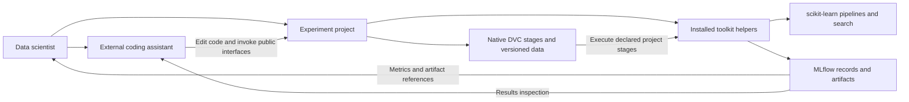

# Agentic ML Development Toolkit — MVP Design

**Version:** 0.15
**Date:** 2026-11-08
**Status:** MVP scope and design approved at Gates 1–3; implementation remains incomplete.
No new executable capability is delivered by this document.

## Reading map and document authority

GitHub issues govern implementation scope. The locally approved
[user stories](user-stories.md) contain stable criteria and the two-milestone MVP.
Remote issues are synchronized to the approved scope after
[PR #57](https://github.com/jimthompson5802/agentic-ml/pull/57) and Phase 4 issue
publication. New integration owners are
[US-39 #58](https://github.com/jimthompson5802/agentic-ml/issues/58) and
[US-40 #59](https://github.com/jimthompson5802/agentic-ml/issues/59). The
[scope revision plan](../plans/mvp-scope-revision.md) owns approval/publication gates.

| Question | Active reference |
|---|---|
| Existing APIs and future component responsibilities | [Software blueprint](design/software-blueprint.md) |
| Inputs, public interfaces and project compatibility | [Interfaces and configuration](design/interfaces-and-configuration.md) |
| Local runs, tracking, evaluation and reproduction | [Execution and governance](design/execution-and-governance.md) |
| Extraction, splits and feature preparation | [Data and features](design/data-and-features.md) |
| Criterion/design/verification mapping | [Acceptance traceability](design/acceptance-traceability.md) |
| Milestone exits and capability order | [Milestone delivery](design/milestone-delivery.md) |
| Toolkit versus experiment files | [Repository layout](design/repository-layout.md) |
| Decisions and superseded guarantees | [Architecture decisions](design/architecture-decisions.md) |
| Scientist/assistant interaction and evidence | [Assistant-supported walkthrough](example-walkthrough.md) |

Historical 0.14 blueprints and previous approvals are reference material, not
additional MVP prerequisites. Follow active topic links for new work.

## MVP outcome

A data scientist initializes a separate project, prepares local CSV/Parquet data,
fits training-only preprocessing, trains a baseline, tunes a bounded candidate
set, evaluates the selected model and inspects MLflow results. DVC versions data
and executes/reuses declared stages. Reproduction starts from committed code/
configuration, locked dependencies and available DVC inputs.

M1 demonstrates classification end to end. M2 adds regression, compatible custom
components, saved notebooks and clean committed-project reproduction. The MVP
ends at M2. Development foundation M0 and technical-environment M50 retain their
recorded status; M99 stays a deferred contributor backlog.

## Architecture

The scientist owns the assistant session and directs setup, execution, inspection
and revision. No toolkit agent adapter, session manager or workflow approval
service is required. Experiments also work without an assistant.

| Owner | Responsibility |
|---|---|
| Experiment project | Objectives/settings, extraction and custom Python, notebooks, dependency lock, DVC stage definitions and committed source |
| Toolkit | Conflict-safe setup, reusable validation/experiment/evaluation helpers and links among run/data/code records |
| scikit-learn | Compatible pipelines/estimators, fitting, prediction and bounded search |
| MLflow | Parameters, metrics, status, fitted artifacts and inspection/comparison records |
| DVC | Dataset content versions, dependencies/parameters, stage execution and cache |
| External assistant | Scientist-directed project editing, documented invocation and result explanation |

These are responsibility boundaries, not mandatory separate services or processes.
Reuse existing library behavior before adding toolkit infrastructure.

For assessment and partitioning, use scikit-learn's existing splitting capabilities
and pandas' native descriptive operations. Do not duplicate library algorithms.
Any proposed toolkit-specific assessment/partition functionality must identify
the library gap and be discussed with the developer before approval and code.
The [data design](design/data-and-features.md#reuse-existing-assessment-and-partition-capabilities)
records the implemented native API integration accepted under issue #19.
Project code owns JSON persistence and saved-source comparisons; supplied
time/group protocols are declarations, with membership/disjointness checks.

## Supported workflow and safeguards

1. Supply explicit data, target/task, metric, split settings and search bounds.
2. Extract/check local data and record its DVC identity.
3. Record disjoint partitions and fit preprocessing/models only on training rows.
4. Compare baseline/candidates on consistent validation data; cap search trials.
5. Inspect MLflow evidence; make a scientist-directed validation-based revision.
6. Select a model, then run the separate final-test step and save its fitted pipeline.
7. Commit source/configuration/lock/DVC metadata and reproduce declared stages.

Pandas DataFrames and ordinary project pandas functions are the tabular basis
for extraction and feature engineering. Reuse native pandas IO/operations;
toolkit provenance/publication helpers use native objects and plain dictionaries
rather than proprietary extraction classes. Learned preprocessing still follows
the training-only native pipeline rules. This 2026-11-07 developer-directed
refinement is recorded as [US-11-SC-01](../plans/milestone-1-us-11.md#scope-change-history);
its [implemented extraction API](../extraction.md) passed IP1–IP3 approval and
[US-11 whole-story acceptance](../plans/milestone-1-us-11.md#story-completion-review)
on 2026-11-07. Earlier proposal and review history remain in the linked plan
and phase evidence.

These activities are not mandatory experiment approval gates. Existing explicit
planning/approval APIs keep their strict behavior and unauthenticated-record
limitations. The future simple path is owned by US-39-AC-01/02; it is not yet
implemented by the current draft initializer.

Preserve clear distinctions among process success, configured validation failure,
insufficient model quality, reproducibility and developer acceptance. An assistant
claim or cache hit does not establish correct results. No model improvement is
required for an honestly recorded comparison.

## Scope boundaries

The MVP assumes trusted local code and user-managed credentials/environment.
It checks supported inputs, splits, fitting scope, output artifacts and candidate
bounds; it does not constrain arbitrary external Python or assistant tools.
Final-test files are not OS-protected, and comprehensive leakage/scientific
validity or robustness assurance is not claimed.

Defer managed agents/autonomous loops, mandatory experiment approvals, filesystem/
network/credential isolation, hard runtime/resource/cost quotas, durable recovery/
duplicate-run accounting, dirty/untracked-source replay, general component
registries, SQL/object-store connectors, LightGBM/PyTorch/GPU, and autonomous data
acquisition. [Decision history](design/architecture-decisions.md) records the
supersession rather than treating previous guarantees as delivered.

## Implementation status and next work

Installed packaging, initialization, strict versioned planning/approvals and
metadata/candidate validation are implemented and accepted in their owning
stories. Local pandas extraction/provenance (US-11), configured quality checks
(US-12-AC-01/05), descriptive assessment and recorded seeded/supplied two-way and
three-way partitions (US-12-AC-02/03) are also implemented and accepted. See the
[extraction](../extraction.md), [quality](../data-quality.md) and
[assessment/partition](../data-assessment-and-splits.md) guides.
Local experiment execution, training-only fitted feature pipelines, real estimator
training/tuning, integrated DVC data/stages, result logging, reproduction and the
assistant walkthrough remain work. Mandatory assessment approval (US-12-AC-04)
remains deferred.
Local MLflow/DVC storage initialization is not integrated experiment delivery.

Build on the published MVP scope and accepted components when planning US-39 M1
slices with confirmed installed public test boundaries. Exact new APIs/configuration
shapes and supported estimator inventory belong to those story contract reviews.
Preserve current APIs/resources; do not implement archived 0.14 schemas by default.

## Historical link aliases

These anchors retain old links as historical context; they do not reinstate
superseded platform requirements. See the [previous reviewed document](https://github.com/jimthompson5802/agentic-ml/blob/0a7b64389cf663290d3bf4fc7063aae29ef8f20c/docs/specs/agentic-ml-harness-design.md).

