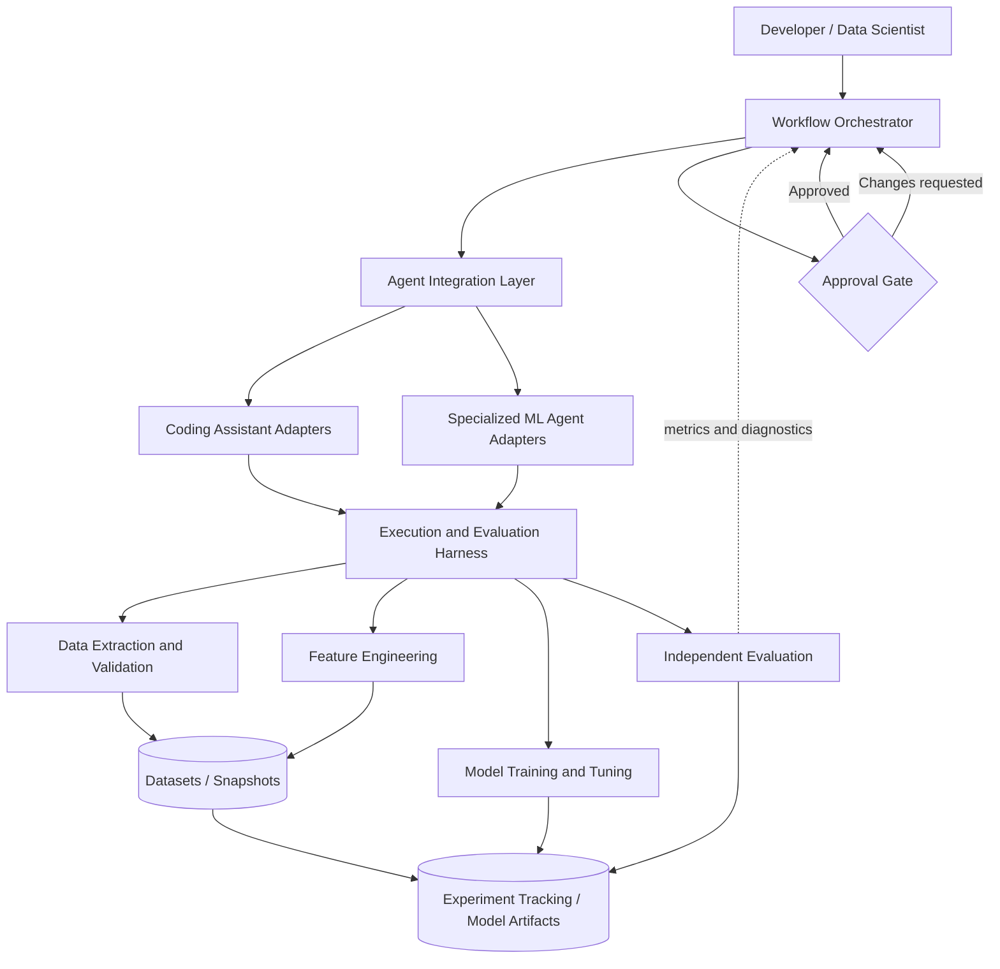
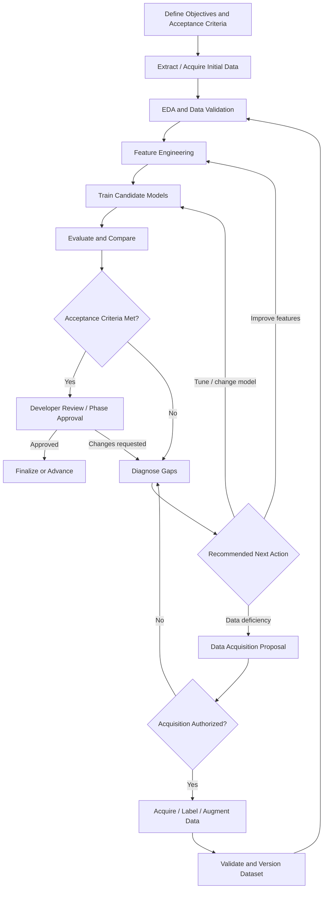

# Agentic ML Development Harness — Architecture Proposal

**Version:** 0.1  
**Status:** Proposed specification; ADR-001 accepted  
**Date:** 2026-10-26

## 1. Executive Summary

Build an agent-independent machine learning development harness for tabular ML and deep learning. A separate workflow orchestrator coordinates AI coding assistants and specialized ML agents; the harness independently executes, validates, and tracks experiments. Development is supervised: agents may iterate within approved phases and budgets, while developers approve phase transitions and expanded data-access scope.

A central design principle is **hierarchical closed-loop ML development**:

- **Inner loop — model improvement:** feature engineering, training, hyperparameter optimization, and evaluation.
- **Outer loop — data improvement:** data gap diagnosis, iterative acquisition, extraction, validation, dataset versioning, and retraining.

## 2. Scope and Design Decisions

| Dimension | Decision |
|---|---|
| Orchestration | Separate orchestrator from execution/evaluation harness |
| Agent integrations | Standardized adapters for coding assistants and specialized agents |
| ML frameworks | Initial scikit-learn, LightGBM, and PyTorch; extensible |
| Package management | Use `uv` for Python dependency management, lockfiles, and virtual environments |
| Jupyter notebooks | Support interactive exploration and automatic notebook execution by the harness |
| Model types | Tabular classification/regression and deep learning |
| Autonomy | Supervised with developer approvals at phase boundaries |
| Data | Extraction, EDA, feature engineering, and iterative acquisition are first-class |
| Execution | Local first; container/GPU and distributed backends incrementally |
| Tracking | MLflow initially; portable versioned manifests and artifact lineage |
| Deployment | Outside initial scope |

### Principles

1. Agent and ML-framework independence through versioned interfaces.
2. Explicit separation of planning/delegation, execution, evaluation, and approval.
3. Independent, evidence-based validation; agent claims alone never establish success.
4. Reproducibility, provenance, and data-to-model lineage by design.
5. Budgeted, interruptible, resumable closed loops.
6. Controlled data access and protected evaluation datasets.
7. Extensible operations: standardized tasks plus sandboxed custom code.

## 3. Architecture



### Component responsibilities

| Component | Responsibilities |
|---|---|
| Workflow orchestrator | Plans phases, delegates tasks, maintains durable state, controls iterations, enforces approvals and budgets, resumes work |
| Agent integration | Capability discovery, structured task/result exchange, cancellation, CLI/SDK/tool adapters |
| Data extraction engine | Source discovery, approved queries, ingestion, snapshots, schema checks, lineage |
| Data acquisition planner | Diagnose gaps, propose additional samples/labels/sources, estimate costs and expected benefit |
| Data acquisition executor | Authorize and execute acquisition, validate and version results |
| EDA/validation | Profiling, missingness, class balance, anomalies, leakage diagnostics, split strategy |
| Feature engineering | Propose/fit/transform/select features, version pipelines, evaluate feature sets |
| Experiment runner | Isolated jobs, resources, timeouts, cancellation, logs, artifacts, checkpoints |
| Framework adapters | Standardized and custom training entrypoints for scikit-learn, LightGBM, PyTorch |
| Evaluation engine | Metrics, baseline comparisons, scientific validity, robustness, reproducibility |
| Tracking and artifact store | Dataset, feature, model, metric, environment, approval, and execution lineage |
| Approval service | Phase and acquisition approvals, authorization scope, audit records |

## 4. Hierarchical Closed-Loop Workflow



**Inner loop:** feature engineering → training/tuning → evaluation → evidence-based revision.  
**Outer loop:** diagnose data limitations → propose acquisition → approve where required → acquire/validate/version → retrain and compare.

Both loops must terminate on success, budget exhaustion, lack of improvement, unrecoverable failure, policy violation, or developer cancellation. Budget exhaustion preserves evidence and produces a reviewable status.

## 5. Standard Development Phases and Gates

| Phase | Activities | Required gate evidence |
|---|---|---|
| 1. Problem definition | Objective, target, metrics, sources, budgets, constraints | Approved ML task contract |
| 2. Data extraction and EDA | Source discovery, snapshots, profiling, quality, split strategy | Approved dataset assessment and split protocol |
| 3. Feature engineering | Transformations, selection, fitted pipelines, baseline feature sets | Validated feature pipeline and lineage |
| 4. Baseline modeling | Train reproducible simple baselines | Approved baseline results |
| 5. Model development | Candidate architectures, training, iterative improvement | Candidate comparison and experiment evidence |
| 6. Optimization | Hyperparameter search within budgets | Approved optimization summary |
| 7. Final evaluation | Protected holdout, robustness, reproducibility, reporting | Final model approval/rejection |

Phases may be configured or skipped when valid preexisting artifacts are supplied. Agents can iterate within approved phase scope; phase transitions require approval. Additional data acquisition may trigger an explicit scope approval and a return to earlier phases.

## 6. Data Extraction and Iterative Acquisition

### Data extraction requirements

- Connect to local CSV/Parquet, SQL, and object storage initially; add APIs later.
- Discover source schemas and metadata without unrestricted data exposure.
- Execute approved extraction queries and sampling plans.
- Snapshot or otherwise version extracted datasets; capture source identity, query, parameters, extraction time, checksums, and permissions metadata.
- Validate schema, row counts, nulls, types, duplicates, and other configured quality rules.
- Enforce least-privilege access, source allowlists, network restrictions, and cost/record limits.

### Acquisition strategies

- Additional observations from approved sources.
- Targeted sampling for underrepresented classes or data slices.
- Additional feature columns or related datasets.
- Human or external labeling workflows.
- Active learning: select informative unlabeled examples.
- Data augmentation and synthetic data, explicitly labeled and tracked as distinct from observed data.

### Acquisition proposal contract

```yaml
proposal:
  id: acquisition-001
  reason: underrepresented_class
  evidence:
    affected_class: minority_class
    current_samples: 250
    observed_recall: 0.61
  acquisition:
    strategy: targeted_sampling
    source: approved_training_database
    target_additional_samples: 500
  expected_benefit:
    hypothesis: improve_minority_class_recall
    metric: recall
  constraints:
    max_records: 500
    max_runtime_minutes: 15
  approval:
    required: true
```

The predicted benefit is a hypothesis, not a guarantee. Compare before/after training with consistent evaluation protocols. Never use protected final-test feedback to guide acquisition. Changes to evaluation protocols require separate approval.

## 7. Feature Engineering

The feature engineering engine must:

- Propose and execute missing-value handling, encoding, scaling, feature construction, selection, and dimensionality reduction.
- Support domain-specific transformations and custom code.
- Track feature definitions, fitted preprocessors, parameters, versions, and dependencies.
- Fit stateful transformations only on training data; apply unchanged to validation/test data.
- Compare candidate feature sets against a fixed baseline and split protocol.
- Support deep-learning preprocessing, image augmentation, tokenization, and PyTorch datasets where relevant.
- Make transformations reusable for inference without requiring model deployment in the initial release.

## 8. Interfaces and Contracts

All contracts should have versioned JSON Schemas and typed Python models. These conceptual interfaces require further design for asynchronous operations, idempotency, error handling, and authorization.

```python
from typing import Protocol, Any

class AgentAdapter(Protocol):
    def capabilities(self) -> set[str]: ...
    def execute(self, task: "AgentTask") -> "AgentResult": ...
    def cancel(self, task_id: str) -> None: ...

class DataSourceAdapter(Protocol):
    def discover(self) -> "DataSourceMetadata": ...
    def extract(self, spec: "ExtractionSpec") -> "DatasetRef": ...
    def validate(self, dataset: "DatasetRef") -> "ValidationReport": ...

class DataAcquisitionPlanner(Protocol):
    def diagnose(self, dataset: "DatasetRef", evaluation: "EvaluationReport") -> "DataGapReport": ...
    def propose(self, gaps: "DataGapReport") -> "DataAcquisitionProposal": ...

class DataAcquisitionExecutor(Protocol):
    def execute(self, proposal: "DataAcquisitionProposal", authorization: "ApprovalRecord") -> "DatasetRef": ...

class FeatureEngineeringAdapter(Protocol):
    def propose(self, dataset: "DatasetRef", context: "FeatureContext") -> "FeaturePlan": ...
    def transform(self, dataset: "DatasetRef", plan: "FeaturePlan") -> "FeatureSetRef": ...
    def evaluate(self, feature_set: "FeatureSetRef") -> "FeatureEvaluationReport": ...

class ExperimentRunner(Protocol):
    def submit(self, spec: "ExperimentSpec") -> str: ...
    def status(self, run_id: str) -> "RunStatus": ...
    def cancel(self, run_id: str) -> None: ...
    def artifacts(self, run_id: str) -> list[str]: ...

class ModelAdapter(Protocol):
    def train(self, context: "TrainingContext") -> Any: ...
    def predict(self, model: Any, data: Any) -> Any: ...
    def save(self, model: Any, path: str) -> None: ...

class Evaluator(Protocol):
    def evaluate(self, run_id: str, criteria: "AcceptanceCriteria") -> "EvaluationReport": ...

class ApprovalService(Protocol):
    def request(self, phase_id: str) -> str: ...
    def decide(self, approval_id: str, decision: str) -> None: ...
```

### Primary contracts

| Contract | Key fields |
|---|---|
| `MLTaskSpec` | Objective, target, task type, data, metrics, budgets, policies |
| `WorkflowPlan` | Phases, dependencies, gates, iteration limits |
| `AgentTask` / `AgentResult` | Task scope, context, tools, proposed changes, outputs |
| `ExtractionSpec` / `DatasetRef` | Source, query, snapshot, checksum, schema, lineage |
| `DataGapReport` / `DataAcquisitionProposal` | Evidence, acquisition hypothesis, scope, cost, approval |
| `FeaturePlan` / `FeatureSetRef` | Transformations, fitted state, versions, provenance |
| `ExperimentSpec` / `ExperimentResult` | Model, data, code, parameters, resources, metrics, artifacts |
| `EvaluationReport` | Metrics, validity checks, baseline comparison, evidence |
| `ApprovalRecord` | Reviewer, scope, decision, timestamp, audit trail |

### Example experiment

```yaml
schema_version: "0.1"
experiment:
  id: experiment-001
  task_type: classification
  hypothesis: "A neural network improves macro F1 over baseline"
dataset:
  uri: data/training.parquet
  version: sha256:...
  target: label
  split_manifest: splits/v1.json
model:
  framework: pytorch
  entrypoint: src/train.py
  parameters:
    hidden_layers: [128, 64]
    learning_rate: 0.001
    batch_size: 128
    epochs: 50
evaluation:
  primary_metric: f1_macro
  direction: maximize
  baseline_run_id: baseline-001
  min_relative_improvement: 0.03
  protected_test_set: true
resources:
  accelerator: gpu
  gpu_count: 1
  max_runtime_minutes: 30
  max_memory_gb: 16
reproducibility:
  seed: 42
  repetitions: 3
governance:
  phase: model_development
  approval_required_to_advance: true
```

## 9. Execution, Evaluation, and Governance

### Execution

- Declare Python dependencies in `pyproject.toml` and commit `uv.lock`; use `uv` to manage environments and run project commands in development, CI, and local harness execution.
- Support local Python subprocesses, followed by containerized and GPU execution.
- Support automatic execution of Jupyter notebooks as experiment entrypoints using `nbclient` and an `ipykernel` kernel in the experiment's `uv`-managed environment; provide JupyterLab for interactive development.
- Execute notebooks from a fresh kernel, in cell order, with explicit input parameters and a recorded working directory. Apply experiment timeouts, cancellation, resource budgets, and filesystem/network restrictions to notebook execution.
- Preserve the source notebook, supplied parameters, executed notebook with cell outputs, execution errors, and generated artifacts in the run record. Cell errors fail execution; successful notebooks remain subject to independent evaluation and protected-data rules.
- Keep reusable preprocessing and training logic in `src/agentic_ml/` so notebooks can import the same tested implementations as Python entrypoints.
- Enforce timeouts, cancellation, experiment counts, memory/GPU quotas where supported.
- Capture logs, exit status, environment, source revision, datasets, checkpoints, and artifacts.
- Treat unsuccessful model performance as a valid experiment result, distinct from execution failure.
- Restrict filesystem, network, and credential access for agent-generated code.

### Notebook development

- Use `notebooks/` for interactive exploration, EDA, and experiment analysis; organize notebooks into `eda/`, `experiments/`, and `analysis/`.
- Declare JupyterLab and `ipykernel` in a development dependency group managed by `uv`; include `nbclient` and `ipykernel` in the harness's notebook execution dependencies.
- Record notebook experiments in MLflow with the same parameters, metrics, dataset versions, feature lineage, source revision, and environment provenance as Python entrypoints.
- Apply the same training/validation/test split rules and protected-test restrictions to interactive and automated notebook work. Notebook execution does not bypass phase approvals or data-acquisition authorization.
- Keep reusable preprocessing and training implementations in `src/agentic_ml/`; use notebooks to compose those implementations and explain results.

### Independent evaluation

1. **Execution correctness:** code completes and expected artifacts exist.
2. **Scientific validity:** split boundaries, preprocessing fitting, and leakage rules are respected.
3. **Model quality:** agreed metrics and baseline comparisons are computed consistently.
4. **Generalization/robustness:** folds, slices, or stress tests satisfy defined criteria.
5. **Reproducibility:** reruns meet explicit metric tolerances, acknowledging GPU nondeterminism where applicable.

### Workflow states

`Planned → Running → Evaluating → AwaitingApproval → Approved → NextPhase/Completed`.

Additional terminal or reviewable states: `Failed`, `Cancelled`, `BudgetExhausted`, and `NeedsReview`. A rejection or revision request returns work to an authorized phase; it does not silently bypass gates.

### Governance

- Approvals are durable, scoped, and auditable.
- New data sources, expanded permissions, changed evaluation criteria, and phase transitions require authorization.
- Protected test sets cannot be used for iterative tuning or data acquisition decisions.
- Resource limits and stopping conditions apply to both inner and outer loops.

## 10. Acceptance Criteria

| ID | Acceptance criterion |
|---|---|
| AC-01 | Two agent adapters successfully use the same task contract |
| AC-02 | End-to-end training/evaluation with scikit-learn, LightGBM, and PyTorch |
| AC-03 | Experiments support submission, monitoring, cancellation, and inspection |
| AC-04 | Each run records parameters, metrics, artifacts, and provenance |
| AC-05 | Independent evaluator determines acceptance without trusting agent assertions |
| AC-06 | Agent revises experiments using structured evaluation feedback |
| AC-07 | Phase advancement is blocked without approval |
| AC-08 | Experiment-count and runtime budgets stop new work |
| AC-09 | Repeated runs satisfy specified reproducibility tolerances |
| AC-10 | Interrupted workflows resume without duplicating completed runs |
| AC-11 | Unauthorized filesystem/credential access is blocked |
| AC-12 | Final report includes model, metrics, baseline, and lineage |
| AC-13 | Leakage and protected-test violations are rejected |
| AC-14 | PyTorch supports checkpoints, cancellation, and CPU/GPU execution |
| AC-15 | Extract data from at least two source types |
| AC-16 | Reconstruct or retrieve a versioned dataset |
| AC-17 | Detect schema mismatches and extraction failures |
| AC-18 | Agent generates and executes candidate feature transformations |
| AC-19 | Feature sets are compared on consistent validation splits |
| AC-20 | Fitted feature pipelines and outputs are reproducible |
| AC-21 | Feature transforms violating split boundaries are rejected |
| AC-22 | Model lineage traces back to features and source datasets |
| AC-23 | Agent identifies data deficiencies with recorded evidence |
| AC-24 | Agent creates a structured acquisition proposal |
| AC-25 | Unauthorized acquisition is blocked |
| AC-26 | Approved acquisition creates versioned datasets with lineage |
| AC-27 | Harness compares performance before/after acquisition |
| AC-28 | Acquisition respects cost, record, and compute budgets |
| AC-29 | Acquisition loops terminate at stopping conditions |
| AC-30 | Workflow resumes after approved acquisition with complete audit trail |
| AC-31 | Harness automatically executes a parameterized notebook from a fresh kernel and records its environment, inputs, executed outputs, and artifacts |
| AC-32 | Notebook errors, timeouts, and cancellation produce the corresponding run status; notebook runs enforce the same access, budget, lineage, and evaluation rules as Python entrypoints |

### Reference acceptance-test datasets

- Small tabular classification dataset (scikit-learn/LightGBM).
- Tabular regression dataset (metrics and objective direction).
- Small image classification dataset (PyTorch CPU; optional GPU).
- Notebook fixtures covering successful parameterized execution, cell errors, timeouts, and cancellation.
- Negative fixtures for leakage, schema errors, missing artifacts, unauthorized access, and skipped approval gates.

## 11. Phased Implementation Plan

| Implementation phase | Deliverables | Exit criteria |
|---|---|---|
| 1. Data and harness foundation | Schemas, local Python and notebook execution, extraction, dataset snapshots, validation, MLflow, CLI | Repeatable extraction and execution without agents |
| 2. EDA and feature pipelines | Profiling, split manifests, transformations, lineage, feature comparison | Validated, reproducible feature artifacts |
| 3. Model experimentation | scikit-learn, LightGBM, basic PyTorch, evaluation, baseline comparisons | Tabular and basic deep-learning runs tracked and assessed |
| 4. Agent integration | First coding-assistant adapter, structured feedback, inner-loop iteration | Agent improves a model within an approved budget |
| 5. Orchestration and approvals | Durable workflow, gates, recovery, second adapter | Supervised multi-phase workflow with enforced approvals |
| 6. Iterative data acquisition | Gap diagnosis, proposals, approved extraction, retraining comparisons | Outer-loop improvement with lineage and budgets |
| 7. Advanced capabilities | Optuna, active learning, labeling, augmentation, specialized agents, containers/distributed backends | Extensible multi-agent workflow with advanced compute/data strategies |

The phase order is an implementation sequence, not a restriction on the final development workflow. Basic PyTorch is included early; advanced distributed deep learning comes later.

## 12. Proposed Repository Layout

```text
agentic-ml/
├── AGENTS.md
├── README.md
├── pyproject.toml
├── uv.lock
├── notebooks/
│   ├── eda/
│   ├── experiments/
│   └── analysis/
├── specs/
│   ├── architecture.md
│   ├── requirements.md
│   ├── interfaces.md
│   ├── adr/
│   └── acceptance/
├── src/agentic_ml/
│   ├── contracts/
│   ├── orchestrator/
│   ├── agents/adapters/
│   ├── data/
│   │   ├── sources/
│   │   ├── acquisition/
│   │   └── validation/
│   ├── features/
│   ├── harness/
│   │   ├── execution/
│   │   ├── evaluation/
│   │   └── resources/
│   ├── frameworks/
│   │   ├── sklearn/
│   │   ├── lightgbm/
│   │   └── pytorch/
│   ├── tracking/
│   ├── storage/
│   └── cli/
├── examples/
│   ├── tabular-classification/
│   ├── tabular-regression/
│   └── image-classification/
└── tests/
    ├── unit/
    ├── integration/
    ├── acceptance/
    └── fixtures/
```

## 13. Risks and Mitigations

| Risk | Mitigation |
|---|---|
| Validation/test leakage | Split manifests, training-only fitting, protected holdout policies |
| Overfitting through repeated experimentation | Iteration budgets, fixed validation protocol, independent final evaluation |
| Agent coupling | Versioned task contracts, capability discovery, multiple adapter acceptance tests |
| Unsafe generated code | Sandboxing, least privilege, constrained network/filesystem access |
| Irreproducible results | Dataset snapshots, dependency lockfiles, seeds, hardware metadata, tolerances |
| Data acquisition drift or cost | Scoped approval, source allowlists, acquisition budgets, controlled before/after comparisons |
| Workflow inconsistency | Durable state, idempotent jobs, audit trail, recovery tests |
| Restrictive framework abstraction | Standard operations plus custom training entrypoints |

## 14. Architecture Decision Records

### ADR-001 — Hierarchical Closed-Loop ML Development

**Status: Accepted**

**Decision:** The harness will implement a model-improvement inner loop and data-improvement outer loop. The orchestrator coordinates both, while the harness executes and independently validates actions. Developers approve phase boundaries and acquisition scope changes.

**Rationale:** Poor model performance can reflect insufficient or unrepresentative data, not just inadequate features, architecture, or hyperparameters. Feedback must support both model and dataset improvement.

**Consequences:** Requires data-gap diagnostics, acquisition contracts, dataset versioning, authorization, consistent before/after evaluation, and termination conditions for both loops.

### Pending decisions

- **ADR-002:** Expose harness through Python API and CLI initially; consider MCP server later.
- **ADR-003:** Start with a lightweight durable state-machine orchestrator; evaluate agent orchestration frameworks if complexity requires.
- **ADR-004:** Hybrid ML operations: standardized capabilities plus sandboxed custom Python code.
- **ADR-005:** Choose concrete dataset versioning and artifact storage mechanisms.
- **ADR-006:** Define the authorization and isolation model for data connectors and generated code.

## 15. Next Steps

1. Ratify pending architectural decisions and clarify nonfunctional targets.
2. Convert requirements and acceptance criteria into independently testable user stories.
3. Define JSON Schemas and Python models for core contracts.
4. Build the Phase 1 vertical slice: extract → validate → snapshot → run → evaluate → track.
5. Add inner-loop agent iteration, supervised orchestration, and then outer-loop acquisition.

**Guiding principle:** Build an ML experimentation and data-development harness that agents can use, rather than a framework that hardcodes one particular agent's reasoning or workflow.
