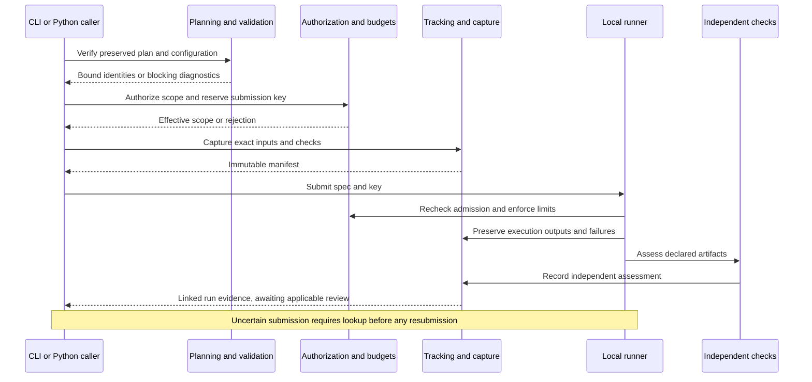
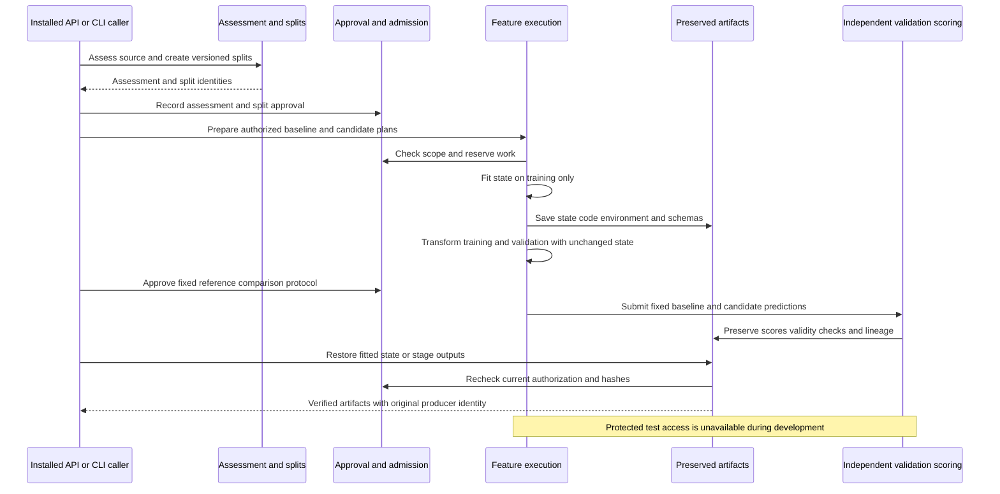

# Software implementation blueprint

Part of the [toolkit design](../agentic-ml-harness-design.md). IP1 review draft.
Milestone 1 is approved; Milestone 2 is an IP2 review draft. Milestones 3–6
await their separate design gates. Approval records belong to the owning plan.

## Authority and notation

Issues govern scope. [Product contracts](execution-and-governance.md),
[interfaces](interfaces-and-configuration.md), [delivery order](milestone-delivery.md),
and [ADRs](architecture-decisions.md) remain applicable. This document owns software
responsibilities and public seams, not private helper structure.

**Implemented** means present in source, not newly verified here. **Accepted contract**
means approved in an owning plan. **Proposed contract** means a concrete design for
review, not an available API. **Blocked decision** identifies a prerequisite to
implementation. Approval of this document does not accept an entire pending ADR.

All proposed modules below are beneath `agentic_ml`. Proposed records are typed,
schema-versioned data, not executable instructions. Public CLI handlers translate
arguments into the same requests used by Python callers; handlers cannot bypass
validation, authorization, budgets, capture, or evaluation.

## Milestone 1 ownership and criterion map

Ranges below include every criterion in the indicated range. These are design
coverage assignments, not acceptance evidence. US-05-AC-05 extends to future
training entrypoints as they appear.

| Owner | Governing issue / criteria | Status | Public verification boundary |
|---|---|---|---|
| Packaging and bootstrap | [#8](https://github.com/jimthompson5802/agentic-ml/issues/8), US-01-AC-01–04 | Implemented | Pinned installation, upgrade and installed CLI/resources outside checkout |
| `initialization` | [#9](https://github.com/jimthompson5802/agentic-ml/issues/9), US-02-AC-01–05 | Implemented / accepted contract | Installed initializer API and `init` |
| `planning`, `approvals` | [#10](https://github.com/jimthompson5802/agentic-ml/issues/10), US-03-AC-01–05 | Implemented / accepted contract | Resolve, inspect, verify, approve and revoke |
| `validation` | [#11](https://github.com/jimthompson5802/agentic-ml/issues/11), US-05-AC-01–05 | Implemented / accepted contract | Registry, configuration and candidate APIs |
| `harness.execution` | [#12](https://github.com/jimthompson5802/agentic-ml/issues/12), US-09-AC-01–05; [#13](https://github.com/jimthompson5802/agentic-ml/issues/13), US-10-AC-01–05 | Proposed contract | Submission, status, cancellation, logs and artifacts through installed API/CLI |
| `data.sources` | [#14](https://github.com/jimthompson5802/agentic-ml/issues/14), US-11-AC-01–05 | Proposed contract | Approved extraction from at least two supported source types |
| `data.validation`, `approvals` | [#15](https://github.com/jimthompson5802/agentic-ml/issues/15), US-12-AC-01, US-12-AC-05 | Proposed contract | Quality report and matching dataset approval |
| `storage.datasets` | [#16](https://github.com/jimthompson5802/agentic-ml/issues/16), US-13-AC-01–04 | Proposed contract | DVC metadata/content separation and verified restoration |
| `tracking`, `harness.evaluation` | [#17](https://github.com/jimthompson5802/agentic-ml/issues/17), US-26-AC-01–05 | Proposed contract | Independent artifact checks and manifest/MLflow lookup |
| `restoration` | [#18](https://github.com/jimthompson5802/agentic-ml/issues/18), US-27-AC-01–04 | Proposed contract | Clean-environment restoration and replay |

## Existing public contracts

### Bootstrap and initialization

Keep the full Git commit pin, normal installed dependency, `agentic-ml` CLI and
`agentic_ml` imports. Installed package resources must not require a checkout.
An explicit upgrade changes the pin and lock identity; initialization never upgrades it.

`initialization.initialize_project(options: InitOptions) -> InitResult` takes an
explicit project root, experiment/package selection and optional DVC, MLflow,
artifact and state locations. Results identify created, updated, unchanged and
pending setup items. `InitializationError` reports stage, conflicts, completed
steps and recovery. Preserve the accepted [initialization contracts](../../verification/us-02-ip1.md).

Preflight precedes durable writes. Conflicts preserve user files. The private
setup journal records partial external-tool progress and safe reruns; it is not
execution authorization or an atomic transaction across uv, DVC and MLflow.
Draft configuration is version 0.1 and grants no execution authority. VS Code is
installed separately; nbclient and ipykernel support managed notebooks.

### Planning and decision approvals

Keep these `planning` exports:

```python
resolve_plan(request: ResolveRequest) -> PlanResult
inspect_plan(*, project_root: Path, plan_id: str) -> PlanInspection
verify_plan(*, project_root: Path, plan_id: str,
            check_current: bool = False) -> VerificationResult
```

`ResolveRequest` selects root and experiment input. Results distinguish blocked
inputs from `input_ready`; inspections expose preserved plan and integrity.
Operational failures use `PlanningError(code, message)`; field/source diagnostics
describe invalid inputs. Preserve original inputs, root-relative paths, working
directory, decisions and checksums in immutable 1.0 plan bundles.

Keep `approvals.approve_plan(ApprovalRequest) -> ApprovalRecord` and
`revoke_approval(RevocationRequest) -> RevocationRecord`, with `ApprovalError`
for operational failures. Existing records approve delegated decisions, not a
general execution scope. Match plan/decision identity and recompute current
revocation/staleness. Records are unauthenticated under US-03-SC-01; a workspace
writer can fabricate history. Preserve the [accepted planning contracts](../../verification/us-03-ip1.md).

### Semantic validation

```python
validate_registry(declarations: RegistryDocument | None = None) -> RegistryResult
validate_configuration(request: ConfigurationRequest) -> ConfigurationResult
validate_candidate(request: CandidateRequest) -> CandidateResult
inspect_validation(*, project_root: Path,
                   validation_id: str) -> ValidationInspection
```

These exports belong to `validation`. ConfigurationRequest binds root, plan ID
and optional registry path; CandidateRequest binds root, validation ID, algorithm
and parameter mapping. Results carry valid/blocked status and diagnostics;
candidate success materializes effective parameters and their origins.
ValidationInspection separates integrity from currentness. Operational failures
use `ValidationError(code, message)`.

Preserve the [accepted validation contracts](../../verification/us-05-ip1.md),
packaged scalar registry and 1.0 schemas. Registry metadata does not load component
code. Validation grants no authorization, reserves no budget and starts no run.
CLI `config validate/inspect` and `candidate validate` share these boundaries.

## Proposed execution and evidence contracts

The following interfaces are proposals for IP1 review. Types are immutable public
records; mappings use the existing JSONValue convention. Storage locations come
from explicit project configuration, never a toolkit checkout.

| Module / interface | Required input and output contract |
|---|---|
| `harness.resources.authorize(request: AuthorizationRequest) -> AuthorizationResult` | Request binds project, plan, validation identity where relevant, operation, input IDs, read/write paths, sources, network endpoints, limits and scoped approval IDs. Result is allowed/blocked with effective scope and diagnostics. Recheck approval currentness before admission. |
| `harness.resources.reserve(request: ReservationRequest) -> Reservation` | Bind authorization, submission key and requested trial/runtime/resource limits; atomically reserve capacity once per key before launch. Reject exhausted budgets. Persist reservation and consumed usage separately without double counting. |
| `tracking.capture_inputs(request: CaptureRequest) -> InputManifest` | Bind explicit source roots/entrypoint, configuration, environment, data IDs, guidance references, authorization and declared output checks. Freeze bytes before submission; return manifest ID/checksum and artifact references. |
| `harness.execution.LocalExperimentRunner` implementing `ExperimentRunner` | Retain submit, lookup_submission, status, cancel and artifacts from the conceptual protocol; add `logs(run_id: str) -> LogSnapshot`. Constructor takes explicit project root. No process-global current project. |
| `harness.evaluation.check_execution(request: ExecutionCheckRequest) -> ExecutionAssessment` | Bind terminal run and declared checks; return pass/fail/incomplete, per-check evidence and diagnostics. Does not approve a dataset or model. |
| `tracking.inspect_run(*, project_root: Path, run_id: str) -> RunRecord` | Return input and terminal manifest references, MLflow ID, execution status, diagnostics, artifacts and independent assessment. Missing/incomplete evidence stays visible. |
| `restoration.restore_run(request: RestoreRequest) -> RestoredRun` | Bind root, original manifest ID, new destination and authorized storage access; restore captured source, lockfiles and verified DVC inputs. Return environment/source/data identities and restored working directory. |
| `restoration.reproduce_run(request: ReproductionRequest) -> ReproductionResult` | Bind restored identity and current authorization; submit a new run linked to the original and compare against its declared output checks/tolerances. Return original/new IDs and pass/fail/incomplete comparison. |

### ExperimentSpec: proposed immutable execution description

Owner: `harness.execution`; M1 US-09-AC-01–05, US-10-AC-01–05 and
US-26-AC-02–04. All fields below are required, with no implicit defaults.
This is a proposed public data contract, not an implemented Python class.

| Attribute | Python type | Meaning and constraint |
|---|---|---|
| `schema_version` | `Literal["1.0"]` | Reject unsupported versions; never infer a version from missing fields. |
| `project_id` | `str` | Nonempty stable identity from the captured project configuration; not an absolute directory path. |
| `experiment_id` | `str` | Experiment identity from the preserved plan, within that project. |
| `plan_id` | `str` | Existing immutable plan identity; must match the input manifest and authorization scope. |
| `input_manifest_id` | `str` | Content identity `sha256:` followed by 64 lowercase hexadecimal digits, computed over the stored input-manifest bytes. Resolve through the project's configured evidence store; verify bytes before use. |
| `entrypoint_kind` | `Literal["notebook", "python"]` | Notebook runs use nbclient; Python runs execute a captured Python file, not an arbitrary shell command or import expression. |
| `entrypoint_path` | `str` | POSIX relative path from the materialized source root to a captured regular file; `.ipynb` for notebook or `.py` for Python. Reject absolute paths, empty segments, `.`/`..` segments and symlink escapes. |
| `working_directory` | `str` | `.` or a normalized POSIX relative directory within the materialized source root. Resolve independently of caller cwd; reject absolute paths, traversal and symlink escapes. |
| `parameters` | `Mapping[str, JSONValue]` | Explicit effective execution parameters, including an explicitly empty mapping when none apply. Finite JSON numbers only. Must match the manifest's preserved parameters; no runner-side defaults or sampling. |
| `environment_id` | `str` | Content identity of the manifest's environment record covering dependency files, interpreter constraints and toolkit identity. A virtualenv path alone is not an identity. |
| `authorization_id` | `str` | Reference to the current scoped authorization record permitting this execution; preserved historical authorization alone is insufficient. |
| `reservation_id` | `str` | Reference to the durable reservation for this execution and submission key. It must belong to the same project, authorization and input identity. |

The manifest is authoritative for source/data/guidance/environment evidence,
effective parameters and declared output checks/tolerances. The spec repeats only
execution selection and binding fields so admission can compare them explicitly;
any disagreement blocks execution. Do not merge competing values or prefer the
caller's copy. Output checks are referenced through the manifest, not duplicated
in the spec. Credentials, execution status, logs and result artifacts are never
spec fields. Project root is supplied to the runner, not serialized into the spec.

No execution, approval, storage or mutation methods belong on ExperimentSpec.
Construction must recursively copy/freeze parameters: a frozen dataclass alone
does not prevent mutation of nested dictionaries/lists. Its JSON representation
uses objects/arrays and rejects unknown fields. Serialization is a service concern.

Proposed construction boundary:

```python
prepare_experiment_spec(request: PrepareExperimentRequest) -> PreparedExperiment
```

`PrepareExperimentRequest` contains `project_root: Path`, `input_manifest_id: str`,
`authorization_id: str`, `reservation_id: str`, and `submission_key: str`.
`PreparedExperiment` contains `status: Literal["ready", "blocked"]`,
`spec: ExperimentSpec | None`, and `diagnostics: tuple[Diagnostic, ...]`.
Only ready results contain a spec. Preparation loads and verifies preserved
evidence, derives all remaining fields from it, and checks cross-record bindings;
it neither launches work nor creates approval or budget capacity. Operational
storage errors raise ExecutionError; invalid evidence returns blocked diagnostics.

Keep the protocol's `submit(spec: ExperimentSpec, submission_key: str) -> str`:
the returned string is the toolkit run ID. Before spawning a process, submission
repeats integrity, environment compatibility, current authorization, reservation
and submission-key checks. A ready preparation result is not a reusable permission
token. Invalid submission raises ExecutionError with a stable safe code and does
not launch work; preserve pre-existing reservations for reconciliation rather than
automatically releasing capacity after an uncertain failure.

Required public-boundary cases: both entrypoint kinds; explicit empty parameters;
unsupported schema; manifest checksum failure; project/plan/parameter/environment
mismatch; missing captured entrypoint; traversal and symlink escape; stale or
revoked authorization after preparation; mismatched/exhausted reservation; caller
mutation of nested parameters; and duplicate-key submission. Reproduction builds
a new spec with current authorization/reservation and links the original evidence;
it never edits the original spec or claims the historical authorization is current.

Submission keys bind exact input identity. A retry with changed inputs is rejected.
Lookup distinguishes accepted, definitively unaccepted and unknown; unknown work
blocks resubmission for review. Transport retries retain the same key.

`RunStatus` distinguishes submitted/running/completed/failed/timed_out/cancelled,
budget exhaustion and review-required uncertainty. Cancellation reports requested,
acknowledged or confirmed terminal, rather than claiming an unconfirmed stop.
Poor model performance remains separate from execution failure when M3 arrives.
`LogSnapshot` carries run ID, captured content/reference and completeness indicator.

Publish a schema-versioned immutable input manifest before launch. It includes
paths/checksums, required modified and untracked source, dependency files, toolkit
URL/full SHA/version/build identity, platform, DVC references, guidance and checks.
Execute its materialized snapshot in the locked project environment with a fresh
kernel, ordered cells and explicit parameters. Preserve outputs/errors/logs even
on timeout, cancellation or failure. Terminal manifests reference input checksum
and MLflow run; interrupted finalization must retain the original input evidence.
Use atomic publication of owned manifest files; MLflow and filesystem updates
require reconciliation, not a claimed cross-store transaction.

Proposed operational exceptions are `ExecutionError`, `TrackingError`,
`AuthorizationError` and `RestorationError`, each carrying safe code/message and
available evidence IDs. Invalid requests return structured blocking diagnostics;
unavailable storage or failed external tools raise operational errors. Never log
credentials. Restoration must identify missing/corrupt inputs without substituting
current source, dependencies or datasets. Historical approval grants no new access.

### Enforcement decision required before execution

**M1-D1 — blocked decision, ADR-006, owner: execution/extraction story design.**
Select and verify an OS-enforced filesystem/network/credential boundary and its
supported platform before shipping US-09-AC-05 or US-11-AC-03. The resource service
owns admission and accounting; the process boundary enforces effective access for
arbitrary Python. Fail closed when required enforcement is unavailable. API checks
alone cannot establish isolation. Present the chosen mechanism at the owning
story's contract gate; this blueprint does not settle the pending mechanism.

## Proposed data contracts

Retain `DataSourceAdapter.discover/extract/validate`, with concrete CSV/Parquet,
SQL and object-storage implementations in `data.sources`. Instantiate connectors
with explicit project and authorization context. ExtractionSpec binds source,
approved query/sampling plan, parameters and record/cost/runtime limits; credentials
are resolved separately and never serialized. DatasetRef identifies content by
checksum and manifest, not merely a mutable filesystem path.

`data.validation.validate_dataset(request: DatasetValidationRequest) -> ValidationReport`
checks schema, counts, types, nulls, duplicates and configured quality rules.
Reports contain independently expected/observed values, pass/fail and evidence.
Extraction stages incomplete output privately; failed extraction never returns
a validated DatasetRef. Dataset manifests record source/query/parameters/time,
checksums and nonsecret permissions metadata.

`storage.datasets.version_dataset(request: DatasetVersionRequest) -> DatasetRef`
publishes validated content to configured DVC storage and records DVC/Git metadata
references. `restore_dataset(request: DatasetRestoreRequest) -> DatasetRef`
retrieves and verifies hashes before returning success. Requests bind root,
dataset/input identity, destination and authorization. `DatasetError(code,
message)` identifies extraction/storage failures without exposing credentials.
Git stores metadata; dataset bytes and generated stores remain excluded.

`approvals.approve_dataset(request: DatasetApprovalRequest) -> DatasetApprovalRecord`
is a proposed separate interface: bind dataset checksum, validation report,
reviewer label, decision and timestamp. A mismatched report or changed content
cannot accept the dataset. This extends scope without changing approve_plan.
Use the same declared unauthenticated assurance level as current records.

## M1 record catalogue

This catalogue completes the public M1 types used above. It excludes private
implementation helpers and later-milestone protocols. Existing field definitions
below describe source as inspected, not new constructor validation guarantees.
`name: Type = value` denotes a default; all other fields are required.
Inherited fields remain required unless the base defines a default.

### Implemented initialization records

Owner `initialization`; US-02-AC-01–05. All records are frozen dataclasses with
no behavioral methods. Validation occurs in initialize_project, not implicitly
in dataclass constructors. Only InitOptions/InitResult/InitializationError are
exported by the package's public `__all__`; the draft models below support the
initialization schema and are not additional supported package exports.

| Type | Attributes and defaults | Contract |
|---|---|---|
| `InitOptions` | `project_root: Path`; `experiment: str = "initial"`; `package_name: str \| None = None`; `dvc_store`, `mlflow_backend`, `artifact_store`, `state_store`: each `Path \| None = None` | None selects documented local defaults; explicit store overrides authorize setup writes only. Package name is validated or derived from the project. |
| `InitResult` | `project_root: Path`; `created`, `updated`, `unchanged`, `setup_pending`: each `tuple[str, ...]` | Service-produced inventory and remaining setup choices; success is not experiment authorization. |
| `ProjectConfig` | `project`, `storage`, `setup`: each `dict[str, str]`; `schema_version: str = "0.1"`; `guidance`, `components`: each `tuple[str, ...] = ()` | Draft project/storage/setup mappings; packaged initialization schema governs keys. |
| `DraftExperiment` | `id`, `brief`, `search_space`: each `str`; `notebooks: tuple[str, ...]`; `schema_version: str = "0.1"`; `working_directory: str = "."`; `data: tuple[str, ...] = ()`; `execution_status: str = "unconfigured"` | Root-relative configuration references; inert draft, not ExperimentSpec. |
| `DraftSearchSpace` | `schema_version: str = "0.1"`; `algorithms: tuple[str, ...] = ()` | Empty initial algorithm set grants no search permission. |
| `InitialState` | `experiment: str`; `schema_version: str = "0.1"`; `status: str = "unconfigured"`; `approvals`, `runs`: each `tuple[str, ...] = ()` | Initial storage state, not a recovery state machine. |

Persist drafts through the packaged initialization YAML/JSON schemas. Frozen
wrappers do not make nested dictionaries immutable. Preserve existing semantics;
do not silently retrofit future recursive-freezing rules onto accepted APIs.
Verify generated inventory/schema contents, conflicts, pin preservation, partial
setup/rerun recovery and absence of implicit access grants through installed init.

### Implemented planning and approval records

Owners `planning`, `approvals`; US-03-AC-01–05. JSONValue is the recursive
JSON scalar/list/dict type from planning; SearchSpace and RegistryDocument are
`dict[str, JSONValue]` aliases, not classes. PlanStatus is
`Literal["blocked", "input_ready"]`; ValidationStatus is `Literal["valid", "blocked"]`.

| Type | Attributes and defaults | Authority and behavior |
|---|---|---|
| `ResolveRequest` | `project_root: Path`; `experiment: Path` | Experiment input resolves against explicit root. |
| `Diagnostic` | `code`, `field`, `source_path`, `message`: each `str`; `line`, `column`: each `int \| None` | Safe field/source diagnostic; unavailable coordinates are None, not guessed. |
| `PlanResult` | `plan_id: str \| None`; `status: PlanStatus`; `diagnostics: tuple[Diagnostic, ...]` | A captured blocked plan may still have an identity; readiness is recomputed. |
| `VerificationResult(PlanResult)` | Adds `integrity: bool`; `authentication: str = "none"`; `approval_ids: tuple[str, ...] = ()` | Integrity is distinct from readiness and reviewer authentication. |
| `PlanInspection` | `plan_id: str`; `status: PlanStatus`; `integrity: bool`; `plan: dict[str, JSONValue] \| None`; `diagnostics: tuple[Diagnostic, ...]`; `authentication: str = "none"`; `approval_ids: tuple[str, ...] = ()` | Plan is preserved evidence where readable, never a trusted success flag. |
| `SearchSelection` | `mode: JSONValue = None`; `allowed: JSONValue = None`; `execution`, `budgets`: each `dict[str, JSONValue]`, default fresh empty dict | None means unresolved delegation. Structural checker narrows declared boundaries without registry access. |
| `BoundaryResult` | `effective_search: SearchSpace \| None`; `effective_budgets: dict[str, JSONValue] \| None`; `diagnostics: tuple[Diagnostic, ...]` | Failure returns neither effective value; inputs remain unmodified. |
| `ApprovalRequest` | `project_root: Path`; `plan_id`, `reviewer`, `reason`: each `str` | Approves all proposed delegated decisions in the exact plan; nonblank reviewer/reason. |
| `ApprovalRecord` | `schema_version`, `approval_id`, `authentication`, `reviewer`, `reason`, `project_root`, `experiment_id`, `plan_id`, `purpose`, `decision`, `recorded_at`: each `str`; `decisions: tuple[dict[str, JSONValue], ...]` | Service derives scope and decision values from verified evidence, not caller claims. Schema 1.0, authentication none, UUID record identity and UTC timestamp; schema defines purpose/decision constants. |
| `RevocationRequest` | `project_root: Path`; `plan_id`, `approval_id`, `reviewer`, `reason`: each `str` | Revokes one existing approval in that exact plan scope. |
| `RevocationRecord` | `schema_version`, `revocation_id`, `authentication`, `approval_id`, `project_root`, `experiment_id`, `plan_id`, `reviewer`, `reason`, `recorded_at`: each `str` | Append-only scoped revocation; same assurance limits as approval. |

Records have no behavioral methods. Use resolve/inspect/verify/validate_boundaries
and approve/revoke services. Planning 1.0 schemas and approval/revocation 1.0
schemas govern persistence; root paths are retained in existing approval records,
unlike proposed portable project IDs. Preserve this distinction explicitly.
Verify malformed/ambiguous inputs, boundary widening, wrong scope, stale/revoked
records, checksum failure and copied nested values through the existing APIs.

### Implemented semantic validation records

Owner `validation`; US-05-AC-01–05. Frozen request/result wrappers, no behavioral
methods; validation services own semantic checks and independent evidence copies.

| Type | Attributes and defaults | Contract |
|---|---|---|
| `RegistryResult` | `status: ValidationStatus`; `registry: RegistryDocument \| None`; `registry_id: str \| None`; `diagnostics: tuple[Diagnostic, ...] = ()` | Blocked registry has neither registry nor ID. |
| `ConfigurationRequest` | `project_root: Path`; `plan_id: str`; `registry: Path \| None = None` | Optional registry path resolves against project root. |
| `ConfigurationResult` | `status: ValidationStatus`; `validation_id: str \| None`; `configuration: dict[str, JSONValue] \| None`; `diagnostics: tuple[Diagnostic, ...] = ()` | Successful evidence published immutably; failure cannot claim valid configuration. |
| `CandidateRequest` | `project_root: Path`; `validation_id`, `algorithm`: each `str`; `parameters: dict[str, JSONValue]` | No trial launch, sampling or budget reservation. |
| `CandidateResult` | `status: ValidationStatus`; `validation_id`, `algorithm`: each `str`; `parameters: dict[str, JSONValue] \| None`; `origins: dict[str, str] \| None`; `diagnostics: tuple[Diagnostic, ...] = ()` | Fully effective values and source origins on success. |
| `ValidationInspection(ConfigurationResult)` | Adds `integrity: bool = False`; `current: bool = False` | Intact stale evidence is integrity true/current false/blocked. |

Persist evidence through validation 1.0 schemas; registry profile metadata does
not authorize importing model code. Verify unknown IDs/parameters, task mismatch,
fixed/default semantics, integer/log/categorical boundaries, corrupted evidence,
drift and cross-project candidates. Preserve the accepted contract report's exact
mapping keys and diagnostic conventions rather than inventing replacements here.

### Proposed common record rules

The remaining catalogue entries are **proposed contracts**. All fields are
required, including explicit None/empty collections; no implicit defaults.
All persisted records carry `schema_version: Literal["1.0"]` in addition to the
listed fields. Requests and in-memory service results do not need that field.
Records have no methods unless a service/protocol signature is explicitly listed.
Recursively copy/freeze nested values; serialize Paths as strings, tuples as JSON
arrays, mappings as objects, timestamps as UTC RFC3339 strings ending Z. Reject
unknown fields, nonfinite numbers, unsupported versions and credential contents.

`EvidenceId = str` means SHA-256 over exact stored bytes, formatted `sha256:HEX`
with 64 lowercase hex digits. `RecordId = str` means a canonical lowercase UUID
allocated by the owning service. References are resolved in configured project
stores and verified, never trusted from filenames alone. A nullable field is
required but explicitly None when unavailable. `ProjectContext` request fields
mean `project_root: Path`, `project_id: str`, `experiment_id: str`; this is notation,
not a new class. Every cross-record binding must match the selected context.
Where a table abbreviates “project/experiment IDs”, these are the required
`project_id: str` and `experiment_id: str` attributes, both nonempty and copied
from preserved project/plan evidence. Collection values must not contain duplicate
record/check identities; an explicitly ordered collection retains its order.

`ArtifactRef` fields: `artifact_id: EvidenceId`, `relative_path: str`,
`media_type: str`, `size_bytes: int`, `storage_uri: str`. Relative paths follow
ExperimentSpec rules; nonnegative size and verified checksum are required.
Storage URI is nonsecret and never grants access. Requests use ArtifactRef only
for already published evidence; new local inputs use explicit paths.

### Proposed authorization and accounting records

Owner `harness.resources`; US-09-AC-05, US-10-AC-03/05, US-11-AC-03.

| Type | Required attributes | Constraints and lifecycle |
|---|---|---|
| `ResourceLimits` | `runtime_seconds: int`; `trial_count: int`; `max_records: int \| None`; `max_cost: str \| None`; `currency: str \| None`; `memory_bytes: int \| None` | Positive supplied limits; decimal cost string with matching currency or both None. None means not applicable, not unlimited when policy requires a limit. Reject unsupported mandatory limits. |
| `AccessScope` | `read_paths`, `write_paths`, `source_ids`, `network_endpoints`: each `tuple[str, ...]` | Paths are explicit resolved project/external locations; endpoint allowlist is explicit, empty denies network. No credential values. |
| `AuthorizationRequest` | ProjectContext; `plan_id: EvidenceId`; `validation_id: EvidenceId \| None`; `operation: Literal["execute", "extract", "restore"]`; `input_ids: tuple[EvidenceId, ...]`; `scope: AccessScope`; `limits: ResourceLimits`; `approval_ids: tuple[RecordId, ...]` | Scope may narrow approved policy, never expand it. Validation ID is mandatory for applicable validated execution, not basic extraction/restoration. |
| `AuthorizationRecord` | Same context identities, plan/validation/operation/input IDs, effective scope/limits and approval IDs; `authorization_id: RecordId`; `recorded_at: str`; `authentication: Literal["none"]` | Service-written immutable decision record. Approval authenticity is not established; enforcement and currentness remain required. |
| `AuthorizationResult` | `status: Literal["allowed", "blocked"]`; `authorization: AuthorizationRecord \| None`; `diagnostics: tuple[Diagnostic, ...]` | Only allowed returns a record; no launch or reservation. |
| `ReservationRequest` | ProjectContext; `authorization_id: RecordId`; `submission_key: str`; `limits: ResourceLimits` | Nonblank key and effective limits within authorization. Atomic admission against remaining project experiment budget. |
| `Reservation` | `reservation_id`, `authorization_id`: RecordId; project/experiment IDs; `submission_key: str`; `limits: ResourceLimits`; `state: Literal["reserved", "settled", "released", "uncertain"]`; `usage: ResourceUsage`; `recorded_at: str` | Durable state snapshots under one identity; retained uncertainty cannot release capacity. No mutable input-manifest reference creates a capture/reservation cycle. |
| `ResourceUsage` | `runtime_seconds: float`; `trial_count: int`; `records: int`; `cost: str \| None`; `currency: str \| None`; `peak_memory_bytes: int \| None` | Nonnegative observations; unavailable cost is explicit, never reported as zero. Settlement accounts each submission once. |

Reservation binds authorization, submission key and requested limits before
capture; runner admission atomically binds that key to the finished manifest.
Thus the reservation need not contain a manifest hash before capture. Reuse with
a different finished manifest is rejected. Record binding before process launch.
Resource service updates reservation state durably; records returned to callers
are immutable snapshots, not mutable handles. Verify concurrent reservation,
scope widening, revocation, unsupported limits, settlement deduplication and
uncertainty preservation. M1-D1 remains prerequisite for actual access enforcement.

### Proposed capture and run records

Owners `tracking`, `harness.execution`, `harness.evaluation`; US-09/10 and
US-26-AC-01–05. Use ExperimentSpec and preparation types defined above.

| Type | Required attributes | Constraints and authority |
|---|---|---|
| `EnvironmentRecord` | `environment_id: EvidenceId`; `pyproject`, `lockfile`: ArtifactRef; `python_version`, `platform`, `toolkit_url`, `toolkit_commit`, `toolkit_version`: str; `toolkit_build: str \| None` | Full commit SHA, actual interpreter/platform and exact dependency files. Environment ID hashes the record payload excluding its own ID. |
| `OutputCheck` | `check_id: str`; `path: str`; `kind: Literal["exists", "sha256", "numeric"]`; `expected: JSONValue`; `absolute_tolerance`, `relative_tolerance`: float | Unique nonblank ID; path under output root. exists requires expected true; sha256 requires EvidenceId; numeric requires finite number. Tolerances nonnegative, zero unless numeric. Numeric output is a JSON numeric scalar; pass when absolute error ≤ absolute tolerance + relative tolerance × absolute expected. |
| `CaptureRequest` | ProjectContext; `plan_id: EvidenceId`; `validation_id: EvidenceId \| None`; `authorization_id`, `reservation_id`: RecordId; `source_roots: tuple[Path, ...]`; `external_files: tuple[Path, ...]`; `entrypoint_kind`, `entrypoint_path`, `working_directory`, `parameters`: as ExperimentSpec; `datasets: tuple[DatasetRef, ...]`; `guidance: tuple[ArtifactRef, ...]`; `checks: tuple[OutputCheck, ...]` | Explicit source-root selection; required external files registered; exclude secrets/environments/stores. Capture actual environment, do not accept caller-invented environment identity. |
| `InputManifest` | `manifest_id: EvidenceId`; project/experiment IDs; `plan_id: EvidenceId`; `validation_id: EvidenceId \| None`; `authorization_id`, `reservation_id`: RecordId; `source: tuple[ArtifactRef, ...]`; `experiment_git_revision: str`; `environment: EnvironmentRecord`; `datasets: tuple[DatasetRef, ...]`; `guidance: tuple[ArtifactRef, ...]`; entrypoint kind/path/working directory/parameters as ExperimentSpec; `checks: tuple[OutputCheck, ...]`; `captured_at: str` | Manifest ID is computed over stored payload excluding its own ID and carried in the returned wrapper/store index. Exact stored payload bytes determine ExperimentSpec.input_manifest_id. Ordered guidance refs preserve order. |
| `RunStatus` | Type alias `Literal["submitted", "running", "completed", "failed", "timed_out", "cancelled", "budget_exhausted", "needs_review"]` | Execution state only; completed does not imply checks passed or acceptance. |
| `SubmissionStatus` | `submission_key: str`; `input_manifest_id: EvidenceId \| None`; `acceptance: Literal["accepted", "not_accepted", "unknown"]`; `run_id: RecordId \| None`; `status: RunStatus \| None`; `evidence: tuple[ArtifactRef, ...]`; `diagnostics: tuple[Diagnostic, ...]` | Accepted requires known run/input IDs. not_accepted requires definitive durable evidence. Lookup failures return unknown. |
| `CancellationResult` | `run_id: RecordId`; `outcome: Literal["requested", "acknowledged", "terminal"]`; `status: RunStatus`; `diagnostics: tuple[Diagnostic, ...]` | Terminal means observed terminal execution, which may have completed before cancellation. No false claim of termination. |
| `LogSnapshot` | `run_id: RecordId`; `logs: tuple[ArtifactRef, ...]`; `complete: bool`; `captured_at: str` | Ordered log chunks; partial logs remain readable after failure. |
| `CheckResult` | `check_id: str`; `status: Literal["pass", "fail", "incomplete"]`; `observed: JSONValue`; `evidence: tuple[ArtifactRef, ...]`; `diagnostics: tuple[Diagnostic, ...]` | Result follows original check; unavailable evidence is incomplete, not pass. |
| `ExecutionCheckRequest` | `project_root: Path`; `run_id: RecordId` | Evaluator loads original checks from verified input manifest; caller cannot substitute checks. |
| `ExecutionAssessment` | `assessment_id: EvidenceId`; `run_id: RecordId`; `input_manifest_id: EvidenceId`; `status: Literal["pass", "fail", "incomplete"]`; `checks: tuple[CheckResult, ...]`; `diagnostics: tuple[Diagnostic, ...]` | Pass requires completed execution and every declared check passed. Failed execution cannot pass; missing evidence is incomplete. |
| `TerminalManifest` | `manifest_id: EvidenceId`; `run_id: RecordId`; `input_manifest_id: EvidenceId`; `mlflow_run_id: str`; `status: RunStatus`; `exit_code: int \| None`; `artifacts: tuple[ArtifactRef, ...]`; `logs: LogSnapshot`; `assessment_id: EvidenceId \| None`; `usage: ResourceUsage`; `finished_at: str` | Immutable terminal observation; no submitted/running status. Missing assessment remains explicit. ID follows input-manifest payload convention. |
| `RunRecord` | `run_id: RecordId`; `input_manifest_id: EvidenceId`; `terminal_manifest_id: EvidenceId \| None`; `mlflow_run_id: str \| None`; `status: RunStatus`; `artifacts: tuple[ArtifactRef, ...]`; `assessment: ExecutionAssessment \| None`; `diagnostics: tuple[Diagnostic, ...]` | Inspection snapshot, not authoritative state transition. Missing terminal evidence cannot imply success. |

Content-addressed records with IDs in this catalogue use the same envelope rule:
serialize schema-versioned payload without its own ID, hash exact stored payload
bytes, and return payload plus ID in the in-memory record. References hash payload,
not an envelope containing its own hash. Consumers verify stored bytes first.

`LocalExperimentRunner.__init__(*, project_root: Path)` resolves project stores.
`submit(spec: ExperimentSpec, submission_key: str) -> str` retains its run-ID result;
`lookup_submission(submission_key: str) -> SubmissionStatus`;
`status(run_id: str) -> RunStatus`; `cancel(run_id: str) -> CancellationResult`;
`artifacts(run_id: str) -> tuple[ArtifactRef, ...]`;
`logs(run_id: str) -> LogSnapshot`. These typed artifact/cancellation results refine
the conceptual protocol; owning implementation must update that protocol rather
than claim conformance to its older `list[str]`/None annotations unchanged.
The M1 evaluator is check_execution, not the future modeling Evaluator protocol.

Verify duplicate/concurrent submissions, mismatched manifests, capture failure
before launch, modified/untracked sources, fresh kernels, timeout/cancellation,
partial logs, MLflow uncertainty, independent failed checks and retry-safe terminal
publication. No successful publication can erase previously available failure evidence.

### Proposed source, dataset and approval records

Owners `data.sources`, `data.validation`, `storage.datasets`, `approvals`;
US-11-AC-01–05, US-12-AC-01/05, US-13-AC-01–04.

| Type | Required attributes | Constraints and lifecycle |
|---|---|---|
| `DataSourceMetadata` | `source_id: str`; `kind: Literal["local", "sql", "object_storage"]`; `schema: Mapping[str, str]`; `permitted_operations: tuple[str, ...]` | Only permitted metadata, no raw rows or credentials from discovery. |
| `ExtractionSpec` | ProjectContext; `source_id: str`; `query_or_path: str`; `parameters: Mapping[str, JSONValue]`; `sampling: Mapping[str, JSONValue]`; `authorization_id`, `reservation_id`: RecordId | Local file, SQL query or object key according to connector; sampling {} means no sampling. Connector validates against approved query/sampling scope; no inferred permission. |
| `DatasetRef` | `dataset_id: EvidenceId`; `content: tuple[ArtifactRef, ...]`; `schema: Mapping[str, str]`; `row_count: int`; `source_id`, `query_or_path`: str; `parameters`, `sampling`: Mapping[str, JSONValue]; `extracted_at: str`; `authorization_id: RecordId`; `validation_report_id: EvidenceId \| None`; `dvc_metadata: tuple[ArtifactRef, ...]` | Nonnegative rows, exact source lineage and content. ID hashes dataset manifest payload. Missing validation/versioning refs mean extracted only, never accepted. |
| `QualityRule` | `rule_id`, `column`: str; `kind: Literal["schema", "row_count", "type", "null_count", "duplicate_count"]`; `expected: JSONValue` | column empty for whole dataset; expected schema mapping, type string or nonnegative count. M1 supports these declarative rules, no executable rule strings. |
| `DatasetValidationRequest` | `project_root: Path`; `dataset: DatasetRef`; `rules: tuple[QualityRule, ...]`; `authorization_id: RecordId` | Validate verified content, unique rule IDs, reject unsupported rule kinds; do not silently ignore rules. |
| `ValidationReport` | `report_id`, `dataset_id`: EvidenceId; `status: Literal["pass", "fail", "incomplete"]`; `checks: tuple[CheckResult, ...]`; `recorded_at: str`; `diagnostics: tuple[Diagnostic, ...]` | Independent observed values; extraction completion alone does not pass validation. |
| `DatasetVersionRequest` | `project_root: Path`; `dataset: DatasetRef`; `validation_report_id: EvidenceId`; `authorization_id: RecordId` | Passing matching report required before publishing validated version; returns new enriched DatasetRef, never mutates old evidence. |
| `DatasetRestoreRequest` | `project_root: Path`; `dataset_id: EvidenceId`; `destination: Path`; `authorization_id: RecordId` | No overwrite of caller files; content hashes must match before exposing restored output as usable. |
| `DatasetApprovalRequest` | `project_root: Path`; `dataset_id`, `validation_report_id`: EvidenceId; `reviewer`, `reason`: str | Nonblank labels; passing report for exact verified dataset. Operation means approve, not implicit approval through validation. |
| `DatasetApprovalRecord` | `approval_id: RecordId`; project/experiment IDs; `dataset_id`, `validation_report_id`: EvidenceId; `reviewer`, `reason`, `recorded_at`: str; `decision: Literal["approve"]`; `authentication: Literal["none"]` | Durable exact-scope record; changed dataset/report does not inherit acceptance. |

`DataSourceAdapter` construction takes project_root, source_id and authorization_id.
Methods: `discover() -> DataSourceMetadata`,
`extract(spec: ExtractionSpec) -> DatasetRef`,
`validate(dataset: DatasetRef) -> ValidationReport`. The last operation uses
configured preserved rules via the same validate_dataset service, never a second
independent validation implementation. Validation failure returns report, not a
falsely accepted DatasetRef. Connector implementations resolve authorized secret
references out of band; no secret-bearing connection strings enter evidence.
Concrete local CSV/Parquet, SQL and object-storage adapters share this contract.

Verification covers metadata-only discovery, at least two connector types,
unauthorized queries/endpoints, truncation/partial output, limits, independently
known schema/counts, wrong-report approval, missing DVC objects, corrupt bytes and
Git metadata/content separation. Splits and fitted preprocessing remain M2.

### Proposed restoration records

Owner `restoration`; US-27-AC-01–04, coordinating US-13 and US-26.

| Type | Required attributes | Constraints and lifecycle |
|---|---|---|
| `RestoreRequest` | `project_root: Path`; `input_manifest_id: EvidenceId`; `destination: Path`; `authorization_id: RecordId` | Explicit empty/new destination, current source/store access; never silently replace existing files. |
| `RestoredRun` | `restoration_id: RecordId`; `original_input_manifest_id: EvidenceId`; `destination: Path`; `source_root: Path`; `environment_id: EvidenceId`; `datasets: tuple[DatasetRef, ...]`; `working_directory: str`; `diagnostics: tuple[Diagnostic, ...]` | Returned only after all required evidence/data/environment checks; locked environment materialized with pinned toolkit. Destination paths are local materialization results, not portable identities. |
| `ReproductionRequest` | `project_root: Path`; `restoration_id: RecordId`; `authorization_id`, `reservation_id`: RecordId; `submission_key: str` | References verified restoration; rechecks materialized content before new execution. |
| `ReproductionResult` | `original_input_manifest_id: EvidenceId`; `run_id: RecordId`; `assessment: ExecutionAssessment`; `status: Literal["pass", "fail", "incomplete"]`; `diagnostics: tuple[Diagnostic, ...]` | New run keeps original declared checks; successful launch alone is not reproduction success. |

Persist restoration identity and references in project state; source/environment
materialization remains at explicit destination. No restoration method starts
execution implicitly. Restore failures raise RestorationError with affected input
and available evidence; partial workspace remains diagnostic, not RestoredRun.
Verify missing source/dependencies/data, changed lockfiles, corrupt guidance,
untracked helper restoration, post-capture edits, output tolerance failure and
current-access rejection. No new second-machine/platform verification is claimed.

### Error classes and future-name reconciliation

Implemented `PlanningError` and `ValidationError` constructors are
`(code: str, message: str)`; message is Exception text and code is public.
`ApprovalError(code: str, message: str, *, operational: bool = False)` additionally
distinguishes invalid scope from storage failures. `InitializationError(message:
str, *, stage: str = "preflight", conflicts: tuple[str, ...] = (),
completed_steps: tuple[str, ...] = (), recovery: str = "Resolve the conflict and
rerun init with the same options.")` preserves completed setup stages.

Proposed `ExecutionError`, `TrackingError`, `AuthorizationError`, `RestorationError`
and `DatasetError` use `(code: str, message: str, *, evidence_ids:
tuple[EvidenceId, ...] = ())`. Safe stable codes identify unavailable storage,
invalid scope, corrupt evidence, unsupported version, incompatible environment,
exhausted budget or uncertain publication; exception chaining retains technical
causes without exposing credentials in public output. No retries or cleanup are
methods on exceptions. Verify code/message and preserved evidence via services.

Conceptual `ExperimentResult` is represented by RunRecord plus TerminalManifest
in M1; no separate duplicate result class. Conceptual ExperimentConfig/MLTaskSpec/
SearchSpaceSpec map to accepted preserved planning documents and schemas, not new
M1 classes. ExperimentProjectConfig maps to initialization drafts plus accepted
planning inputs; do not invent a migration to a new project model here.
RuntimeInstructionBundle in M1 is preserved ordered guidance ArtifactRefs with
captured contents; managed selection/conflict resolution arrives in M4.
ApprovalService and WorkflowRecoveryRecord remain M5 contracts; current explicit
approval functions and runner submission records do not claim those interfaces.
Agent/model/feature/acquisition protocols and their types are deferred to their
assigned M2–6 gates, not omitted M1 implementation work.

## M1 verification summary



Tests must enter installed public interfaces in separate experiment fixtures.
Cover existing-file conflicts and pin preservation; ambiguous plans; stale/revoked
approvals; invalid candidates; fresh-kernel/working-directory behavior; unauthorized
filesystem/network/credential access from arbitrary code; duplicate keys; exhausted
budgets; partial extraction; corrupt datasets; missing output artifacts; failed
finalization; and clean restoration with modified notebooks and untracked helpers.
Source edits after capture must not affect execution. Independently define expected
dataset counts, output checks and corruption cases. CLI/API parity alone does not
prove OS enforcement, second-machine reproducibility or platform support.

No executable tests were added or run for this documentation phase. Future story
plans must confirm these public boundaries before TDD and record actual milestone
verification evidence. Full workflow recovery belongs to M5; M1 must still prevent
duplicate submission and preserve reviewable uncertainty and failed-run evidence.

## Milestone 2: assessment, features and pipeline reuse

**Status: proposed contracts throughout this section; no M2 implementation is
claimed.** Retain M1 contracts unchanged. M2 adds schema-versioned records and
services, not silent fields in accepted planning/validation schemas. Proposed
modules are beneath `agentic_ml`; records use M1 EvidenceId, RecordId, ArtifactRef,
Diagnostic, JSONValue, ResourceUsage and ProjectContext definitions by reference.
The M1 proposed common serialization, immutable-record and identity-envelope rules
apply. All listed fields are required with no defaults; None is an explicit
unavailable/not-applicable value, never an omitted field. Persisted M2 records add
`schema_version: Literal["1.0"]`; requests do not. Data records have no behavioral
methods unless expressly listed below. Identifiers and mappings cannot contain
credentials; statuses describe evidence, not implicit approval.

### Criterion ownership and public boundaries

| Module / governing issue | Criteria | Public boundary and evidence |
|---|---|---|
| `data.assessment`, `data.splits`, `approvals` / [#19](https://github.com/jimthompson5802/agentic-ml/issues/19) | US-12-AC-02–04 | Assessment findings, versioned partition memberships, assessment/split approval before feature work |
| `features`, `harness.evaluation` / [#20](https://github.com/jimthompson5802/agentic-ml/issues/20) | US-14-AC-01–05 | Ordered authored/supplied plans, reproducible feature outputs, fixed approved reference comparison, independent lineage checks |
| `features.preprocessing` / [#21](https://github.com/jimthompson5802/agentic-ml/issues/21) | US-15-AC-01–04 | Training-only fit, unchanged state for transforms, leakage rejection, state restore with declared checks |
| `components` / [#22](https://github.com/jimthompson5802/agentic-ml/issues/22) | US-16-AC-01–05 | Supplied stateful/stateless registration, version/parameter checks, shared enforcement and code/state lineage |
| `pipelines` / [#23](https://github.com/jimthompson5802/agentic-ml/issues/23) | US-27-AC-05–09 | DVC stage/lock evidence, explicit cwd, reproduce/reuse with original producer provenance and current authorization |

All ranges are inclusive. US-14-AC-05 permits authored candidates here; agent
generation is M4. Minimal reference-estimator training is M2, while supplied
model registration, algorithm selection and tuning remain M3.

### Assessment and split records

Owners `data.assessment`, `data.splits`; US-12-AC-02–04.

| Type | Required attributes | Constraints and authority |
|---|---|---|
| `AssessmentRequest` | ProjectContext; `dataset_id: EvidenceId`; `target: str \| None`; `task: Literal["classification", "regression"]`; `time_column: str \| None`; `group_columns: tuple[str, ...]`; `authorization_id: RecordId` | Columns must exist in verified source schema. Classification requires target. Inspect only authorized development data; never inspect protected memberships after sealing. |
| `AssessmentFinding` | `finding_id`, `column`, `kind`: str; `severity: Literal["info", "warning", "blocking"]`; `observed: JSONValue`; `method: str`; `evidence: tuple[ArtifactRef, ...]` | Unique finding ID; empty column means whole dataset. Method identifies statistic/anomaly/leakage rule and version; observed values retain counts/units and cannot assert universal absence of leakage. |
| `DatasetAssessment` | `assessment_id`, `dataset_id`: EvidenceId; `findings: tuple[AssessmentFinding, ...]`; `status: Literal["reviewable", "blocked"]`; `recorded_at: str`; `run_id: RecordId`; `diagnostics: tuple[Diagnostic, ...]` | Include distributions, class counts/balance where relevant, anomaly and leakage diagnostics; blocking findings prevent dependent work until resolved in new evidence. |
| `SplitRequest` | ProjectContext; `dataset_id`, `assessment_id`: EvidenceId; `row_key: tuple[str, ...]`; `strategy: Literal["random", "time", "group"]`; `train_fraction`, `validation_fraction`, `test_fraction`: float; `seed: int`; `time_column: str \| None`; `group_columns: tuple[str, ...]`; `authorization_id: RecordId` | Unique nonnull row key; finite positive fractions sum to 1 within 1e-12. Time/group columns are explicit constraints, even when combined. Time strategy sorts ascending; group strategy allocates whole groups. Reject constraints that cannot satisfy nonempty disjoint partitions. |
| `PartitionRef` | `role: Literal["training", "validation", "protected_test"]`; `membership: ArtifactRef`; `row_count: int` | Membership preserves exact source row keys, not mutable row positions. Positive count. Protected membership/content references are redacted from experiment-facing views and resolved only by authorized services. |
| `SplitManifest` | `split_id`, `dataset_id`, `assessment_id`: EvidenceId; `row_key: tuple[str, ...]`; `strategy: str`; fractions/seed/time_column/group_columns as SplitRequest; `partitions: tuple[PartitionRef, ...]`; `checks: tuple[CheckResult, ...]`; `dvc_metadata: tuple[ArtifactRef, ...]`; `run_id: RecordId` | Exactly one partition per role; memberships disjoint and cover source rows. Check all declared time/group constraints. Version source/membership hashes with DVC. Protected record stored in evaluator-side storage, not exposed as an ordinary experiment artifact. |
| `AssessmentApprovalRequest` | `project_root: Path`; `assessment_id`, `split_id`: EvidenceId; `reviewer`, `reason`: str | Nonblank reviewer/reason; matching source dataset and reviewable assessment/passing split checks required. |
| `AssessmentApprovalRecord` | `approval_id: RecordId`; project/experiment IDs; `assessment_id`, `split_id`, `dataset_id`: EvidenceId; `reviewer`, `reason`, `recorded_at`: str; `decision: Literal["approve"]`; `authentication: Literal["none"]` | Durable exact-scope approval. Changed source, assessment or split requires new approval. No reviewer authenticity claim. |

Services:
`data.assessment.assess_dataset(request: AssessmentRequest) -> DatasetAssessment`;
`data.splits.create_split(request: SplitRequest) -> SplitManifest`;
`approvals.approve_assessment(request: AssessmentApprovalRequest) -> AssessmentApprovalRecord`.
These run under M1 execution/capture/accounting controls; assessment/splitting
produce evidence and never approve themselves. Deterministic splitting uses the
recorded seed and preserves actual membership, so replay does not depend on
reimplementing an algorithm. Time boundaries never split a shared time value;
group boundaries never split a group; incompatible combinations block with
diagnostics rather than weakening constraints or silently choosing another split.
Before sealing a first split, assessment may inspect approved raw data as
authorized. Subsequent development assessments cannot read the sealed holdout;
new data/split protocols require explicit authorization.

### Component registration and preprocessing protocols

Owner `components`, `features.preprocessing`; US-16-AC-01–05 and US-15-AC-01–04.
Registry metadata validation from M1 stays import-free. M2 adds separate explicit
registration/loading through an authorized execution boundary.

| Type | Required attributes | Constraints and lifecycle |
|---|---|---|
| `ParameterSpec` | `name: str`; `value_type: Literal["boolean", "integer", "float", "string"]`; `required: bool`; `has_default: bool`; `default: JSONValue`; `choices: tuple[JSONValue, ...]`; `minimum`, `maximum`: float \| None | No type coercion; false has_default requires default None. Nonempty choices restrict values; numeric bounds are inclusive/ordered. Reject default outside constraints and conflicting declarations. |
| `ComponentSpec` | `component_id: str`; `kind: Literal["stateful_preprocessor", "stateless_transform"]`; `entrypoint: str`; `interface_version: Literal["1.0"]`; `parameters: tuple[ParameterSpec, ...]`; `agent_may_modify: bool`; `code: tuple[ArtifactRef, ...]`; `dependency_lock: ArtifactRef` | Entrypoint is module:attribute from captured project code or a locked dependency. Unique ID and parameter names; explicit immutable-by-default declaration emitted by configuration authoring. Component identity includes code/lock, not entrypoint alone. |
| `RegistrationRequest` | ProjectContext; `components: tuple[ComponentSpec, ...]`; `authorization_id: RecordId` | Validate against combined built-in/project registry; no replacement of duplicates. Does not authorize tuning. |
| `ComponentRegistry` | `registry_id: EvidenceId`; `components: tuple[ComponentSpec, ...]`; `diagnostics: tuple[Diagnostic, ...]` | Returned only when declarations, signatures, version and parameter specifications pass; immutable record snapshot. |
| `DataPartition` | `dataset_id`, `split_id`: EvidenceId; `role: Literal["training", "validation", "protected_test", "inference"]`; `content: ArtifactRef`; `schema: Mapping[str, str]`; `row_keys: ArtifactRef` | Service-issued view; inference uses source split identity for fitted-state lineage. No training/interactive constructor may mint protected access. Materialization obeys role-specific access, not caller-supplied role text. |
| `TransformResult` | `content`, `row_keys`: ArtifactRef; `schema: Mapping[str, str]`; `row_count: int` | Output schema must match declaration; retain row-key alignment, reject row loss/duplication unless a separately approved contract permits it (not M2). |
| `FittedComponent` | `fitted_id: EvidenceId`; `component: ComponentSpec`; `parameters: Mapping[str, JSONValue]`; `training_dataset_id`, `split_id`: EvidenceId; `state: tuple[ArtifactRef, ...]`; `output_schema: Mapping[str, str]`; `environment_id: EvidenceId`; `producer_run_id: RecordId` | Only approved training membership fits state. Store exact code/dependencies/parameters/schema; state checksum unchanged across transforms. |
| `PreprocessingRestoreRequest` | `project_root: Path`; `fitted_id: EvidenceId`; `destination: Path`; `authorization_id: RecordId` | Verify state/code/dependencies before loading; hostile/unapproved serialized code must not execute during inspection. |

`components.register_components(request: RegistrationRequest) -> ComponentRegistry`.
Construction of each component instance takes `parameters: Mapping[str, JSONValue]`
with validated defaults materialized; no access to whole datasets is passed through
constructor parameters. Proposed versioned protocols:

```python
class StatefulPreprocessor(Protocol):
    def fit(self, training: DataPartition) -> None: ...
    def transform(self, inputs: DataPartition) -> TransformResult: ...
    def output_schema(self) -> Mapping[str, str]: ...
    def save(self, destination: Path) -> tuple[ArtifactRef, ...]: ...
    def load(self, artifacts: tuple[ArtifactRef, ...]) -> None: ...

class StatelessTransformation(Protocol):
    def transform(self, inputs: DataPartition) -> TransformResult: ...
    def output_schema(self) -> Mapping[str, str]: ...
```

fit may mutate only the component's private fitted state; transform must preserve
it and row alignment. save writes only an authorized artifact destination; load
requires a verified compatible code/environment and no retraining. Stateful
output_schema is available after fitting/loading; before that raises FeatureError.
Stateless output_schema is available before transform. Neither protocol has an
independent approval or submission method. Project-local wrappers implement these
protocols without toolkit changes. `features.preprocessing.restore_preprocessing(
request: PreprocessingRestoreRequest) -> FittedComponent` verifies/materializes
state; a managed execution service creates/loads the instance when needed, never
returns a privileged live component to an unrestricted kernel.

### Ordered feature plans, execution and reference comparison

Owners `features`, `harness.evaluation`; US-14-AC-01–05, US-15-AC-01–04.

| Type | Required attributes | Constraints and authority |
|---|---|---|
| `FeatureStep` | `component_id: str`; `parameters: Mapping[str, JSONValue]`; `input_schema`, `output_schema`: Mapping[str, str]; `fit_scope: Literal["training", "none"]`; `agent_may_modify: bool` | Stateful steps require training scope, stateless require none; fixed effective parameters and modification permission cannot exceed ComponentSpec. |
| `FeaturePlan` | `feature_plan_id`, `registry_id`, `dataset_id`, `split_id`: EvidenceId; `assessment_approval_id: RecordId`; `steps: tuple[FeatureStep, ...]`; `input_columns: tuple[str, ...]`; `target: str` | Ordered schema-compatible pipeline; nonempty unique input columns exclude target and approved leakage exclusions. Empty steps permit explicit raw-feature baseline. |
| `FeatureExecutionRequest` | ProjectContext; `feature_plan_id: EvidenceId`; `authorization_id`, `reservation_id`: RecordId; `submission_key: str` | Verify approved assessment/split and authorized plan selection before training-only fit. |
| `FeatureSetRef` | `feature_set_id`, `feature_plan_id`, `dataset_id`, `split_id`: EvidenceId; `training`, `validation`: TransformResult; `fitted: tuple[FittedComponent, ...]`; `producer_run_id: RecordId`; `checks: tuple[CheckResult, ...]` | No protected-test content in returned record. Immutable output/state hashes and row-key checks establish lineage. Stateless steps preserve code/parameters through the plan/registry. |
| `ReferenceEstimatorSpec` | `estimator_id: str`; `entrypoint: str`; `interface_version: Literal["1.0"]`; `task: Literal["classification", "regression"]`; `parameters: Mapping[str, JSONValue]`; `code: tuple[ArtifactRef, ...]`; `dependency_lock: ArtifactRef`; `seed: int` | Fixed explicit estimator/settings, no algorithm search or tunable domains. Project-authored wrappers permitted for this reference purpose, not general M3 model registration. |
| `MetricSpec` | `metric_id: Literal["accuracy", "mean_squared_error"]`; `direction: Literal["maximize", "minimize"]`; `absolute_tolerance`, `relative_tolerance`: float | M2 minimal built-ins; accuracy requires maximize/labels and MSE minimize/finite regression values. Nonnegative tolerances govern reproduction, not whether gain is positive. Additional metrics require explicit contract extension. |
| `FeatureComparisonProtocol` | `protocol_id`, `split_id`, `baseline_feature_set_id`: EvidenceId; `estimator: ReferenceEstimatorSpec`; `metric: MetricSpec`; `assessment_approval_id: RecordId` | Frozen baseline, estimator/settings, metric/direction and split binding. Each candidate uses the same protocol; changing any creates new identity and approval. |
| `FeatureApprovalRequest` | `project_root: Path`; `protocol_id: EvidenceId`; `candidate_plan_ids: tuple[EvidenceId, ...]`; `reviewer`, `reason`: str | Explicit authorized authored candidates, nonblank reviewer/reason; every plan shares approved source/split. |
| `FeatureApprovalRecord` | `approval_id: RecordId`; project/experiment IDs; `protocol_id: EvidenceId`; `candidate_plan_ids: tuple[EvidenceId, ...]`; `reviewer`, `reason`, `recorded_at`: str; `decision: Literal["approve"]`; `authentication: Literal["none"]` | Authorizes recorded comparison scope, not code modifications or holdout use. |
| `ReferenceFitResult` | `model: tuple[ArtifactRef, ...]`; `predictions: ArtifactRef`; `prediction_row_keys: ArtifactRef`; `estimator_identity: EvidenceId`; `training_feature_set_id`, `split_id`: EvidenceId; `producer_run_id: RecordId` | Model fitted on training only; predictions correspond to approved validation row keys. Preserve model/code/environment without exposing holdout. |
| `FeatureComparisonRequest` | ProjectContext; `protocol_id`, `candidate_feature_set_id`: EvidenceId; `feature_approval_id`, `authorization_id`, `reservation_id`: RecordId; `submission_key: str` | Check matching approved candidate plan, baseline and split; reserve both baseline/candidate work when needed, cache reuse separately validated. |
| `FeatureEvaluationReport` | `report_id`, `protocol_id`, `baseline_feature_set_id`, `candidate_feature_set_id`: EvidenceId; `baseline_fit`, `candidate_fit`: ReferenceFitResult; `baseline_score`, `candidate_score`, `gain`: float; `outcome: Literal["gain", "tie", "regression"]`; `validity: Literal["valid", "invalid", "incomplete"]`; `checks: tuple[CheckResult, ...]`; `diagnostics: tuple[Diagnostic, ...]` | Finite independent scores. gain = candidate − baseline for maximize, baseline − candidate for minimize; positive/zero/negative selects outcome. An invalid comparison never supports an improvement claim. |

`features.execute_features(request: FeatureExecutionRequest) -> FeatureSetRef`;
`approvals.approve_feature_comparison(request: FeatureApprovalRequest) -> FeatureApprovalRecord`;
`features.compare_features(request: FeatureComparisonRequest) -> FeatureEvaluationReport`.
Feature baseline preparation is authorized feature work under assessment approval
and execution scope; the baseline then becomes fixed in the comparison protocol.
Candidate preparation and comparison require recorded feature-plan authorization.

`ReferenceEstimator` is the minimal M2 protocol: constructor accepts fixed
parameters/seed; `fit(training: TransformResult, targets: ArtifactRef) -> None`;
`predict(validation: TransformResult) -> ArtifactRef`;
`save(destination: Path) -> tuple[ArtifactRef, ...]`;
`load(artifacts: tuple[ArtifactRef, ...]) -> None`. Targets are training-only in fit,
with row-key alignment checked by the service. Predictions are JSON label arrays
for accuracy, finite numeric arrays for MSE. The service packages predictions and
row keys into ReferenceFitResult. Independent evaluator receives approved validation
targets separately; training code receives no protected targets. M3 ModelAdapter
may extend/wrap this seam; it must not retroactively permit tuning in M2.

For M2, this blueprint proposes replacing the conceptual FeatureEngineeringAdapter
interface with separate data and service contracts. This is a proposed interface
change, not an implementation of the original protocol:

| Original conceptual interface | Proposed M2 replacement |
|---|---|
| `propose(dataset, context) -> FeaturePlan` | A developer supplies an authored FeaturePlan. Automatic agent proposals arrive in M4; M2 requires no agent proposer. |
| `transform(dataset, plan) -> FeatureSetRef` | `execute_features(request: FeatureExecutionRequest) -> FeatureSetRef` fits preprocessing on training data and transforms permitted partitions. |
| `evaluate(feature_set) -> FeatureEvaluationReport` | `compare_features(request: FeatureComparisonRequest) -> FeatureEvaluationReport` compares baseline and candidate features with the approved fixed estimator, metric and split protocol. |
| `FeatureContext` | Assessment approval, split and component-registry references in FeaturePlan supply the relevant context. No separate M2 FeatureContext class is proposed. |

FeatureEvaluationReport is the result type defined in the table above. The original
protocol remains a conceptual example in the interfaces document; the owning
implementation must reconcile that example with these replacements before claiming
protocol conformance. IP2 approval of this proposed change remains pending.

### Pipeline stage and reuse records

Owner `pipelines`; US-27-AC-05–09. DVC remains data/stage storage, not the authority
for execution permission, approval, scientific validity or developer acceptance.

| Type | Required attributes | Constraints and lifecycle |
|---|---|---|
| `PipelineStage` | `stage_id: str`; `working_directory`, `entrypoint_path`: str; `entrypoint_kind: Literal["notebook", "python"]`; `dependencies: tuple[ArtifactRef, ...]`; `parameters: Mapping[str, JSONValue]`; `output_paths: tuple[str, ...]`; `checks: tuple[OutputCheck, ...]` | Source-root-relative cwd and entrypoint as M1; dependency/output/check paths resolve against stage cwd for DVC and toolkit identically. No absolute/escaping paths or shell command execution. |
| `PipelineDefinition` | `pipeline_id: EvidenceId`; `stages: tuple[PipelineStage, ...]`; `dvc_yaml: ArtifactRef`; `environment_id: EvidenceId` | Unique stage IDs and acyclic dependency graph derived from inputs/outputs; exact source definitions frozen. |
| `StageRequest` | ProjectContext; `pipeline_id: EvidenceId`; `stage_id: str`; `authorization_id`, `reservation_id`: RecordId; `submission_key: str`; `allow_reuse: bool` | Explicit reuse request does not bypass permission or verification. |
| `StageResult` | `pipeline_id: EvidenceId`; `stage_id: str`; `outcome: Literal["executed", "reused", "blocked"]`; `producer_run_id: RecordId \| None`; `outputs: tuple[ArtifactRef, ...]`; `dvc_lock: ArtifactRef \| None`; `assessment: ExecutionAssessment \| None`; `reuse_record_id: RecordId \| None`; `diagnostics: tuple[Diagnostic, ...]` | Success requires verified outputs and resolved dvc.lock hashes. Blocked may preserve available evidence but cannot imply accepted output. |
| `StageReuseRecord` | `reuse_id: RecordId`; `pipeline_id: EvidenceId`; `stage_id: str`; `producer_run_id: RecordId`; `producer_input_manifest_id: EvidenceId`; `authorization_id: RecordId`; `assessment_id: EvidenceId`; `outputs: tuple[ArtifactRef, ...]`; `recorded_at: str` | Preserve original producer and separately record present authorization/evaluation. Never create a new producer identity for a cache hit. |

`pipelines.reproduce_stage(request: StageRequest) -> StageResult` restores verified
cached output or executes captured source through the M1 runner, applying current
authorization and checks to both paths. Changed dependency/parameter/environment
identities invalidate cache eligibility. Missing/corrupt content cannot be returned
as reused; authorized execution may regenerate it, otherwise return blocked.
Persist immutable definition, locked stage evidence and reuse decision in configured
artifact/state stores; Git tracks dvc.yaml/dvc.lock, DVC stores content. A successful
stage remains subject to independent feature validity and pending review gates.

### Lifecycle, failures and enforcement

Proposed `AssessmentError`, `SplitError`, `ComponentError`, `FeatureError` and
`PipelineError` follow M1 error signature `(code: str, message: str, *,
evidence_ids: tuple[EvidenceId, ...] = ())`; code/message are safe public attributes,
technical causes are chained. They have no operational methods. Invalid request,
scope, version, parameter, signature, schema, leakage, state corruption or missing
approval rejects before dependent execution. Storage/import/runtime failures retain
available evidence. Assessment returns explicit blocked findings; feature comparison
with scientifically invalid but available outputs returns invalid/incomplete report,
never an improvement. Operational failures that prevent report production raise
the owning error. No error changes assertions, declared protocol or split constraints.

Records are constructed/validated by their owning services and preserved with code,
environment, data and producer references in M1 input/terminal evidence. Replaying
or loading fitted state checks hashes/dependencies before use; no implicit refit.
M2 services record their extra contract IDs in a separate versioned evidence bundle
referenced as captured artifacts, leaving accepted M1 schema identities unchanged.
M1 authorization resource scope must cover these operations under execute; no new
permission is implied by type construction, registration or record deserialization.

**M2-D1 — blocked implementation decision, ADR-006.** Owner: US-12/14 execution
contract gate. Select and verify protected-test storage/process/credential isolation
for arbitrary custom code and exploratory kernels before predictive comparison.
Experiment-facing split views redact protected memberships and access locations;
checksums/row IDs that reveal protected data must not be exposed through ordinary
MLflow/DVC metadata or globally readable caches. Only independent authorized final
evaluation may materialize protected content; that operation arrives in M3.
Demonstrate bypass rejection outside API calls. M1-D1 alone does not establish
this stronger boundary. Authenticated reviewers remain deferred; data isolation
cannot be described as enforced by unauthenticated approval files.

### Fit, transform, restore and comparison flow



### M2 verification scenarios and completion boundary

Use separate installed-project fixtures with controlled datasets. Verify known
distributions/class balance/anomalies/leakage; disjoint coverage, time/group rules,
changed-dataset split rejection and missing approval. Fit a stateful scaler with
independently calculated training statistics and extreme validation values; verify
unchanged state, expected validation/inference transforms, restoration and rejected
fit on other partitions. Test stateless/schema contracts, duplicate IDs, wrong
versions, invalid parameters, missing code/dependencies and malicious import/state
access through the enforced execution boundary. Do not use internal mocks as
evidence of protected-test isolation.

Compare baseline/candidates with independently known gain, tie and regression in
both metric directions. Reject changed estimator/settings/seed/metric/split and
misaligned prediction rows. Preserve fitted estimator, predictions and scores;
replay within declared tolerances. Confirm exhausted budgets, unauthorized paths
and exploratory holdout access cannot bypass controls. Check DVC cwd/hash mapping,
changed dependencies, corrupt cache, producer identity on reuse, current approval
rejection despite cache hit and no implicit acceptance after successful execution.

No executable behavior or tests are introduced by IP2. These are future public
test boundaries requiring owning story confirmation and TDD before implementation.
M3–6 classes remain explicitly deferred; M2 introduces no managed agent generator,
general tuner, final holdout evaluation or complete workflow recovery service.
