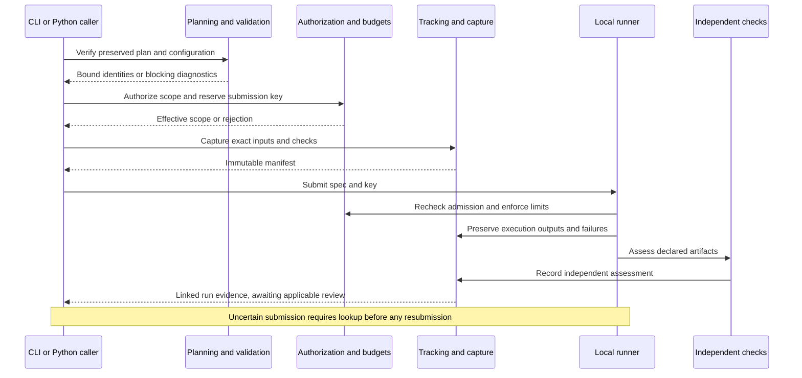
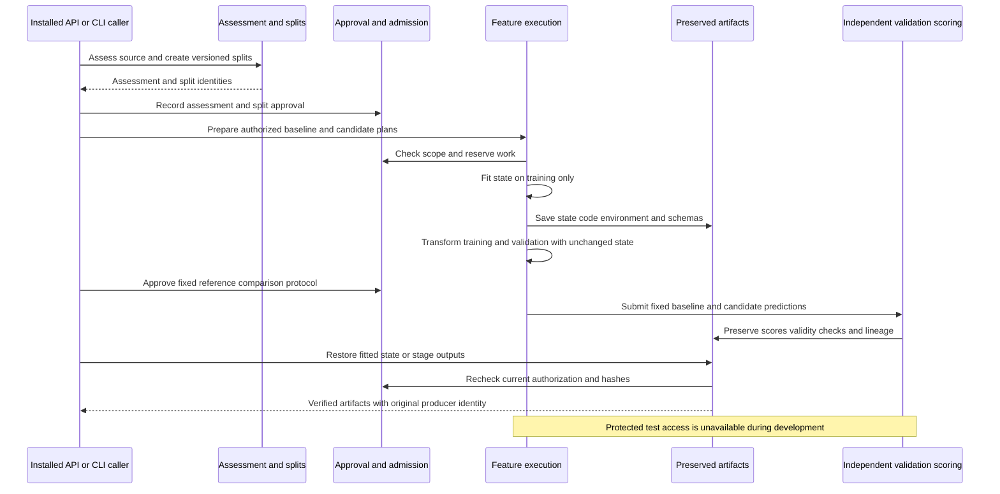
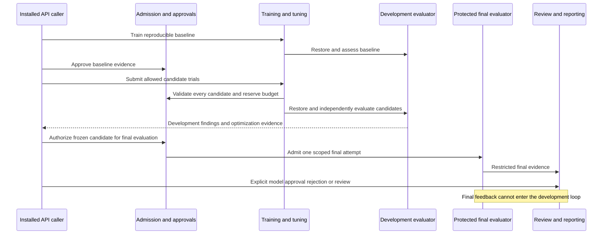
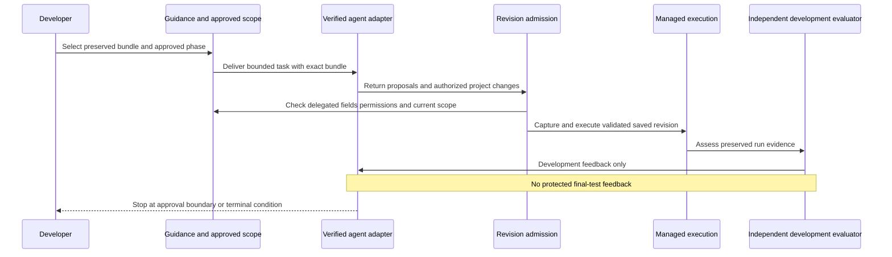
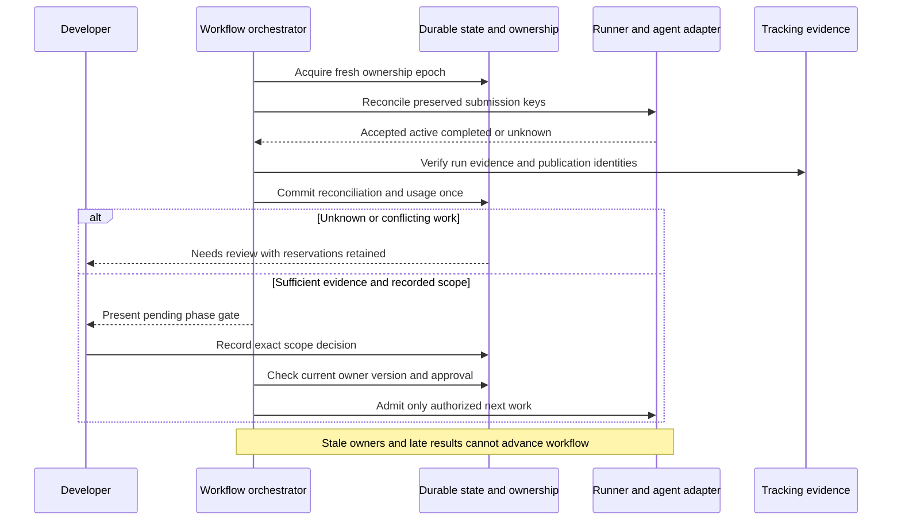
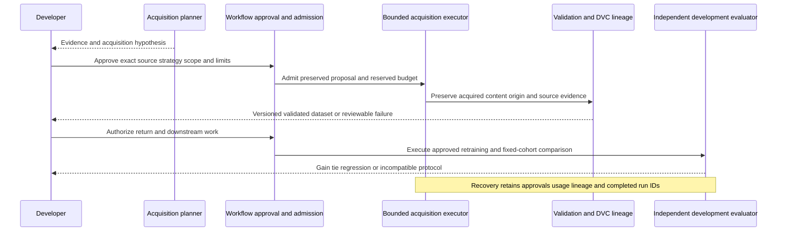

# Software implementation blueprint

Part of the [toolkit design](../agentic-ml-harness-design.md). Milestones 1–5 are
approved; Milestone 6 and final reconciliation are also approved at the IP6 gate.
Approval records belong to the owning plan, not executable product acceptance.

## Authority and notation

Issues govern scope. [Product contracts](execution-and-governance.md),
[interfaces](interfaces-and-configuration.md), [delivery order](milestone-delivery.md),
and [ADRs](architecture-decisions.md) remain applicable. This document owns software
responsibilities and public seams, not private helper structure.

**Implemented** means present in source, not newly verified here. **Accepted contract**
means approved in an owning plan. **Proposed contract** means a concrete design for
review, not an available API. **Blocked decision** identifies a prerequisite to
implementation. Approval of this document does not accept an entire pending ADR.

All proposed modules below are beneath `agentic_ml`. Proposed records are typed,
schema-versioned data, not executable instructions. Public CLI handlers translate
arguments into the same requests used by Python callers; handlers cannot bypass
validation, authorization, budgets, capture, or evaluation.

## Milestone 1 ownership and criterion map

Ranges below include every criterion in the indicated range. These are design
coverage assignments, not acceptance evidence. US-05-AC-05 extends to future
training entrypoints as they appear.

| Owner | Governing issue / criteria | Status | Public verification boundary |
|---|---|---|---|
| Packaging and bootstrap | [#8](https://github.com/jimthompson5802/agentic-ml/issues/8), US-01-AC-01–04 | Implemented | Pinned installation, upgrade and installed CLI/resources outside checkout |
| `initialization` | [#9](https://github.com/jimthompson5802/agentic-ml/issues/9), US-02-AC-01–05 | Implemented / accepted contract | Installed initializer API and `init` |
| `planning`, `approvals` | [#10](https://github.com/jimthompson5802/agentic-ml/issues/10), US-03-AC-01–05 | Implemented / accepted contract | Resolve, inspect, verify, approve and revoke |
| `validation` | [#11](https://github.com/jimthompson5802/agentic-ml/issues/11), US-05-AC-01–05 | Implemented / accepted contract | Registry, configuration and candidate APIs |
| `harness.execution` | [#12](https://github.com/jimthompson5802/agentic-ml/issues/12), US-09-AC-01–05; [#13](https://github.com/jimthompson5802/agentic-ml/issues/13), US-10-AC-01–05 | Proposed contract | Submission, status, cancellation, logs and artifacts through installed API/CLI |
| `data.sources` | [#14](https://github.com/jimthompson5802/agentic-ml/issues/14), US-11-AC-01–05 | Proposed contract | Approved extraction from at least two supported source types |
| `data.validation`, `approvals` | [#15](https://github.com/jimthompson5802/agentic-ml/issues/15), US-12-AC-01, US-12-AC-05 | Proposed contract | Quality report and matching dataset approval |
| `storage.datasets` | [#16](https://github.com/jimthompson5802/agentic-ml/issues/16), US-13-AC-01–04 | Proposed contract | DVC metadata/content separation and verified restoration |
| `tracking`, `harness.evaluation` | [#17](https://github.com/jimthompson5802/agentic-ml/issues/17), US-26-AC-01–05 | Proposed contract | Independent artifact checks and manifest/MLflow lookup |
| `restoration` | [#18](https://github.com/jimthompson5802/agentic-ml/issues/18), US-27-AC-01–04 | Proposed contract | Clean-environment restoration and replay |

## Existing public contracts

### Bootstrap and initialization

Keep the full Git commit pin, normal installed dependency, `agentic-ml` CLI and
`agentic_ml` imports. Installed package resources must not require a checkout.
An explicit upgrade changes the pin and lock identity; initialization never upgrades it.

`initialization.initialize_project(options: InitOptions) -> InitResult` takes an
explicit project root, experiment/package selection and optional DVC, MLflow,
artifact and state locations. Results identify created, updated, unchanged and
pending setup items. `InitializationError` reports stage, conflicts, completed
steps and recovery. Preserve the accepted [initialization contracts](../../verification/us-02-ip1.md).

Preflight precedes durable writes. Conflicts preserve user files. The private
setup journal records partial external-tool progress and safe reruns; it is not
execution authorization or an atomic transaction across uv, DVC and MLflow.
Draft configuration is version 0.1 and grants no execution authority. VS Code is
installed separately; nbclient and ipykernel support managed notebooks.

### Planning and decision approvals

Keep these `planning` exports:

```python
resolve_plan(request: ResolveRequest) -> PlanResult
inspect_plan(*, project_root: Path, plan_id: str) -> PlanInspection
verify_plan(*, project_root: Path, plan_id: str,
            check_current: bool = False) -> VerificationResult
```

`ResolveRequest` selects root and experiment input. Results distinguish blocked
inputs from `input_ready`; inspections expose preserved plan and integrity.
Operational failures use `PlanningError(code, message)`; field/source diagnostics
describe invalid inputs. Preserve original inputs, root-relative paths, working
directory, decisions and checksums in immutable 1.0 plan bundles.

Keep `approvals.approve_plan(ApprovalRequest) -> ApprovalRecord` and
`revoke_approval(RevocationRequest) -> RevocationRecord`, with `ApprovalError`
for operational failures. Existing records approve delegated decisions, not a
general execution scope. Match plan/decision identity and recompute current
revocation/staleness. Records are unauthenticated under US-03-SC-01; a workspace
writer can fabricate history. Preserve the [accepted planning contracts](../../verification/us-03-ip1.md).

### Semantic validation

```python
validate_registry(declarations: RegistryDocument | None = None) -> RegistryResult
validate_configuration(request: ConfigurationRequest) -> ConfigurationResult
validate_candidate(request: CandidateRequest) -> CandidateResult
inspect_validation(*, project_root: Path,
                   validation_id: str) -> ValidationInspection
```

These exports belong to `validation`. ConfigurationRequest binds root, plan ID
and optional registry path; CandidateRequest binds root, validation ID, algorithm
and parameter mapping. Results carry valid/blocked status and diagnostics;
candidate success materializes effective parameters and their origins.
ValidationInspection separates integrity from currentness. Operational failures
use `ValidationError(code, message)`.

Preserve the [accepted validation contracts](../../verification/us-05-ip1.md),
packaged scalar registry and 1.0 schemas. Registry metadata does not load component
code. Validation grants no authorization, reserves no budget and starts no run.
CLI `config validate/inspect` and `candidate validate` share these boundaries.

## Proposed execution and evidence contracts

The following interfaces are proposals for IP1 review. Types are immutable public
records; mappings use the existing JSONValue convention. Storage locations come
from explicit project configuration, never a toolkit checkout.

| Module / interface | Required input and output contract |
|---|---|
| `harness.resources.authorize(request: AuthorizationRequest) -> AuthorizationResult` | Request binds project, plan, validation identity where relevant, operation, input IDs, read/write paths, sources, network endpoints, limits and scoped approval IDs. Result is allowed/blocked with effective scope and diagnostics. Recheck approval currentness before admission. |
| `harness.resources.reserve(request: ReservationRequest) -> Reservation` | Bind authorization, submission key and requested trial/runtime/resource limits; atomically reserve capacity once per key before launch. Reject exhausted budgets. Persist reservation and consumed usage separately without double counting. |
| `tracking.capture_inputs(request: CaptureRequest) -> InputManifest` | Bind explicit source roots/entrypoint, configuration, environment, data IDs, guidance references, authorization and declared output checks. Freeze bytes before submission; return manifest ID/checksum and artifact references. |
| `harness.execution.LocalExperimentRunner` implementing `ExperimentRunner` | Retain submit, lookup_submission, status, cancel and artifacts from the conceptual protocol; add `logs(run_id: str) -> LogSnapshot`. Constructor takes explicit project root. No process-global current project. |
| `harness.evaluation.check_execution(request: ExecutionCheckRequest) -> ExecutionAssessment` | Bind terminal run and declared checks; return pass/fail/incomplete, per-check evidence and diagnostics. Does not approve a dataset or model. |
| `tracking.inspect_run(*, project_root: Path, run_id: str) -> RunRecord` | Return input and terminal manifest references, MLflow ID, execution status, diagnostics, artifacts and independent assessment. Missing/incomplete evidence stays visible. |
| `restoration.restore_run(request: RestoreRequest) -> RestoredRun` | Bind root, original manifest ID, new destination and authorized storage access; restore captured source, lockfiles and verified DVC inputs. Return environment/source/data identities and restored working directory. |
| `restoration.reproduce_run(request: ReproductionRequest) -> ReproductionResult` | Bind restored identity and current authorization; submit a new run linked to the original and compare against its declared output checks/tolerances. Return original/new IDs and pass/fail/incomplete comparison. |

### ExperimentSpec: proposed immutable execution description

Owner: `harness.execution`; M1 US-09-AC-01–05, US-10-AC-01–05 and
US-26-AC-02–04. All fields below are required, with no implicit defaults.
This is a proposed public data contract, not an implemented Python class.

| Attribute | Python type | Meaning and constraint |
|---|---|---|
| `schema_version` | `Literal["1.0"]` | Reject unsupported versions; never infer a version from missing fields. |
| `project_id` | `str` | Nonempty stable identity from the captured project configuration; not an absolute directory path. |
| `experiment_id` | `str` | Experiment identity from the preserved plan, within that project. |
| `plan_id` | `str` | Existing immutable plan identity; must match the input manifest and authorization scope. |
| `input_manifest_id` | `str` | Content identity `sha256:` followed by 64 lowercase hexadecimal digits, computed over the stored input-manifest bytes. Resolve through the project's configured evidence store; verify bytes before use. |
| `entrypoint_kind` | `Literal["notebook", "python"]` | Notebook runs use nbclient; Python runs execute a captured Python file, not an arbitrary shell command or import expression. |
| `entrypoint_path` | `str` | POSIX relative path from the materialized source root to a captured regular file; `.ipynb` for notebook or `.py` for Python. Reject absolute paths, empty segments, `.`/`..` segments and symlink escapes. |
| `working_directory` | `str` | `.` or a normalized POSIX relative directory within the materialized source root. Resolve independently of caller cwd; reject absolute paths, traversal and symlink escapes. |
| `parameters` | `Mapping[str, JSONValue]` | Explicit effective execution parameters, including an explicitly empty mapping when none apply. Finite JSON numbers only. Must match the manifest's preserved parameters; no runner-side defaults or sampling. |
| `environment_id` | `str` | Content identity of the manifest's environment record covering dependency files, interpreter constraints and toolkit identity. A virtualenv path alone is not an identity. |
| `authorization_id` | `str` | Reference to the current scoped authorization record permitting this execution; preserved historical authorization alone is insufficient. |
| `reservation_id` | `str` | Reference to the durable reservation for this execution and submission key. It must belong to the same project, authorization and input identity. |

The manifest is authoritative for source/data/guidance/environment evidence,
effective parameters and declared output checks/tolerances. The spec repeats only
execution selection and binding fields so admission can compare them explicitly;
any disagreement blocks execution. Do not merge competing values or prefer the
caller's copy. Output checks are referenced through the manifest, not duplicated
in the spec. Credentials, execution status, logs and result artifacts are never
spec fields. Project root is supplied to the runner, not serialized into the spec.

No execution, approval, storage or mutation methods belong on ExperimentSpec.
Construction must recursively copy/freeze parameters: a frozen dataclass alone
does not prevent mutation of nested dictionaries/lists. Its JSON representation
uses objects/arrays and rejects unknown fields. Serialization is a service concern.

Proposed construction boundary:

```python
prepare_experiment_spec(request: PrepareExperimentRequest) -> PreparedExperiment
```

`PrepareExperimentRequest` contains `project_root: Path`, `input_manifest_id: str`,
`authorization_id: str`, `reservation_id: str`, and `submission_key: str`.
`PreparedExperiment` contains `status: Literal["ready", "blocked"]`,
`spec: ExperimentSpec | None`, and `diagnostics: tuple[Diagnostic, ...]`.
Only ready results contain a spec. Preparation loads and verifies preserved
evidence, derives all remaining fields from it, and checks cross-record bindings;
it neither launches work nor creates approval or budget capacity. Operational
storage errors raise ExecutionError; invalid evidence returns blocked diagnostics.

Keep the protocol's `submit(spec: ExperimentSpec, submission_key: str) -> str`:
the returned string is the toolkit run ID. Before spawning a process, submission
repeats integrity, environment compatibility, current authorization, reservation
and submission-key checks. A ready preparation result is not a reusable permission
token. Invalid submission raises ExecutionError with a stable safe code and does
not launch work; preserve pre-existing reservations for reconciliation rather than
automatically releasing capacity after an uncertain failure.

Required public-boundary cases: both entrypoint kinds; explicit empty parameters;
unsupported schema; manifest checksum failure; project/plan/parameter/environment
mismatch; missing captured entrypoint; traversal and symlink escape; stale or
revoked authorization after preparation; mismatched/exhausted reservation; caller
mutation of nested parameters; and duplicate-key submission. Reproduction builds
a new spec with current authorization/reservation and links the original evidence;
it never edits the original spec or claims the historical authorization is current.

Submission keys bind exact input identity. A retry with changed inputs is rejected.
Lookup distinguishes accepted, definitively unaccepted and unknown; unknown work
blocks resubmission for review. Transport retries retain the same key.

`RunStatus` distinguishes submitted/running/completed/failed/timed_out/cancelled,
budget exhaustion and review-required uncertainty. Cancellation reports requested,
acknowledged or confirmed terminal, rather than claiming an unconfirmed stop.
Poor model performance remains separate from execution failure when M3 arrives.
`LogSnapshot` carries run ID, captured content/reference and completeness indicator.

Publish a schema-versioned immutable input manifest before launch. It includes
paths/checksums, required modified and untracked source, dependency files, toolkit
URL/full SHA/version/build identity, platform, DVC references, guidance and checks.
Execute its materialized snapshot in the locked project environment with a fresh
kernel, ordered cells and explicit parameters. Preserve outputs/errors/logs even
on timeout, cancellation or failure. Terminal manifests reference input checksum
and MLflow run; interrupted finalization must retain the original input evidence.
Use atomic publication of owned manifest files; MLflow and filesystem updates
require reconciliation, not a claimed cross-store transaction.

Proposed operational exceptions are `ExecutionError`, `TrackingError`,
`AuthorizationError` and `RestorationError`, each carrying safe code/message and
available evidence IDs. Invalid requests return structured blocking diagnostics;
unavailable storage or failed external tools raise operational errors. Never log
credentials. Restoration must identify missing/corrupt inputs without substituting
current source, dependencies or datasets. Historical approval grants no new access.

### Enforcement decision required before execution

**M1-D1 — blocked decision, ADR-006, owner: execution/extraction story design.**
Select and verify an OS-enforced filesystem/network/credential boundary and its
supported platform before shipping US-09-AC-05 or US-11-AC-03. The resource service
owns admission and accounting; the process boundary enforces effective access for
arbitrary Python. Fail closed when required enforcement is unavailable. API checks
alone cannot establish isolation. Present the chosen mechanism at the owning
story's contract gate; this blueprint does not settle the pending mechanism.

## Proposed data contracts

Retain `DataSourceAdapter.discover/extract/validate`, with concrete CSV/Parquet,
SQL and object-storage implementations in `data.sources`. Instantiate connectors
with explicit project and authorization context. ExtractionSpec binds source,
approved query/sampling plan, parameters and record/cost/runtime limits; credentials
are resolved separately and never serialized. DatasetRef identifies content by
checksum and manifest, not merely a mutable filesystem path.

`data.validation.validate_dataset(request: DatasetValidationRequest) -> ValidationReport`
checks schema, counts, types, nulls, duplicates and configured quality rules.
Reports contain independently expected/observed values, pass/fail and evidence.
Extraction stages incomplete output privately; failed extraction never returns
a validated DatasetRef. Dataset manifests record source/query/parameters/time,
checksums and nonsecret permissions metadata.

`storage.datasets.version_dataset(request: DatasetVersionRequest) -> DatasetRef`
publishes validated content to configured DVC storage and records DVC/Git metadata
references. `restore_dataset(request: DatasetRestoreRequest) -> DatasetRef`
retrieves and verifies hashes before returning success. Requests bind root,
dataset/input identity, destination and authorization. `DatasetError(code,
message)` identifies extraction/storage failures without exposing credentials.
Git stores metadata; dataset bytes and generated stores remain excluded.

`approvals.approve_dataset(request: DatasetApprovalRequest) -> DatasetApprovalRecord`
is a proposed separate interface: bind dataset checksum, validation report,
reviewer label, decision and timestamp. A mismatched report or changed content
cannot accept the dataset. This extends scope without changing approve_plan.
Use the same declared unauthenticated assurance level as current records.

## M1 record catalogue

This catalogue completes the public M1 types used above. It excludes private
implementation helpers and later-milestone protocols. Existing field definitions
below describe source as inspected, not new constructor validation guarantees.
`name: Type = value` denotes a default; all other fields are required.
Inherited fields remain required unless the base defines a default.

### Implemented initialization records

Owner `initialization`; US-02-AC-01–05. All records are frozen dataclasses with
no behavioral methods. Validation occurs in initialize_project, not implicitly
in dataclass constructors. Only InitOptions/InitResult/InitializationError are
exported by the package's public `__all__`; the draft models below support the
initialization schema and are not additional supported package exports.

| Type | Attributes and defaults | Contract |
|---|---|---|
| `InitOptions` | `project_root: Path`; `experiment: str = "initial"`; `package_name: str \| None = None`; `dvc_store`, `mlflow_backend`, `artifact_store`, `state_store`: each `Path \| None = None` | None selects documented local defaults; explicit store overrides authorize setup writes only. Package name is validated or derived from the project. |
| `InitResult` | `project_root: Path`; `created`, `updated`, `unchanged`, `setup_pending`: each `tuple[str, ...]` | Service-produced inventory and remaining setup choices; success is not experiment authorization. |
| `ProjectConfig` | `project`, `storage`, `setup`: each `dict[str, str]`; `schema_version: str = "0.1"`; `guidance`, `components`: each `tuple[str, ...] = ()` | Draft project/storage/setup mappings; packaged initialization schema governs keys. |
| `DraftExperiment` | `id`, `brief`, `search_space`: each `str`; `notebooks: tuple[str, ...]`; `schema_version: str = "0.1"`; `working_directory: str = "."`; `data: tuple[str, ...] = ()`; `execution_status: str = "unconfigured"` | Root-relative configuration references; inert draft, not ExperimentSpec. |
| `DraftSearchSpace` | `schema_version: str = "0.1"`; `algorithms: tuple[str, ...] = ()` | Empty initial algorithm set grants no search permission. |
| `InitialState` | `experiment: str`; `schema_version: str = "0.1"`; `status: str = "unconfigured"`; `approvals`, `runs`: each `tuple[str, ...] = ()` | Initial storage state, not a recovery state machine. |

Persist drafts through the packaged initialization YAML/JSON schemas. Frozen
wrappers do not make nested dictionaries immutable. Preserve existing semantics;
do not silently retrofit future recursive-freezing rules onto accepted APIs.
Verify generated inventory/schema contents, conflicts, pin preservation, partial
setup/rerun recovery and absence of implicit access grants through installed init.

### Implemented planning and approval records

Owners `planning`, `approvals`; US-03-AC-01–05. JSONValue is the recursive
JSON scalar/list/dict type from planning; SearchSpace and RegistryDocument are
`dict[str, JSONValue]` aliases, not classes. PlanStatus is
`Literal["blocked", "input_ready"]`; ValidationStatus is `Literal["valid", "blocked"]`.

| Type | Attributes and defaults | Authority and behavior |
|---|---|---|
| `ResolveRequest` | `project_root: Path`; `experiment: Path` | Experiment input resolves against explicit root. |
| `Diagnostic` | `code`, `field`, `source_path`, `message`: each `str`; `line`, `column`: each `int \| None` | Safe field/source diagnostic; unavailable coordinates are None, not guessed. |
| `PlanResult` | `plan_id: str \| None`; `status: PlanStatus`; `diagnostics: tuple[Diagnostic, ...]` | A captured blocked plan may still have an identity; readiness is recomputed. |
| `VerificationResult(PlanResult)` | Adds `integrity: bool`; `authentication: str = "none"`; `approval_ids: tuple[str, ...] = ()` | Integrity is distinct from readiness and reviewer authentication. |
| `PlanInspection` | `plan_id: str`; `status: PlanStatus`; `integrity: bool`; `plan: dict[str, JSONValue] \| None`; `diagnostics: tuple[Diagnostic, ...]`; `authentication: str = "none"`; `approval_ids: tuple[str, ...] = ()` | Plan is preserved evidence where readable, never a trusted success flag. |
| `SearchSelection` | `mode: JSONValue = None`; `allowed: JSONValue = None`; `execution`, `budgets`: each `dict[str, JSONValue]`, default fresh empty dict | None means unresolved delegation. Structural checker narrows declared boundaries without registry access. |
| `BoundaryResult` | `effective_search: SearchSpace \| None`; `effective_budgets: dict[str, JSONValue] \| None`; `diagnostics: tuple[Diagnostic, ...]` | Failure returns neither effective value; inputs remain unmodified. |
| `ApprovalRequest` | `project_root: Path`; `plan_id`, `reviewer`, `reason`: each `str` | Approves all proposed delegated decisions in the exact plan; nonblank reviewer/reason. |
| `ApprovalRecord` | `schema_version`, `approval_id`, `authentication`, `reviewer`, `reason`, `project_root`, `experiment_id`, `plan_id`, `purpose`, `decision`, `recorded_at`: each `str`; `decisions: tuple[dict[str, JSONValue], ...]` | Service derives scope and decision values from verified evidence, not caller claims. Schema 1.0, authentication none, UUID record identity and UTC timestamp; schema defines purpose/decision constants. |
| `RevocationRequest` | `project_root: Path`; `plan_id`, `approval_id`, `reviewer`, `reason`: each `str` | Revokes one existing approval in that exact plan scope. |
| `RevocationRecord` | `schema_version`, `revocation_id`, `authentication`, `approval_id`, `project_root`, `experiment_id`, `plan_id`, `reviewer`, `reason`, `recorded_at`: each `str` | Append-only scoped revocation; same assurance limits as approval. |

Records have no behavioral methods. Use resolve/inspect/verify/validate_boundaries
and approve/revoke services. Planning 1.0 schemas and approval/revocation 1.0
schemas govern persistence; root paths are retained in existing approval records,
unlike proposed portable project IDs. Preserve this distinction explicitly.
Verify malformed/ambiguous inputs, boundary widening, wrong scope, stale/revoked
records, checksum failure and copied nested values through the existing APIs.

### Implemented semantic validation records

Owner `validation`; US-05-AC-01–05. Frozen request/result wrappers, no behavioral
methods; validation services own semantic checks and independent evidence copies.

| Type | Attributes and defaults | Contract |
|---|---|---|
| `RegistryResult` | `status: ValidationStatus`; `registry: RegistryDocument \| None`; `registry_id: str \| None`; `diagnostics: tuple[Diagnostic, ...] = ()` | Blocked registry has neither registry nor ID. |
| `ConfigurationRequest` | `project_root: Path`; `plan_id: str`; `registry: Path \| None = None` | Optional registry path resolves against project root. |
| `ConfigurationResult` | `status: ValidationStatus`; `validation_id: str \| None`; `configuration: dict[str, JSONValue] \| None`; `diagnostics: tuple[Diagnostic, ...] = ()` | Successful evidence published immutably; failure cannot claim valid configuration. |
| `CandidateRequest` | `project_root: Path`; `validation_id`, `algorithm`: each `str`; `parameters: dict[str, JSONValue]` | No trial launch, sampling or budget reservation. |
| `CandidateResult` | `status: ValidationStatus`; `validation_id`, `algorithm`: each `str`; `parameters: dict[str, JSONValue] \| None`; `origins: dict[str, str] \| None`; `diagnostics: tuple[Diagnostic, ...] = ()` | Fully effective values and source origins on success. |
| `ValidationInspection(ConfigurationResult)` | Adds `integrity: bool = False`; `current: bool = False` | Intact stale evidence is integrity true/current false/blocked. |

Persist evidence through validation 1.0 schemas; registry profile metadata does
not authorize importing model code. Verify unknown IDs/parameters, task mismatch,
fixed/default semantics, integer/log/categorical boundaries, corrupted evidence,
drift and cross-project candidates. Preserve the accepted contract report's exact
mapping keys and diagnostic conventions rather than inventing replacements here.

### Proposed common record rules

The remaining catalogue entries are **proposed contracts**. All fields are
required, including explicit None/empty collections; no implicit defaults.
All persisted records carry `schema_version: Literal["1.0"]` in addition to the
listed fields. Requests and in-memory service results do not need that field.
Records have no methods unless a service/protocol signature is explicitly listed.
Recursively copy/freeze nested values; serialize Paths as strings, tuples as JSON
arrays, mappings as objects, timestamps as UTC RFC3339 strings ending Z. Reject
unknown fields, nonfinite numbers, unsupported versions and credential contents.

`EvidenceId = str` means SHA-256 over exact stored bytes, formatted `sha256:HEX`
with 64 lowercase hex digits. `RecordId = str` means a canonical lowercase UUID
allocated by the owning service. References are resolved in configured project
stores and verified, never trusted from filenames alone. A nullable field is
required but explicitly None when unavailable. `ProjectContext` request fields
mean `project_root: Path`, `project_id: str`, `experiment_id: str`; this is notation,
not a new class. Every cross-record binding must match the selected context.
Where a table abbreviates “project/experiment IDs”, these are the required
`project_id: str` and `experiment_id: str` attributes, both nonempty and copied
from preserved project/plan evidence. Collection values must not contain duplicate
record/check identities; an explicitly ordered collection retains its order.

`ArtifactRef` fields: `artifact_id: EvidenceId`, `relative_path: str`,
`media_type: str`, `size_bytes: int`, `storage_uri: str`. Relative paths follow
ExperimentSpec rules; nonnegative size and verified checksum are required.
Storage URI is nonsecret and never grants access. Requests use ArtifactRef only
for already published evidence; new local inputs use explicit paths.

### Proposed authorization and accounting records

Owner `harness.resources`; US-09-AC-05, US-10-AC-03/05, US-11-AC-03.

| Type | Required attributes | Constraints and lifecycle |
|---|---|---|
| `ResourceLimits` | `runtime_seconds: int`; `trial_count: int`; `max_records: int \| None`; `max_cost: str \| None`; `currency: str \| None`; `memory_bytes: int \| None` | Positive supplied limits; decimal cost string with matching currency or both None. None means not applicable, not unlimited when policy requires a limit. Reject unsupported mandatory limits. |
| `AccessScope` | `read_paths`, `write_paths`, `source_ids`, `network_endpoints`: each `tuple[str, ...]` | Paths are explicit resolved project/external locations; endpoint allowlist is explicit, empty denies network. No credential values. |
| `AuthorizationRequest` | ProjectContext; `plan_id: EvidenceId`; `validation_id: EvidenceId \| None`; `operation: Literal["execute", "extract", "restore"]`; `input_ids: tuple[EvidenceId, ...]`; `scope: AccessScope`; `limits: ResourceLimits`; `approval_ids: tuple[RecordId, ...]` | Scope may narrow approved policy, never expand it. Validation ID is mandatory for applicable validated execution, not basic extraction/restoration. |
| `AuthorizationRecord` | Same context identities, plan/validation/operation/input IDs, effective scope/limits and approval IDs; `authorization_id: RecordId`; `recorded_at: str`; `authentication: Literal["none"]` | Service-written immutable decision record. Approval authenticity is not established; enforcement and currentness remain required. |
| `AuthorizationResult` | `status: Literal["allowed", "blocked"]`; `authorization: AuthorizationRecord \| None`; `diagnostics: tuple[Diagnostic, ...]` | Only allowed returns a record; no launch or reservation. |
| `ReservationRequest` | ProjectContext; `authorization_id: RecordId`; `submission_key: str`; `limits: ResourceLimits` | Nonblank key and effective limits within authorization. Atomic admission against remaining project experiment budget. |
| `Reservation` | `reservation_id`, `authorization_id`: RecordId; project/experiment IDs; `submission_key: str`; `limits: ResourceLimits`; `state: Literal["reserved", "settled", "released", "uncertain"]`; `usage: ResourceUsage`; `recorded_at: str` | Durable state snapshots under one identity; retained uncertainty cannot release capacity. No mutable input-manifest reference creates a capture/reservation cycle. |
| `ResourceUsage` | `runtime_seconds: float`; `trial_count: int`; `records: int`; `cost: str \| None`; `currency: str \| None`; `peak_memory_bytes: int \| None` | Nonnegative observations; unavailable cost is explicit, never reported as zero. Settlement accounts each submission once. |

Reservation binds authorization, submission key and requested limits before
capture; runner admission atomically binds that key to the finished manifest.
Thus the reservation need not contain a manifest hash before capture. Reuse with
a different finished manifest is rejected. Record binding before process launch.
Resource service updates reservation state durably; records returned to callers
are immutable snapshots, not mutable handles. Verify concurrent reservation,
scope widening, revocation, unsupported limits, settlement deduplication and
uncertainty preservation. M1-D1 remains prerequisite for actual access enforcement.

### Proposed capture and run records

Owners `tracking`, `harness.execution`, `harness.evaluation`; US-09/10 and
US-26-AC-01–05. Use ExperimentSpec and preparation types defined above.

| Type | Required attributes | Constraints and authority |
|---|---|---|
| `EnvironmentRecord` | `environment_id: EvidenceId`; `pyproject`, `lockfile`: ArtifactRef; `python_version`, `platform`, `toolkit_url`, `toolkit_commit`, `toolkit_version`: str; `toolkit_build: str \| None` | Full commit SHA, actual interpreter/platform and exact dependency files. Environment ID hashes the record payload excluding its own ID. |
| `OutputCheck` | `check_id: str`; `path: str`; `kind: Literal["exists", "sha256", "numeric"]`; `expected: JSONValue`; `absolute_tolerance`, `relative_tolerance`: float | Unique nonblank ID; path under output root. exists requires expected true; sha256 requires EvidenceId; numeric requires finite number. Tolerances nonnegative, zero unless numeric. Numeric output is a JSON numeric scalar; pass when absolute error ≤ absolute tolerance + relative tolerance × absolute expected. |
| `CaptureRequest` | ProjectContext; `plan_id: EvidenceId`; `validation_id: EvidenceId \| None`; `authorization_id`, `reservation_id`: RecordId; `source_roots: tuple[Path, ...]`; `external_files: tuple[Path, ...]`; `entrypoint_kind`, `entrypoint_path`, `working_directory`, `parameters`: as ExperimentSpec; `datasets: tuple[DatasetRef, ...]`; `guidance: tuple[ArtifactRef, ...]`; `checks: tuple[OutputCheck, ...]` | Explicit source-root selection; required external files registered; exclude secrets/environments/stores. Capture actual environment, do not accept caller-invented environment identity. |
| `InputManifest` | `manifest_id: EvidenceId`; project/experiment IDs; `plan_id: EvidenceId`; `validation_id: EvidenceId \| None`; `authorization_id`, `reservation_id`: RecordId; `source: tuple[ArtifactRef, ...]`; `experiment_git_revision: str`; `environment: EnvironmentRecord`; `datasets: tuple[DatasetRef, ...]`; `guidance: tuple[ArtifactRef, ...]`; entrypoint kind/path/working directory/parameters as ExperimentSpec; `checks: tuple[OutputCheck, ...]`; `captured_at: str` | Manifest ID is computed over stored payload excluding its own ID and carried in the returned wrapper/store index. Exact stored payload bytes determine ExperimentSpec.input_manifest_id. Ordered guidance refs preserve order. |
| `RunStatus` | Type alias `Literal["submitted", "running", "completed", "failed", "timed_out", "cancelled", "budget_exhausted", "needs_review"]` | Execution state only; completed does not imply checks passed or acceptance. |
| `SubmissionStatus` | `submission_key: str`; `input_manifest_id: EvidenceId \| None`; `acceptance: Literal["accepted", "not_accepted", "unknown"]`; `run_id: RecordId \| None`; `status: RunStatus \| None`; `evidence: tuple[ArtifactRef, ...]`; `diagnostics: tuple[Diagnostic, ...]` | Accepted requires known run/input IDs. not_accepted requires definitive durable evidence. Lookup failures return unknown. |
| `CancellationResult` | `run_id: RecordId`; `outcome: Literal["requested", "acknowledged", "terminal"]`; `status: RunStatus`; `diagnostics: tuple[Diagnostic, ...]` | Terminal means observed terminal execution, which may have completed before cancellation. No false claim of termination. |
| `LogSnapshot` | `run_id: RecordId`; `logs: tuple[ArtifactRef, ...]`; `complete: bool`; `captured_at: str` | Ordered log chunks; partial logs remain readable after failure. |
| `CheckResult` | `check_id: str`; `status: Literal["pass", "fail", "incomplete"]`; `observed: JSONValue`; `evidence: tuple[ArtifactRef, ...]`; `diagnostics: tuple[Diagnostic, ...]` | Result follows original check; unavailable evidence is incomplete, not pass. |
| `ExecutionCheckRequest` | `project_root: Path`; `run_id: RecordId` | Evaluator loads original checks from verified input manifest; caller cannot substitute checks. |
| `ExecutionAssessment` | `assessment_id: EvidenceId`; `run_id: RecordId`; `input_manifest_id: EvidenceId`; `status: Literal["pass", "fail", "incomplete"]`; `checks: tuple[CheckResult, ...]`; `diagnostics: tuple[Diagnostic, ...]` | Pass requires completed execution and every declared check passed. Failed execution cannot pass; missing evidence is incomplete. |
| `TerminalManifest` | `manifest_id: EvidenceId`; `run_id: RecordId`; `input_manifest_id: EvidenceId`; `mlflow_run_id: str`; `status: RunStatus`; `exit_code: int \| None`; `artifacts: tuple[ArtifactRef, ...]`; `logs: LogSnapshot`; `assessment_id: EvidenceId \| None`; `usage: ResourceUsage`; `finished_at: str` | Immutable terminal observation; no submitted/running status. Missing assessment remains explicit. ID follows input-manifest payload convention. |
| `RunRecord` | `run_id: RecordId`; `input_manifest_id: EvidenceId`; `terminal_manifest_id: EvidenceId \| None`; `mlflow_run_id: str \| None`; `status: RunStatus`; `artifacts: tuple[ArtifactRef, ...]`; `assessment: ExecutionAssessment \| None`; `diagnostics: tuple[Diagnostic, ...]` | Inspection snapshot, not authoritative state transition. Missing terminal evidence cannot imply success. |

Content-addressed records with IDs in this catalogue use the same envelope rule:
serialize schema-versioned payload without its own ID, hash exact stored payload
bytes, and return payload plus ID in the in-memory record. References hash payload,
not an envelope containing its own hash. Consumers verify stored bytes first.

`LocalExperimentRunner.__init__(*, project_root: Path)` resolves project stores.
`submit(spec: ExperimentSpec, submission_key: str) -> str` retains its run-ID result;
`lookup_submission(submission_key: str) -> SubmissionStatus`;
`status(run_id: str) -> RunStatus`; `cancel(run_id: str) -> CancellationResult`;
`artifacts(run_id: str) -> tuple[ArtifactRef, ...]`;
`logs(run_id: str) -> LogSnapshot`. These typed artifact/cancellation results refine
the conceptual protocol; owning implementation must update that protocol rather
than claim conformance to its older `list[str]`/None annotations unchanged.
The M1 evaluator is check_execution, not the future modeling Evaluator protocol.

Verify duplicate/concurrent submissions, mismatched manifests, capture failure
before launch, modified/untracked sources, fresh kernels, timeout/cancellation,
partial logs, MLflow uncertainty, independent failed checks and retry-safe terminal
publication. No successful publication can erase previously available failure evidence.

### Proposed source, dataset and approval records

Owners `data.sources`, `data.validation`, `storage.datasets`, `approvals`;
US-11-AC-01–05, US-12-AC-01/05, US-13-AC-01–04.

| Type | Required attributes | Constraints and lifecycle |
|---|---|---|
| `DataSourceMetadata` | `source_id: str`; `kind: Literal["local", "sql", "object_storage"]`; `schema: Mapping[str, str]`; `permitted_operations: tuple[str, ...]` | Only permitted metadata, no raw rows or credentials from discovery. |
| `ExtractionSpec` | ProjectContext; `source_id: str`; `query_or_path: str`; `parameters: Mapping[str, JSONValue]`; `sampling: Mapping[str, JSONValue]`; `authorization_id`, `reservation_id`: RecordId | Local file, SQL query or object key according to connector; sampling {} means no sampling. Connector validates against approved query/sampling scope; no inferred permission. |
| `DatasetRef` | `dataset_id: EvidenceId`; `content: tuple[ArtifactRef, ...]`; `schema: Mapping[str, str]`; `row_count: int`; `source_id`, `query_or_path`: str; `parameters`, `sampling`: Mapping[str, JSONValue]; `extracted_at: str`; `authorization_id: RecordId`; `validation_report_id: EvidenceId \| None`; `dvc_metadata: tuple[ArtifactRef, ...]` | Nonnegative rows, exact source lineage and content. ID hashes dataset manifest payload. Missing validation/versioning refs mean extracted only, never accepted. |
| `QualityRule` | `rule_id`, `column`: str; `kind: Literal["schema", "row_count", "type", "null_count", "duplicate_count"]`; `expected: JSONValue` | column empty for whole dataset; expected schema mapping, type string or nonnegative count. M1 supports these declarative rules, no executable rule strings. |
| `DatasetValidationRequest` | `project_root: Path`; `dataset: DatasetRef`; `rules: tuple[QualityRule, ...]`; `authorization_id: RecordId` | Validate verified content, unique rule IDs, reject unsupported rule kinds; do not silently ignore rules. |
| `ValidationReport` | `report_id`, `dataset_id`: EvidenceId; `status: Literal["pass", "fail", "incomplete"]`; `checks: tuple[CheckResult, ...]`; `recorded_at: str`; `diagnostics: tuple[Diagnostic, ...]` | Independent observed values; extraction completion alone does not pass validation. |
| `DatasetVersionRequest` | `project_root: Path`; `dataset: DatasetRef`; `validation_report_id: EvidenceId`; `authorization_id: RecordId` | Passing matching report required before publishing validated version; returns new enriched DatasetRef, never mutates old evidence. |
| `DatasetRestoreRequest` | `project_root: Path`; `dataset_id: EvidenceId`; `destination: Path`; `authorization_id: RecordId` | No overwrite of caller files; content hashes must match before exposing restored output as usable. |
| `DatasetApprovalRequest` | `project_root: Path`; `dataset_id`, `validation_report_id`: EvidenceId; `reviewer`, `reason`: str | Nonblank labels; passing report for exact verified dataset. Operation means approve, not implicit approval through validation. |
| `DatasetApprovalRecord` | `approval_id: RecordId`; project/experiment IDs; `dataset_id`, `validation_report_id`: EvidenceId; `reviewer`, `reason`, `recorded_at`: str; `decision: Literal["approve"]`; `authentication: Literal["none"]` | Durable exact-scope record; changed dataset/report does not inherit acceptance. |

`DataSourceAdapter` construction takes project_root, source_id and authorization_id.
Methods: `discover() -> DataSourceMetadata`,
`extract(spec: ExtractionSpec) -> DatasetRef`,
`validate(dataset: DatasetRef) -> ValidationReport`. The last operation uses
configured preserved rules via the same validate_dataset service, never a second
independent validation implementation. Validation failure returns report, not a
falsely accepted DatasetRef. Connector implementations resolve authorized secret
references out of band; no secret-bearing connection strings enter evidence.
Concrete local CSV/Parquet, SQL and object-storage adapters share this contract.

Verification covers metadata-only discovery, at least two connector types,
unauthorized queries/endpoints, truncation/partial output, limits, independently
known schema/counts, wrong-report approval, missing DVC objects, corrupt bytes and
Git metadata/content separation. Splits and fitted preprocessing remain M2.

### Proposed restoration records

Owner `restoration`; US-27-AC-01–04, coordinating US-13 and US-26.

| Type | Required attributes | Constraints and lifecycle |
|---|---|---|
| `RestoreRequest` | `project_root: Path`; `input_manifest_id: EvidenceId`; `destination: Path`; `authorization_id: RecordId` | Explicit empty/new destination, current source/store access; never silently replace existing files. |
| `RestoredRun` | `restoration_id: RecordId`; `original_input_manifest_id: EvidenceId`; `destination: Path`; `source_root: Path`; `environment_id: EvidenceId`; `datasets: tuple[DatasetRef, ...]`; `working_directory: str`; `diagnostics: tuple[Diagnostic, ...]` | Returned only after all required evidence/data/environment checks; locked environment materialized with pinned toolkit. Destination paths are local materialization results, not portable identities. |
| `ReproductionRequest` | `project_root: Path`; `restoration_id: RecordId`; `authorization_id`, `reservation_id`: RecordId; `submission_key: str` | References verified restoration; rechecks materialized content before new execution. |
| `ReproductionResult` | `original_input_manifest_id: EvidenceId`; `run_id: RecordId`; `assessment: ExecutionAssessment`; `status: Literal["pass", "fail", "incomplete"]`; `diagnostics: tuple[Diagnostic, ...]` | New run keeps original declared checks; successful launch alone is not reproduction success. |

Persist restoration identity and references in project state; source/environment
materialization remains at explicit destination. No restoration method starts
execution implicitly. Restore failures raise RestorationError with affected input
and available evidence; partial workspace remains diagnostic, not RestoredRun.
Verify missing source/dependencies/data, changed lockfiles, corrupt guidance,
untracked helper restoration, post-capture edits, output tolerance failure and
current-access rejection. No new second-machine/platform verification is claimed.

### Error classes and future-name reconciliation

Implemented `PlanningError` and `ValidationError` constructors are
`(code: str, message: str)`; message is Exception text and code is public.
`ApprovalError(code: str, message: str, *, operational: bool = False)` additionally
distinguishes invalid scope from storage failures. `InitializationError(message:
str, *, stage: str = "preflight", conflicts: tuple[str, ...] = (),
completed_steps: tuple[str, ...] = (), recovery: str = "Resolve the conflict and
rerun init with the same options.")` preserves completed setup stages.

Proposed `ExecutionError`, `TrackingError`, `AuthorizationError`, `RestorationError`
and `DatasetError` use `(code: str, message: str, *, evidence_ids:
tuple[EvidenceId, ...] = ())`. Safe stable codes identify unavailable storage,
invalid scope, corrupt evidence, unsupported version, incompatible environment,
exhausted budget or uncertain publication; exception chaining retains technical
causes without exposing credentials in public output. No retries or cleanup are
methods on exceptions. Verify code/message and preserved evidence via services.

Conceptual `ExperimentResult` is represented by RunRecord plus TerminalManifest
in M1; no separate duplicate result class. Conceptual ExperimentConfig/MLTaskSpec/
SearchSpaceSpec map to accepted preserved planning documents and schemas, not new
M1 classes. ExperimentProjectConfig maps to initialization drafts plus accepted
planning inputs; do not invent a migration to a new project model here.
RuntimeInstructionBundle in M1 is preserved ordered guidance ArtifactRefs with
captured contents; managed selection/conflict resolution arrives in M4.
ApprovalService and WorkflowRecoveryRecord remain M5 contracts; current explicit
approval functions and runner submission records do not claim those interfaces.
Agent/model/feature/acquisition protocols and their types are deferred to their
assigned M2–6 gates, not omitted M1 implementation work.

## M1 verification summary



Tests must enter installed public interfaces in separate experiment fixtures.
Cover existing-file conflicts and pin preservation; ambiguous plans; stale/revoked
approvals; invalid candidates; fresh-kernel/working-directory behavior; unauthorized
filesystem/network/credential access from arbitrary code; duplicate keys; exhausted
budgets; partial extraction; corrupt datasets; missing output artifacts; failed
finalization; and clean restoration with modified notebooks and untracked helpers.
Source edits after capture must not affect execution. Independently define expected
dataset counts, output checks and corruption cases. CLI/API parity alone does not
prove OS enforcement, second-machine reproducibility or platform support.

No executable tests were added or run for this documentation phase. Future story
plans must confirm these public boundaries before TDD and record actual milestone
verification evidence. Full workflow recovery belongs to M5; M1 must still prevent
duplicate submission and preserve reviewable uncertainty and failed-run evidence.

## Milestone 2: assessment, features and pipeline reuse

**Status: proposed contracts throughout this section; no M2 implementation is
claimed.** Retain M1 contracts unchanged. M2 adds schema-versioned records and
services, not silent fields in accepted planning/validation schemas. Proposed
modules are beneath `agentic_ml`; records use M1 EvidenceId, RecordId, ArtifactRef,
Diagnostic, JSONValue, ResourceUsage and ProjectContext definitions by reference.
The M1 proposed common serialization, immutable-record and identity-envelope rules
apply. All listed fields are required with no defaults; None is an explicit
unavailable/not-applicable value, never an omitted field. Persisted M2 records add
`schema_version: Literal["1.0"]`; requests do not. Data records have no behavioral
methods unless expressly listed below. Identifiers and mappings cannot contain
credentials; statuses describe evidence, not implicit approval.

### Criterion ownership and public boundaries

| Module / governing issue | Criteria | Public boundary and evidence |
|---|---|---|
| `data.assessment`, `data.splits`, `approvals` / [#19](https://github.com/jimthompson5802/agentic-ml/issues/19) | US-12-AC-02–04 | Assessment findings, versioned partition memberships, assessment/split approval before feature work |
| `features`, `harness.evaluation` / [#20](https://github.com/jimthompson5802/agentic-ml/issues/20) | US-14-AC-01–05 | Ordered authored/supplied plans, reproducible feature outputs, fixed approved reference comparison, independent lineage checks |
| `features.preprocessing` / [#21](https://github.com/jimthompson5802/agentic-ml/issues/21) | US-15-AC-01–04 | Training-only fit, unchanged state for transforms, leakage rejection, state restore with declared checks |
| `components` / [#22](https://github.com/jimthompson5802/agentic-ml/issues/22) | US-16-AC-01–05 | Supplied stateful/stateless registration, version/parameter checks, shared enforcement and code/state lineage |
| `pipelines` / [#23](https://github.com/jimthompson5802/agentic-ml/issues/23) | US-27-AC-05–09 | DVC stage/lock evidence, explicit cwd, reproduce/reuse with original producer provenance and current authorization |

All ranges are inclusive. US-14-AC-05 permits authored candidates here; agent
generation is M4. Minimal reference-estimator training is M2, while supplied
model registration, algorithm selection and tuning remain M3.

### Assessment and split records

Owners `data.assessment`, `data.splits`; US-12-AC-02–04.

| Type | Required attributes | Constraints and authority |
|---|---|---|
| `AssessmentRequest` | ProjectContext; `dataset_id: EvidenceId`; `target: str \| None`; `task: Literal["classification", "regression"]`; `time_column: str \| None`; `group_columns: tuple[str, ...]`; `authorization_id: RecordId` | Columns must exist in verified source schema. Classification requires target. Inspect only authorized development data; never inspect protected memberships after sealing. |
| `AssessmentFinding` | `finding_id`, `column`, `kind`: str; `severity: Literal["info", "warning", "blocking"]`; `observed: JSONValue`; `method: str`; `evidence: tuple[ArtifactRef, ...]` | Unique finding ID; empty column means whole dataset. Method identifies statistic/anomaly/leakage rule and version; observed values retain counts/units and cannot assert universal absence of leakage. |
| `DatasetAssessment` | `assessment_id`, `dataset_id`: EvidenceId; `findings: tuple[AssessmentFinding, ...]`; `status: Literal["reviewable", "blocked"]`; `recorded_at: str`; `run_id: RecordId`; `diagnostics: tuple[Diagnostic, ...]` | Include distributions, class counts/balance where relevant, anomaly and leakage diagnostics; blocking findings prevent dependent work until resolved in new evidence. |
| `SplitRequest` | ProjectContext; `dataset_id`, `assessment_id`: EvidenceId; `row_key: tuple[str, ...]`; `strategy: Literal["random", "time", "group"]`; `train_fraction`, `validation_fraction`, `test_fraction`: float; `seed: int`; `time_column: str \| None`; `group_columns: tuple[str, ...]`; `authorization_id: RecordId` | Unique nonnull row key; finite positive fractions sum to 1 within 1e-12. Time/group columns are explicit constraints, even when combined. Time strategy sorts ascending; group strategy allocates whole groups. Reject constraints that cannot satisfy nonempty disjoint partitions. |
| `PartitionRef` | `role: Literal["training", "validation", "protected_test"]`; `membership: ArtifactRef`; `row_count: int` | Membership preserves exact source row keys, not mutable row positions. Positive count. Protected membership/content references are redacted from experiment-facing views and resolved only by authorized services. |
| `SplitManifest` | `split_id`, `dataset_id`, `assessment_id`: EvidenceId; `row_key: tuple[str, ...]`; `strategy: str`; fractions/seed/time_column/group_columns as SplitRequest; `partitions: tuple[PartitionRef, ...]`; `checks: tuple[CheckResult, ...]`; `dvc_metadata: tuple[ArtifactRef, ...]`; `run_id: RecordId` | Exactly one partition per role; memberships disjoint and cover source rows. Check all declared time/group constraints. Version source/membership hashes with DVC. Protected record stored in evaluator-side storage, not exposed as an ordinary experiment artifact. |
| `AssessmentApprovalRequest` | `project_root: Path`; `assessment_id`, `split_id`: EvidenceId; `reviewer`, `reason`: str | Nonblank reviewer/reason; matching source dataset and reviewable assessment/passing split checks required. |
| `AssessmentApprovalRecord` | `approval_id: RecordId`; project/experiment IDs; `assessment_id`, `split_id`, `dataset_id`: EvidenceId; `reviewer`, `reason`, `recorded_at`: str; `decision: Literal["approve"]`; `authentication: Literal["none"]` | Durable exact-scope approval. Changed source, assessment or split requires new approval. No reviewer authenticity claim. |

Services:
`data.assessment.assess_dataset(request: AssessmentRequest) -> DatasetAssessment`;
`data.splits.create_split(request: SplitRequest) -> SplitManifest`;
`approvals.approve_assessment(request: AssessmentApprovalRequest) -> AssessmentApprovalRecord`.
These run under M1 execution/capture/accounting controls; assessment/splitting
produce evidence and never approve themselves. Deterministic splitting uses the
recorded seed and preserves actual membership, so replay does not depend on
reimplementing an algorithm. Time boundaries never split a shared time value;
group boundaries never split a group; incompatible combinations block with
diagnostics rather than weakening constraints or silently choosing another split.
Before sealing a first split, assessment may inspect approved raw data as
authorized. Subsequent development assessments cannot read the sealed holdout;
new data/split protocols require explicit authorization.

### Component registration and preprocessing protocols

Owner `components`, `features.preprocessing`; US-16-AC-01–05 and US-15-AC-01–04.
Registry metadata validation from M1 stays import-free. M2 adds separate explicit
registration/loading through an authorized execution boundary.

| Type | Required attributes | Constraints and lifecycle |
|---|---|---|
| `ParameterSpec` | `name: str`; `value_type: Literal["boolean", "integer", "float", "string"]`; `required: bool`; `has_default: bool`; `default: JSONValue`; `choices: tuple[JSONValue, ...]`; `minimum`, `maximum`: float \| None | No type coercion; false has_default requires default None. Nonempty choices restrict values; numeric bounds are inclusive/ordered. Reject default outside constraints and conflicting declarations. |
| `ComponentSpec` | `component_id: str`; `kind: Literal["stateful_preprocessor", "stateless_transform"]`; `entrypoint: str`; `interface_version: Literal["1.0"]`; `parameters: tuple[ParameterSpec, ...]`; `agent_may_modify: bool`; `code: tuple[ArtifactRef, ...]`; `dependency_lock: ArtifactRef` | Entrypoint is module:attribute from captured project code or a locked dependency. Unique ID and parameter names; explicit immutable-by-default declaration emitted by configuration authoring. Component identity includes code/lock, not entrypoint alone. |
| `RegistrationRequest` | ProjectContext; `components: tuple[ComponentSpec, ...]`; `authorization_id: RecordId` | Validate against combined built-in/project registry; no replacement of duplicates. Does not authorize tuning. |
| `ComponentRegistry` | `registry_id: EvidenceId`; `components: tuple[ComponentSpec, ...]`; `diagnostics: tuple[Diagnostic, ...]` | Returned only when declarations, signatures, version and parameter specifications pass; immutable record snapshot. |
| `DataPartition` | `dataset_id`, `split_id`: EvidenceId; `role: Literal["training", "validation", "protected_test", "inference"]`; `content: ArtifactRef`; `schema: Mapping[str, str]`; `row_keys: ArtifactRef` | Service-issued view; inference uses source split identity for fitted-state lineage. No training/interactive constructor may mint protected access. Materialization obeys role-specific access, not caller-supplied role text. |
| `TransformResult` | `content`, `row_keys`: ArtifactRef; `schema: Mapping[str, str]`; `row_count: int` | Output schema must match declaration; retain row-key alignment, reject row loss/duplication unless a separately approved contract permits it (not M2). |
| `FittedComponent` | `fitted_id: EvidenceId`; `component: ComponentSpec`; `parameters: Mapping[str, JSONValue]`; `training_dataset_id`, `split_id`: EvidenceId; `state: tuple[ArtifactRef, ...]`; `output_schema: Mapping[str, str]`; `environment_id: EvidenceId`; `producer_run_id: RecordId` | Only approved training membership fits state. Store exact code/dependencies/parameters/schema; state checksum unchanged across transforms. |
| `PreprocessingRestoreRequest` | `project_root: Path`; `fitted_id: EvidenceId`; `destination: Path`; `authorization_id: RecordId` | Verify state/code/dependencies before loading; hostile/unapproved serialized code must not execute during inspection. |

`components.register_components(request: RegistrationRequest) -> ComponentRegistry`.
Construction of each component instance takes `parameters: Mapping[str, JSONValue]`
with validated defaults materialized; no access to whole datasets is passed through
constructor parameters. Proposed versioned protocols:

```python
class StatefulPreprocessor(Protocol):
    def fit(self, training: DataPartition) -> None: ...
    def transform(self, inputs: DataPartition) -> TransformResult: ...
    def output_schema(self) -> Mapping[str, str]: ...
    def save(self, destination: Path) -> tuple[ArtifactRef, ...]: ...
    def load(self, artifacts: tuple[ArtifactRef, ...]) -> None: ...


class StatelessTransformation(Protocol):
    def transform(self, inputs: DataPartition) -> TransformResult: ...
    def output_schema(self) -> Mapping[str, str]: ...
```

fit may mutate only the component's private fitted state; transform must preserve
it and row alignment. save writes only an authorized artifact destination; load
requires a verified compatible code/environment and no retraining. Stateful
output_schema is available after fitting/loading; before that raises FeatureError.
Stateless output_schema is available before transform. Neither protocol has an
independent approval or submission method. Project-local wrappers implement these
protocols without toolkit changes. `features.preprocessing.restore_preprocessing(
request: PreprocessingRestoreRequest) -> FittedComponent` verifies/materializes
state; a managed execution service creates/loads the instance when needed, never
returns a privileged live component to an unrestricted kernel.

### Ordered feature plans, execution and reference comparison

Owners `features`, `harness.evaluation`; US-14-AC-01–05, US-15-AC-01–04.

| Type | Required attributes | Constraints and authority |
|---|---|---|
| `FeatureStep` | `component_id: str`; `parameters: Mapping[str, JSONValue]`; `input_schema`, `output_schema`: Mapping[str, str]; `fit_scope: Literal["training", "none"]`; `agent_may_modify: bool` | Stateful steps require training scope, stateless require none; fixed effective parameters and modification permission cannot exceed ComponentSpec. |
| `FeaturePlan` | `feature_plan_id`, `registry_id`, `dataset_id`, `split_id`: EvidenceId; `assessment_approval_id: RecordId`; `steps: tuple[FeatureStep, ...]`; `input_columns: tuple[str, ...]`; `target: str` | Ordered schema-compatible pipeline; nonempty unique input columns exclude target and approved leakage exclusions. Empty steps permit explicit raw-feature baseline. |
| `FeatureExecutionRequest` | ProjectContext; `feature_plan_id: EvidenceId`; `authorization_id`, `reservation_id`: RecordId; `submission_key: str` | Verify approved assessment/split and authorized plan selection before training-only fit. |
| `FeatureSetRef` | `feature_set_id`, `feature_plan_id`, `dataset_id`, `split_id`: EvidenceId; `training`, `validation`: TransformResult; `fitted: tuple[FittedComponent, ...]`; `producer_run_id: RecordId`; `checks: tuple[CheckResult, ...]` | No protected-test content in returned record. Immutable output/state hashes and row-key checks establish lineage. Stateless steps preserve code/parameters through the plan/registry. |
| `ReferenceEstimatorSpec` | `estimator_id: str`; `entrypoint: str`; `interface_version: Literal["1.0"]`; `task: Literal["classification", "regression"]`; `parameters: Mapping[str, JSONValue]`; `code: tuple[ArtifactRef, ...]`; `dependency_lock: ArtifactRef`; `seed: int` | Fixed explicit estimator/settings, no algorithm search or tunable domains. Project-authored wrappers permitted for this reference purpose, not general M3 model registration. |
| `MetricSpec` | `metric_id: Literal["accuracy", "mean_squared_error"]`; `direction: Literal["maximize", "minimize"]`; `absolute_tolerance`, `relative_tolerance`: float | M2 minimal built-ins; accuracy requires maximize/labels and MSE minimize/finite regression values. Nonnegative tolerances govern reproduction, not whether gain is positive. Additional metrics require explicit contract extension. |
| `FeatureComparisonProtocol` | `protocol_id`, `split_id`, `baseline_feature_set_id`: EvidenceId; `estimator: ReferenceEstimatorSpec`; `metric: MetricSpec`; `assessment_approval_id: RecordId` | Frozen baseline, estimator/settings, metric/direction and split binding. Each candidate uses the same protocol; changing any creates new identity and approval. |
| `FeatureApprovalRequest` | `project_root: Path`; `protocol_id: EvidenceId`; `candidate_plan_ids: tuple[EvidenceId, ...]`; `reviewer`, `reason`: str | Explicit authorized authored candidates, nonblank reviewer/reason; every plan shares approved source/split. |
| `FeatureApprovalRecord` | `approval_id: RecordId`; project/experiment IDs; `protocol_id: EvidenceId`; `candidate_plan_ids: tuple[EvidenceId, ...]`; `reviewer`, `reason`, `recorded_at`: str; `decision: Literal["approve"]`; `authentication: Literal["none"]` | Authorizes recorded comparison scope, not code modifications or holdout use. |
| `ReferenceFitResult` | `model: tuple[ArtifactRef, ...]`; `predictions: ArtifactRef`; `prediction_row_keys: ArtifactRef`; `estimator_identity: EvidenceId`; `training_feature_set_id`, `split_id`: EvidenceId; `producer_run_id: RecordId` | Model fitted on training only; predictions correspond to approved validation row keys. Preserve model/code/environment without exposing holdout. |
| `FeatureComparisonRequest` | ProjectContext; `protocol_id`, `candidate_feature_set_id`: EvidenceId; `feature_approval_id`, `authorization_id`, `reservation_id`: RecordId; `submission_key: str` | Check matching approved candidate plan, baseline and split; reserve both baseline/candidate work when needed, cache reuse separately validated. |
| `FeatureEvaluationReport` | `report_id`, `protocol_id`, `baseline_feature_set_id`, `candidate_feature_set_id`: EvidenceId; `baseline_fit`, `candidate_fit`: ReferenceFitResult; `baseline_score`, `candidate_score`, `gain`: float; `outcome: Literal["gain", "tie", "regression"]`; `validity: Literal["valid", "invalid", "incomplete"]`; `checks: tuple[CheckResult, ...]`; `diagnostics: tuple[Diagnostic, ...]` | Finite independent scores. gain = candidate − baseline for maximize, baseline − candidate for minimize; positive/zero/negative selects outcome. An invalid comparison never supports an improvement claim. |

`features.execute_features(request: FeatureExecutionRequest) -> FeatureSetRef`;
`approvals.approve_feature_comparison(request: FeatureApprovalRequest) -> FeatureApprovalRecord`;
`features.compare_features(request: FeatureComparisonRequest) -> FeatureEvaluationReport`.
Feature baseline preparation is authorized feature work under assessment approval
and execution scope; the baseline then becomes fixed in the comparison protocol.
Candidate preparation and comparison require recorded feature-plan authorization.

`ReferenceEstimator` is the minimal M2 protocol: constructor accepts fixed
parameters/seed; `fit(training: TransformResult, targets: ArtifactRef) -> None`;
`predict(validation: TransformResult) -> ArtifactRef`;
`save(destination: Path) -> tuple[ArtifactRef, ...]`;
`load(artifacts: tuple[ArtifactRef, ...]) -> None`. Targets are training-only in fit,
with row-key alignment checked by the service. Predictions are JSON label arrays
for accuracy, finite numeric arrays for MSE. The service packages predictions and
row keys into ReferenceFitResult. Independent evaluator receives approved validation
targets separately; training code receives no protected targets. M3 ModelAdapter
may extend/wrap this seam; it must not retroactively permit tuning in M2.

For M2, this blueprint proposes replacing the conceptual FeatureEngineeringAdapter
interface with separate data and service contracts. This is a proposed interface
change, not an implementation of the original protocol:

| Original conceptual interface | Proposed M2 replacement |
|---|---|
| `propose(dataset, context) -> FeaturePlan` | A developer supplies an authored FeaturePlan. Automatic agent proposals arrive in M4; M2 requires no agent proposer. |
| `transform(dataset, plan) -> FeatureSetRef` | `execute_features(request: FeatureExecutionRequest) -> FeatureSetRef` fits preprocessing on training data and transforms permitted partitions. |
| `evaluate(feature_set) -> FeatureEvaluationReport` | `compare_features(request: FeatureComparisonRequest) -> FeatureEvaluationReport` compares baseline and candidate features with the approved fixed estimator, metric and split protocol. |
| `FeatureContext` | Assessment approval, split and component-registry references in FeaturePlan supply the relevant context. No separate M2 FeatureContext class is proposed. |

FeatureEvaluationReport is the result type defined in the table above. The original
protocol remains a conceptual example in the interfaces document; the owning
implementation must reconcile that example with these replacements before claiming
protocol conformance. IP2 approval of this proposed change remains pending.

### Pipeline stage and reuse records

Owner `pipelines`; US-27-AC-05–09. DVC remains data/stage storage, not the authority
for execution permission, approval, scientific validity or developer acceptance.

| Type | Required attributes | Constraints and lifecycle |
|---|---|---|
| `PipelineStage` | `stage_id: str`; `working_directory`, `entrypoint_path`: str; `entrypoint_kind: Literal["notebook", "python"]`; `dependencies: tuple[ArtifactRef, ...]`; `parameters: Mapping[str, JSONValue]`; `output_paths: tuple[str, ...]`; `checks: tuple[OutputCheck, ...]` | Source-root-relative cwd and entrypoint as M1; dependency/output/check paths resolve against stage cwd for DVC and toolkit identically. No absolute/escaping paths or shell command execution. |
| `PipelineDefinition` | `pipeline_id: EvidenceId`; `stages: tuple[PipelineStage, ...]`; `dvc_yaml: ArtifactRef`; `environment_id: EvidenceId` | Unique stage IDs and acyclic dependency graph derived from inputs/outputs; exact source definitions frozen. |
| `StageRequest` | ProjectContext; `pipeline_id: EvidenceId`; `stage_id: str`; `authorization_id`, `reservation_id`: RecordId; `submission_key: str`; `allow_reuse: bool` | Explicit reuse request does not bypass permission or verification. |
| `StageResult` | `pipeline_id: EvidenceId`; `stage_id: str`; `outcome: Literal["executed", "reused", "blocked"]`; `producer_run_id: RecordId \| None`; `outputs: tuple[ArtifactRef, ...]`; `dvc_lock: ArtifactRef \| None`; `assessment: ExecutionAssessment \| None`; `reuse_record_id: RecordId \| None`; `diagnostics: tuple[Diagnostic, ...]` | Success requires verified outputs and resolved dvc.lock hashes. Blocked may preserve available evidence but cannot imply accepted output. |
| `StageReuseRecord` | `reuse_id: RecordId`; `pipeline_id: EvidenceId`; `stage_id: str`; `producer_run_id: RecordId`; `producer_input_manifest_id: EvidenceId`; `authorization_id: RecordId`; `assessment_id: EvidenceId`; `outputs: tuple[ArtifactRef, ...]`; `recorded_at: str` | Preserve original producer and separately record present authorization/evaluation. Never create a new producer identity for a cache hit. |

`pipelines.reproduce_stage(request: StageRequest) -> StageResult` restores verified
cached output or executes captured source through the M1 runner, applying current
authorization and checks to both paths. Changed dependency/parameter/environment
identities invalidate cache eligibility. Missing/corrupt content cannot be returned
as reused; authorized execution may regenerate it, otherwise return blocked.
Persist immutable definition, locked stage evidence and reuse decision in configured
artifact/state stores; Git tracks dvc.yaml/dvc.lock, DVC stores content. A successful
stage remains subject to independent feature validity and pending review gates.

### Lifecycle, failures and enforcement

Proposed `AssessmentError`, `SplitError`, `ComponentError`, `FeatureError` and
`PipelineError` follow M1 error signature `(code: str, message: str, *,
evidence_ids: tuple[EvidenceId, ...] = ())`; code/message are safe public attributes,
technical causes are chained. They have no operational methods. Invalid request,
scope, version, parameter, signature, schema, leakage, state corruption or missing
approval rejects before dependent execution. Storage/import/runtime failures retain
available evidence. Assessment returns explicit blocked findings; feature comparison
with scientifically invalid but available outputs returns invalid/incomplete report,
never an improvement. Operational failures that prevent report production raise
the owning error. No error changes assertions, declared protocol or split constraints.

Records are constructed/validated by their owning services and preserved with code,
environment, data and producer references in M1 input/terminal evidence. Replaying
or loading fitted state checks hashes/dependencies before use; no implicit refit.
M2 services record their extra contract IDs in a separate versioned evidence bundle
referenced as captured artifacts, leaving accepted M1 schema identities unchanged.
M1 authorization resource scope must cover these operations under execute; no new
permission is implied by type construction, registration or record deserialization.

**M2-D1 — blocked implementation decision, ADR-006.** Owner: US-12/14 execution
contract gate. Select and verify protected-test storage/process/credential isolation
for arbitrary custom code and exploratory kernels before predictive comparison.
Experiment-facing split views redact protected memberships and access locations;
checksums/row IDs that reveal protected data must not be exposed through ordinary
MLflow/DVC metadata or globally readable caches. Only independent authorized final
evaluation may materialize protected content; that operation arrives in M3.
Demonstrate bypass rejection outside API calls. M1-D1 alone does not establish
this stronger boundary. Authenticated reviewers remain deferred; data isolation
cannot be described as enforced by unauthenticated approval files.

### Fit, transform, restore and comparison flow



### M2 verification scenarios and completion boundary

Use separate installed-project fixtures with controlled datasets. Verify known
distributions/class balance/anomalies/leakage; disjoint coverage, time/group rules,
changed-dataset split rejection and missing approval. Fit a stateful scaler with
independently calculated training statistics and extreme validation values; verify
unchanged state, expected validation/inference transforms, restoration and rejected
fit on other partitions. Test stateless/schema contracts, duplicate IDs, wrong
versions, invalid parameters, missing code/dependencies and malicious import/state
access through the enforced execution boundary. Do not use internal mocks as
evidence of protected-test isolation.

Compare baseline/candidates with independently known gain, tie and regression in
both metric directions. Reject changed estimator/settings/seed/metric/split and
misaligned prediction rows. Preserve fitted estimator, predictions and scores;
replay within declared tolerances. Confirm exhausted budgets, unauthorized paths
and exploratory holdout access cannot bypass controls. Check DVC cwd/hash mapping,
changed dependencies, corrupt cache, producer identity on reuse, current approval
rejection despite cache hit and no implicit acceptance after successful execution.

No executable behavior or tests are introduced by IP2. These are future public
test boundaries requiring owning story confirmation and TDD before implementation.
M3–6 classes remain explicitly deferred; M2 introduces no managed agent generator,
general tuner, final holdout evaluation or complete workflow recovery service.

## Milestone 3: training, tuning and independent evaluation

**Proposed contracts; no executable M3 delivery is claimed.** Reuse M1 identity,
serialization, error, admission, runner and evidence rules and M2 split/fitted-feature
contracts by reference. Every listed field is required with no defaults; explicit
None represents unavailable data. Persisted records carry schema_version 1.0.
Data records have no behavioral methods. Credentials and protected content never
appear in ordinary request/result records. All IDs ending in evidence identity
use EvidenceId; operational/approval/run identities use RecordId as typed below.

### Ownership and criterion map

| Owner / issue | Criteria | Public contract boundary |
|---|---|---|
| `modeling.selection` / [#26](https://github.com/jimthompson5802/agentic-ml/issues/26) | US-06-AC-01–04 | Explicit use/select/compare plans, budgeted coverage and nonbinding recommendations |
| `components.models` / [#27](https://github.com/jimthompson5802/agentic-ml/issues/27) | US-16-AC-06–10 | Supplied model registration, compatible outputs, restored prediction and exact lineage |
| `frameworks`, `modeling` / [#28](https://github.com/jimthompson5802/agentic-ml/issues/28) | US-18-AC-01–04 | scikit-learn/LightGBM/PyTorch adapters, approved baseline, captured training |
| `frameworks.pytorch`, `harness.execution` / [#29](https://github.com/jimthompson5802/agentic-ml/issues/29) | US-19-AC-01–04 | CPU/available GPU, declared checkpoints, cancellation, resource observations |
| `modeling.tuning` / [#30](https://github.com/jimthompson5802/agentic-ml/issues/30) | US-20-AC-01–04 | Common candidate validation, budgeted trials and optimization summary |
| `harness.evaluation` / [#31](https://github.com/jimthompson5802/agentic-ml/issues/31) | US-21-AC-01–05 | Independent execution/validity/quality/robustness/reproduction evidence |
| `harness.evaluation.final`, `approvals` / [#32](https://github.com/jimthompson5802/agentic-ml/issues/32) | US-24-AC-01–05 | Evaluator-only authorized final access, no development feedback, final decision |
| `tracking.reporting` / [#33](https://github.com/jimthompson5802/agentic-ml/issues/33) | US-26-AC-06–09 | MLflow comparisons, evidence-linked report and acceptance outcome |

### Model registration and algorithm selection

Owner `components.models`, `modeling.selection`; US-16-AC-06–10, US-06-AC-01–04.
M2 ComponentSpec remains preprocessing-only. Add ModelSpec instead of silently
adding model kinds to that accepted draft contract; reuse ParameterSpec.

| Type | Required attributes | Constraints and authority |
|---|---|---|
| `ModelSpec` | `model_id`, `entrypoint`: str; `interface_version: Literal["1.0"]`; `framework: Literal["sklearn", "lightgbm", "pytorch", "custom"]`; `tasks: tuple[str, ...]`; `prediction_outputs: tuple[str, ...]`; `parameters: tuple[ParameterSpec, ...]`; `agent_may_modify: bool`; `code: tuple[ArtifactRef, ...]`; `dependency_lock: ArtifactRef` | Tasks classification/regression only; outputs labels/probabilities/regression_values. Unique IDs/parameters, explicit immutable-by-default permission; captured project code or pinned dependency, never toolkit edits. |
| `ModelRegistrationRequest` | ProjectContext; `models: tuple[ModelSpec, ...]`; `authorization_id: RecordId` | Reject duplicate IDs across active combined model registry; validate signatures/version/task/output metadata before importing under execution controls. |
| `ModelRegistry` | `registry_id: EvidenceId`; `models: tuple[ModelSpec, ...]`; `diagnostics: tuple[Diagnostic, ...]` | Returned only on valid registration; code/dependency identities preserved. Scalar metadata must agree with M1 validation registry; disagreement blocks execution. |
| `AlgorithmSelectionRequest` | ProjectContext; `plan_id`, `validation_id`, `model_registry_id`: EvidenceId; `mode: Literal["use", "select", "compare"]`; `selected_model_id: str \| None`; `reason: str`; `authorization_id: RecordId` | use/select require one explicit allowed choice; compare requires None and schedules every allowed algorithm. No agent reasoning dependency. |
| `AlgorithmSelection` | `selection_id`, `plan_id`, `validation_id`, `model_registry_id`: EvidenceId; `mode: str`; `model_ids: tuple[str, ...]`; `reason: str` | Immutable effective allowed set/selection; compare is algorithm coverage, not exhaustive parameter enumeration. Budget-shortened coverage stays incomplete, never silently becomes select mode. |
| `SearchRecommendation` | `recommendation_id`, `source_plan_id`: EvidenceId; `suggested_algorithm: str \| None`; `suggested_parameters: Mapping[str, JSONValue]`; `rationale: str` | Proposal for a later configuration only; never expands active selection, registry or parameter bounds. |

`components.models.register_models(request: ModelRegistrationRequest) -> ModelRegistry`;
`modeling.selection.select_algorithms(request: AlgorithmSelectionRequest) -> AlgorithmSelection`.
SearchRecommendation is authored data, persisted with results, not automatically
adopted. Metadata checks reject incompatible metric outputs before costly training;
actual prediction shape/value checks also run after prediction.

### Training, models, predictions and checkpoints

Owners `modeling`, `frameworks`; US-18-AC-01–04, US-19-AC-01–04, US-16-AC-07–10.

| Type | Required attributes | Constraints and lifecycle |
|---|---|---|
| `ComputeRequest` | `device: Literal["cpu", "cuda", "mps"]`; `device_count: int`; `memory_bytes: int \| None`; `runtime_seconds: int` | Positive requested quantities; CPU count is 1 device. Reject unavailable device or mandatory unsupported quota before launch, never silently substitute hardware. |
| `ComputeObservation` | `device: str`; `hardware: Mapping[str, str]`; `framework_version`, `backend_version`: str; `enforced_limits: tuple[str, ...]`; `unsupported_limits: tuple[str, ...]` | Actual device/version and explicit enforcement limitations; no unsupported limit reported as enforced. |
| `TrainingRequest` | ProjectContext; `model_registry_id`, `selection_id`, `validation_id`, `feature_set_id`: EvidenceId; `model_id: str`; `parameters: Mapping[str, JSONValue]`; `seed: int`; `purpose: Literal["baseline", "candidate"]`; `baseline_approval_id: RecordId \| None`; `compute: ComputeRequest`; `authorization_id`, `reservation_id`: RecordId; `submission_key: str` | Candidate requires exact baseline approval. Always call M1 validate_candidate and compatibility checks before reservation consumption/training, including Python/notebook/custom-code calls. Parameters materialized with origins, not resampled by adapter. |
| `TrainingContext` | `training: TransformResult`; `training_targets: ArtifactRef`; `validation: TransformResult \| None`; `validation_targets: ArtifactRef \| None`; `parameters: Mapping[str, JSONValue]`; `seed: int`; `compute: ComputeRequest`; `run_id: RecordId`; `checkpoint_directory: Path` | Service supplies approved aligned training inputs and, only if authorized, development validation for early stopping. Never protected inputs. Writes limited to authorized run/checkpoint storage. |
| `FittedModel` | `model_identity: EvidenceId`; `model: ModelSpec`; `state: tuple[ArtifactRef, ...]`; `parameters: Mapping[str, JSONValue]`; `parameter_origins: Mapping[str, str]`; `feature_set_id`, `environment_id`, `validation_id`: EvidenceId; `producer_run_id: RecordId`; `compute: ComputeObservation` | Immutable fitted artifacts and exact code/lock/feature lineage; state loading is isolated and verified. |
| `PredictionResult` | `content`, `row_keys`: ArtifactRef; `output_kind: Literal["labels", "probabilities", "regression_values"]`; `class_order: tuple[str, ...]`; `row_count: int` | Stable row alignment; probabilities finite in [0,1] with declared class order and row sums within 1e-6 of 1; regression finite; labels match declared classes. Empty class_order for regression. |
| `TrainingResult` | `run_id: RecordId`; `status: RunStatus`; `model: FittedModel \| None`; `checkpoints: tuple[CheckpointRecord, ...]`; `diagnostics: tuple[Diagnostic, ...]` | Completed training requires model artifacts, but no scientific/quality/acceptance implication. Failure/cancellation preserves previously emitted checkpoints. |
| `ModelRestoreRequest` | `project_root: Path`; `model_identity: EvidenceId`; `destination: Path`; `authorization_id: RecordId` | Explicit destination; verify code/state/environment before load, no implicit retraining. |
| `CheckpointRecord` | `checkpoint_id: EvidenceId`; `producer_run_id: RecordId`; `model_id: str`; `artifacts: tuple[ArtifactRef, ...]`; `format_id: str`; `declared_state: tuple[str, ...]`; `step: int`; `environment_id: EvidenceId`; `code: tuple[ArtifactRef, ...]`; `recorded_at: str` | Nonnegative step; declared_state lists actual model/optimizer/scheduler/RNG/loader state supplied by implementation. Immutable artifacts capture available state, never promise absent continuation state. |
| `CheckpointRestoreRequest` | `project_root: Path`; `checkpoint_id: EvidenceId`; `destination: Path`; `authorization_id: RecordId` | Verify checksum, format, code/environment compatibility and permitted writes. |
| `CheckpointRestoration` | `checkpoint_id: EvidenceId`; `restored_state: tuple[str, ...]`; `checks: tuple[CheckResult, ...]`; `usable: bool`; `diagnostics: tuple[Diagnostic, ...]` | Required declared state must be usable under recorded checks; no exact-continuation claim merely from usable true. |

Proposed typed replacement for conceptual ModelAdapter (its Any-based signatures
are not claimed unchanged). This also extends beyond M2 ReferenceEstimator,
whose fixed-feature-comparison scope remains unchanged:

```python
class ModelAdapter(Protocol):
    def train(self, context: TrainingContext) -> FittedModel: ...
    def predict(
        self, model: FittedModel, data: TransformResult, output_kind: str
    ) -> PredictionResult: ...
    def save(self, model: FittedModel, path: Path) -> tuple[ArtifactRef, ...]: ...
    def load(self, artifacts: tuple[ArtifactRef, ...]) -> FittedModel: ...


class CheckpointRestorer(Protocol):
    def restore_checkpoint(
        self, checkpoint: CheckpointRecord, destination: Path
    ) -> CheckpointRestoration: ...
```

Adapters constructed with verified ModelSpec and explicit project context resolve
the framework object inside an isolated worker; no live privileged model escapes
to an unrestricted caller. FittedModel is the artifact descriptor, not the live
framework instance. predict/load/save may load state in worker-private memory but
cannot change preserved state. PyTorch adapters implement CheckpointRestorer;
checkpoint formats remain model-owned and versioned through format_id and code.
Framework-specific checkpoint capture writes atomic complete artifacts to the
context directory, then registers a CheckpointRecord in run evidence before it
can be advertised. Runner preserves registered artifacts after forced termination;
it cannot promise an additional checkpoint after killing a process.

`modeling.train_model(request: TrainingRequest) -> TrainingResult`;
`modeling.restore_model(request: ModelRestoreRequest) -> FittedModel`;
`frameworks.pytorch.restore_checkpoint(request: CheckpointRestoreRequest) -> CheckpointRestoration`.
Initial framework adapters SklearnModelAdapter, LightGBMModelAdapter and
PyTorchModelAdapter have the ModelAdapter constructor/method contract above, no
extra public data attributes; PyTorch additionally implements CheckpointRestorer.
They record actual framework/library/hardware identities. CPU is mandatory;
GPU support is demonstrated only where hardware/backend is available. Cancellation
uses the M1 runner cancel method and original run ID, not a second framework-only
cancellation API. No distributed/Ray or exact optimizer continuation requirement.

### Baselines and bounded tuning

Owners `modeling.tuning`, `approvals`; US-18-AC-02, US-20-AC-01–04, US-06-AC-01–04.

| Type | Required attributes | Constraints and authority |
|---|---|---|
| `BaselineApprovalRequest` | `project_root: Path`; `baseline_run_id: RecordId`; `evaluation_id: EvidenceId`; `reviewer`, `reason`: str | Matching scientifically valid development baseline and nonblank labels before candidate comparisons. |
| `BaselineApprovalRecord` | `approval_id`, `baseline_run_id`: RecordId; project/experiment IDs; `evaluation_id`, `feature_set_id`, `split_id`: EvidenceId; `reviewer`, `reason`, `recorded_at`: str; `authentication: Literal["none"]`; `decision: Literal["approve"]` | Immutable reviewed baseline identity and evidence; baseline changes invalidate dependent comparisons. |
| `TuningRequest` | ProjectContext; `selection_id`, `validation_id`, `feature_set_id`, `criteria_id`: EvidenceId; `baseline_approval_id`, `authorization_id`: RecordId; `candidates: tuple[CandidateRequest, ...]`; `compute: ComputeRequest`; `seed: int` | Explicit finite candidate order provides simple local non-exhaustive tuning. Each CandidateRequest uses same project/validation binding and immutable checked boundaries. Evaluation uses the fixed criteria_id, not a trial-selected metric. No Optuna dependency required. |
| `TrialRecord` | `trial_id`, `run_id`: RecordId; `candidate: CandidateResult`; `evaluation_id: EvidenceId \| None`; `model_identity: EvidenceId \| None`; `status: RunStatus`; `usage: ResourceUsage` | Rejected candidate starts no training; trial/run identity and reservation are durably allocated once for each admitted candidate. |
| `OptimizationSummary` | `summary_id`, `selection_id`, `validation_id`: EvidenceId; `trials: tuple[TrialRecord, ...]`; `remaining_model_ids: tuple[str, ...]`; `usage: ResourceUsage`; `stop_reason: Literal["completed", "budget_exhausted", "cancelled", "failed", "needs_review"]`; `proposed_model_identity: EvidenceId \| None`; `recommendations: tuple[SearchRecommendation, ...]` | Summarize coverage/search and consumed resources, including unsuccessful work. Proposal uses development evidence only; no final access authorization. |

`approvals.approve_baseline(request: BaselineApprovalRequest) -> BaselineApprovalRecord`;
`modeling.tuning.tune_models(request: TuningRequest) -> OptimizationSummary`.
Each trial reuses validate_candidate, authorization, fresh reservation and runner
admission, preserving trial keys across transport retry. Aggregate runtime/trial
limits stop new work and apply cancellation to running work as configured. A failed
trial still retains consumed usage. compare mode requires a candidate for every
allowed algorithm or remains incomplete; budget shortage is reported, not hidden.
Selection of proposed best candidate follows approved metric direction with stable
original trial order to break exact ties. No protected-test feedback enters tuning.

### Independent evaluation and final decisions

Owner `harness.evaluation`; US-21-AC-01–05, US-24-AC-01–05. Reuse M2 MetricSpec
for accuracy/MSE minimum implementations; other approved metrics require a named
versioned extension before use, never a silently changed score definition.

| Type | Required attributes | Constraints and lifecycle |
|---|---|---|
| `EvaluationCheckSpec` | `check_id: str`; `kind: Literal["fold", "slice", "stress", "repeat"]`; `inputs: tuple[ArtifactRef, ...]`; `expected: JSONValue`; `absolute_tolerance`, `relative_tolerance`: float | Nonempty ID and finite nonnegative tolerances. Fold/slice inputs contain explicit development row memberships; stress inputs contain an approved transformed development dataset; repeat inputs reference repeated development run evidence. expected is a finite scalar score. All input identities are frozen before evaluation and cannot include protected data in development. |
| `AcceptanceCriteria` | `criteria_id`, `split_id`: EvidenceId; `metric: MetricSpec`; `quality_threshold: float`; `minimum_baseline_gain: float \| None`; `robustness_checks`, `reproduction_checks`: tuple[EvaluationCheckSpec, ...]; `output_kind: str` | Freeze metric/output compatibility, thresholds, fold/slice/stress definitions and rerun tolerances before evaluation. quality_threshold is an inclusive lower bound for maximize and upper bound for minimize; baseline gain uses direction-normalized candidate improvement. Output kind must match the metric; checks require explicit expected values. |
| `EvaluationRequest` | `project_root: Path`; `run_id: RecordId`; `criteria_id: EvidenceId`; `baseline_evaluation_id: EvidenceId \| None`; `authorization_id: RecordId` | Development validation only; baseline None allowed only for baseline evaluation. Evaluator restores model and fitted preprocessing from verified evidence. |
| `EvaluationReport` | `evaluation_id`, `criteria_id`: EvidenceId; `run_id: RecordId`; `model_identity: EvidenceId \| None`; `phase: Literal["development", "final"]`; `execution: Literal["completed", "failed", "incomplete"]`; `scientific_validity: Literal["valid", "invalid", "incomplete"]`; `model_quality: Literal["sufficient", "insufficient", "not_assessed"]`; `score`, `baseline_gain`: float \| None; `checks: tuple[CheckResult, ...]`; `predictions: PredictionResult \| None`; `diagnostics: tuple[Diagnostic, ...]` | Model quality cannot be sufficient if execution/validity prerequisites fail. Missing evidence is explicit. Robustness and reproduction checks remain separate individual results; no narrative acceptance claim. |
| `FinalEvaluationApprovalRequest` | `project_root: Path`; `model_identity`, `criteria_id`: EvidenceId; `development_evaluation_id: EvidenceId`; `reviewer`, `reason`: str | Select exactly one frozen candidate and separately authorize final evaluation scope. All development prerequisites and pending gates checked. |
| `FinalEvaluationApproval` | `approval_id: RecordId`; project/experiment IDs; `model_identity`, `criteria_id`, `development_evaluation_id`: EvidenceId; `reviewer`, `reason`, `recorded_at`: str; `authentication: Literal["none"]` | Bound final scope, no reusable permission for iterative testing. |
| `FinalEvaluationRequest` | `project_root: Path`; `final_approval_id`, `authorization_id`, `reservation_id`: RecordId; `submission_key: str` | Protected evaluator resolves test resources internally. Repeat transport request reattaches to same final attempt, never creates another evaluation. |
| `ModelDecisionRequest` | `project_root: Path`; `final_evaluation_id: EvidenceId`; `decision: Literal["approve", "reject", "review"]`; `reviewer`, `reason`: str | Approve requires completed, scientifically valid, quality-sufficient final evidence and required checks passed. |
| `ModelDecision` | `decision_id: RecordId`; project/experiment IDs; `final_evaluation_id`, `model_identity`: EvidenceId; `decision: Literal["approve", "reject", "review"]`; `reviewer`, `reason`, `recorded_at`: str; `authentication: Literal["none"]` | Only explicit approve permits model acceptance; reject/review preserves evidence and stops dependent improvement. |

`harness.evaluation.evaluate_model(request: EvaluationRequest) -> EvaluationReport`;
`approvals.authorize_final_evaluation(request: FinalEvaluationApprovalRequest) -> FinalEvaluationApproval`;
`harness.evaluation.final.evaluate_final(request: FinalEvaluationRequest) -> EvaluationReport`;
`approvals.decide_model(request: ModelDecisionRequest) -> ModelDecision`.
The conceptual Evaluator.evaluate(run_id, criteria) protocol is proposed to be
replaced by these separate development/final service contracts, avoiding a generic
entrypoint that accidentally exposes holdout access. Not claimed as unchanged
protocol conformance. M1 check_execution remains the execution/artifact subcheck.

Development evaluator independently restores/predicts/scores and checks split and
training-only fitted lineage. It evaluates approved robustness and reproducibility
protocols rather than trusting training/agent assertions. Evaluation failures cannot
be converted to pass by omitting unavailable checks. Protected results are restricted
final-review evidence, unavailable to development recommendation/tuning services.
Unsuccessful final evaluation ends in reject/review; any continuation requires a
separately approved protocol preserving holdout protection, never an automatic retry
with revised model parameters. Durable single-attempt binding precedes final access;
uncertain submission requires review rather than repeated test exposure.

**M3-D1 — blocked implementation decision, ADR-006, owner US-24 contract gate.**
Specify and test evaluator-only holdout storage/credential/process access and
restricted report delivery, building on M2-D1. Arbitrary training/custom code,
exploratory kernels and assistant tools must be unable to read protected content
or use final feedback for development. Ordinary API checks, hashes or unauthenticated
approvals cannot enforce this boundary. #32's older authenticated-dependency wording
is superseded for this version by recorded US-03-SC-01 and the current ADR-006
exception; reviewer labels remain unauthenticated, future US-23-AC-02 undelivered.
This does not defer or weaken actual holdout isolation or development approval gates.

### Reporting and public verification

Owner `tracking.reporting`; US-26-AC-06–09.

| Type | Required attributes | Constraints and authority |
|---|---|---|
| `RunComparisonRequest` | `project_root: Path`; `baseline_run_id: RecordId`; `candidate_run_ids: tuple[RecordId, ...]`; `criteria_id: EvidenceId` | Same approved comparison protocol/features/split or explicit incomparable result, not silently mixed metrics. |
| `RunComparison` | `comparison_id`, `criteria_id`: EvidenceId; `runs: tuple[RunRecord, ...]`; `evaluations: tuple[EvaluationReport, ...]`; `mlflow_run_ids: tuple[str, ...]`; `comparable: bool`; `diagnostics: tuple[Diagnostic, ...]` | Preserve baseline/candidate parameters, statuses, models and evaluation refs; missing links cannot imply comparability. |
| `FinalReportRequest` | `project_root: Path`; `comparison_id`, `final_evaluation_id`: EvidenceId; `decision_id: RecordId \| None` | No decision means awaiting review, not accepted. Protected report readable only in final-review context. |
| `FinalReport` | `report_id`, `comparison_id`, `final_evaluation_id`, `model_identity`: EvidenceId; `decision_id: RecordId \| None`; `acceptance: Literal["pending", "approved", "rejected", "review"]`; `evidence: tuple[ArtifactRef, ...]`; `document: ArtifactRef` | Includes original objective, metrics/baseline, validity/robustness/reproduction, component/fitted-feature/data/code/config/environment lineage and independent evidence references. Document text cannot override ModelDecision or evaluation. |

`tracking.reporting.compare_runs(request: RunComparisonRequest) -> RunComparison`;
`tracking.reporting.build_final_report(request: FinalReportRequest) -> FinalReport`.
Persist comparisons/reports as immutable MLflow-linked evidence with M1 run IDs,
not duplicate disconnected tracking runs. No decision_id yields pending acceptance;
model-quality failure and execution failure remain separately visible.

Proposed ModelError, SelectionError, CheckpointError, TuningError, EvaluationError
and ReportError follow M1 `(code: str, message: str, *, evidence_ids:
tuple[EvidenceId, ...] = ())`, with no operational methods. Invalid scope/version,
parameters, output compatibility, hash/state/environment, missing approvals or
unsupported hardware block affected work; operational framework/storage failures
retain causes and available evidence. Results describe unsuccessful executions
without erasing emitted checkpoints or reporting insufficient quality as a crash.



Required future installed-project scenarios: all three algorithm modes, partial
compare coverage, forbidden fixed/default/range changes through arbitrary custom
code and notebooks, exhausted budgets and duplicate trial submission. Run tabular
classification/regression across sklearn/LightGBM and basic PyTorch image fixtures;
verify CPU and available GPU separately, recorded enforcement limitations and
no implicit fallback. Test pretraining output incompatibility and independently
restored model/pipeline predictions with row alignment and known metrics.

Checkpoint fixtures emit state, cancel, restore and verify declared usability;
forced termination preserves existing artifacts without requiring a new checkpoint.
Test missing/corrupt state and unsupported continuation claims. Independent
evaluation covers failed execution/artifacts, leakage/wrong-fit/split violations,
insufficient quality, metric direction, approved folds/slices/stress and repeated
run tolerances. Reject unauthorized holdout access outside API calls and final
feedback supplied to tuning. Test unsuccessful final review, pending model decision,
approved successful evidence and accurate failed/insufficient-quality reports.
No implementation tests run for this documentation-only phase. M3-D1 remains
an explicit implementation blocker; M4 agent integration and M5 orchestration
remain deferred. All these contracts await the IP3 developer gate.

## Milestone 4: bounded agent integration

**Proposed contracts; no implemented managed adapter is claimed.** Apply the same
M1 EvidenceId/RecordId, immutable copying, versioned record envelope, serialization
and exception conventions. Persisted records add schema_version 1.0. All listed
attributes are required with no implicit defaults, including explicit None where
allowed. ProjectContext is the earlier project_root/project_id/experiment_id request
notation. Records have no methods unless explicitly specified below. A tool's
permission to execute a command is never experiment approval.

### Ownership and criterion map

| Owner / issue | Criteria | Public boundary |
|---|---|---|
| `agents.decisions` / [#34](https://github.com/jimthompson5802/agentic-ml/issues/34) | US-04-AC-01–04 | Only delegated proposals, exact reasoning/source lineage and existing plan approval |
| `agents.notebooks` / [#35](https://github.com/jimthompson5802/agentic-ml/issues/35) | US-07-AC-01–04 | Reviewable notebook/helper revision, explicit parameters, installed imports and managed snapshot execution |
| `interactive` / [#36](https://github.com/jimthompson5802/agentic-ml/issues/36) | US-08-AC-01–04 | Project kernel, arbitrary-Python isolation, managed training and no interactive acceptance |
| `components.permissions` / [#37](https://github.com/jimthompson5802/agentic-ml/issues/37) | US-17-AC-01–04 | Default immutable code, scoped change approval and new versioned configuration |
| `agents.iteration` / [#38](https://github.com/jimthompson5802/agentic-ml/issues/38) | US-22-AC-01–05 | Development feedback, bounded revisions, managed re-evaluation and explicit stop reasons |
| `agents.adapters`, `guidance` / [#39](https://github.com/jimthompson5802/agentic-ml/issues/39) | US-30-AC-01–05 | First verified product/interface/version, task/result/cancellation and preserved guidance delivery |

All 26 criteria are covered by this increment. M5's second adapter/full workflow
recovery and M6 acquisition remain outside M4; durable single-phase task identities,
budgets, cancellation and rejection of uncertain duplicate work are required now.

### Runtime guidance selection and preservation

Owner `guidance`; US-30-AC-02–05. Packaged resources are read through installed
package APIs, project runtime files through explicit root-relative mappings.

| Type | Required attributes | Constraints and authority |
|---|---|---|
| `GuidanceSource` | `owner: Literal["toolkit", "project"]`; `path: str`; `version: str`; `task_kinds: tuple[str, ...]`; `layer: Literal["shared", "task", "project"]` | Packaged runtime-resource path or project runtime path, never arbitrary discovery. Nonempty version; explicit task mapping, no filename-based activation. Development AGENTS.md files are not selectable runtime sources. |
| `GuidanceSelectionRequest` | ProjectContext; `plan_id: EvidenceId`; `task_kind: str`; `sources: tuple[GuidanceSource, ...]` | Only configured mappings; source ownership/path resolved explicitly. Shared first, task second, project last; preserve configured order within each layer. |
| `PreservedGuidance` | `source: GuidanceSource`; `content: ArtifactRef`; `load_index: int` | Preserve exact UTF-8 bytes, original path/version and checksum. Contiguous zero-based load indexes, no source silently overwritten. |
| `GuidanceConflict` | `source_indexes: tuple[int, ...]`; `constraint_field: str`; `description: str`; `status: Literal["unresolved", "resolved"]`; `resolution: str \| None` | Explicit observable conflict with another source or approved experiment field. Nonblank resolution only for resolved; unresolved blocks dependent work. No promise to infer every contradiction in unrestricted natural language. |
| `RuntimeInstructionBundle` | `bundle_id`, `plan_id`: EvidenceId; `task_kind: str`; `entries: tuple[PreservedGuidance, ...]`; `conflicts: tuple[GuidanceConflict, ...]`; `recorded_at: str` | Immutable selected contents/order/ownership. No toolkit/experiment development files loaded automatically. Bound plan remains preserved; changed selection/content creates new bundle and configuration. |
| `GuidanceSelectionResult` | `status: Literal["ready", "blocked"]`; `bundle: RuntimeInstructionBundle \| None`; `diagnostics: tuple[Diagnostic, ...]` | Only ready bundle may be delivered; absent source, unknown version or unresolved visible conflict blocks. Preserve diagnostic evidence for rejected selections. |
| `ExternalContextRecord` | `observed_instructions: tuple[ArtifactRef, ...]`; `session_settings: Mapping[str, JSONValue]`; `unobservable_context: tuple[str, ...]`; `capture_complete: bool` | Capture only permitted observable context; false when anything unknown. No credential/session secret copies. External independently loaded AGENTS.md is outside toolkit loader guarantee. |
| `GuidanceDeliveryReceipt` | `task_id`, `attempt_id`: RecordId; `bundle_id: EvidenceId`; `delivered_entries: tuple[EvidenceId, ...]`; `external_context: ExternalContextRecord`; `acknowledged: bool`; `recorded_at: str` | Must match bundle's ordered content identities; acknowledged means delivery evidence, not proof of instruction compliance or deterministic reasoning. |

`guidance.select_guidance(request: GuidanceSelectionRequest) -> GuidanceSelectionResult`;
`guidance.inspect_bundle(*, project_root: Path, bundle_id: EvidenceId) -> RuntimeInstructionBundle`.
The inspector verifies preserved bytes and order; it does not reload changed live
files. New bundle adoption requires newly resolved experiment configuration and
applicable existing approval gates. Conflicts visible through structured constraints,
declared conflicts or review block work; unavailable external context is recorded
as a limitation, never certified conflict-free. M1 ordered guidance ArtifactRefs
remain valid; M4 adds explicit loader/delivery records as separate evidence, not
an incompatible mutation of old input manifests.

### Adapter capabilities, tasks and results

Owner `agents.adapters`; US-30-AC-01, supporting all M4 agent stories.

| Type | Required attributes | Constraints and lifecycle |
|---|---|---|
| `AgentIntegrationSpec` | `integration_id`, `product`, `product_version`, `interface_name`, `interface_version`: str; `adapter_version: str`; `verification_evidence: tuple[ArtifactRef, ...]` | Exact verified invocation interface/version, not a marketing product name. No credential values. Unverified version cannot claim supported status. |
| `AgentCapabilities` | `integration: AgentIntegrationSpec`; `task_kinds: tuple[str, ...]`; `guidance_delivery: bool`; `cancellation: Literal["requested_only", "acknowledged", "confirmed_terminal"]`; `usage_measurement`, `usage_enforcement`: tuple[str, ...]; `access_enforcement: tuple[str, ...]`; `limitations: tuple[str, ...]` | Task kinds delegated_decisions/generate_notebook/revise_experiment. Missing required capability blocks delegation. Measurement/enforcement named separately for tokens/cost/runtime; unavailable usage is explicit. |
| `AgentTask` | `task_id`, `attempt_id`: RecordId; project/experiment IDs; `task_kind: str`; `plan_id`, `validation_id`, `bundle_id`: EvidenceId; `authorization_id: RecordId`; `workflow_phase: str`; `input_artifacts: tuple[ArtifactRef, ...]`; `feedback_ids: tuple[EvidenceId, ...]`; `allowed_tools`, `writable_paths`: tuple[str, ...]; `component_permission_ids: tuple[RecordId, ...]`; `budget: AgentBudget`; `predecessor_attempt_id: RecordId \| None` | Bound approved phase/scope. Paths/tools narrow authorization, never broaden it. Feedback is development-only. Fresh attempt ID on permitted retry; identical transport retry keeps same attempt. |
| `AgentBudget` | `runtime_seconds: int`; `max_tokens: int \| None`; `max_cost: str \| None`; `currency: str \| None` | Positive limits, exact decimal cost and currency paired. Required tokens/cost limit unsupported by adapter blocks task rather than claiming enforcement; optional unavailable measurements remain limitations. Toolkit run budgets remain independently enforced. |
| `AgentUsage` | `measurement_id: RecordId`; `runtime_seconds: float`; `input_tokens`, `output_tokens`: int \| None; `cost: str \| None`; `currency: str \| None`; `source: str`; `complete: bool` | Nonnegative known quantities; unknown is None, not zero. Durable measurement IDs prevent double accounting. Runtime observation does not imply complete token/cost accounting. |
| `AgentTaskStatus` | Alias `Literal["submitted", "running", "completed", "failed", "cancelled", "budget_exhausted", "awaiting_approval", "needs_review"]` | Task status is independent of experiment RunStatus and model acceptance. |
| `AgentTaskHandle` | `task_id`, `attempt_id`: RecordId; `integration_id: str`; `external_task_id: str \| None`; `status: AgentTaskStatus` | Durable binding before accepting execution; unknown external acceptance goes to needs_review, not automatic resend. |
| `AgentResult` | `task_id`, `attempt_id`: RecordId; `status: AgentTaskStatus`; `plan_id`, `bundle_id`: EvidenceId; `proposals: tuple[DecisionProposal, ...]`; `changes: tuple[ProposedFileChange, ...]`; `explanation: str`; `delivery: GuidanceDeliveryReceipt \| None`; `usage: tuple[AgentUsage, ...]`; `run_ids: tuple[RecordId, ...]`; `evaluation_ids: tuple[EvidenceId, ...]`; `diagnostics: tuple[Diagnostic, ...]` | Untrusted proposal/evidence references, not authority. Completed managed result requires matching delivered bundle. Cross-attempt/late cancelled results cannot advance work. |
| `AgentCancellation` | `task_id`, `attempt_id`: RecordId; `outcome: Literal["requested", "acknowledged", "terminal", "unknown"]`; `child_run_ids: tuple[RecordId, ...]`; `diagnostics: tuple[Diagnostic, ...]` | Cancels assistant task, not automatically every experiment run. Explicit child-work disposition is recorded; late results cannot bypass stop decision. |

Proposed replacement for the conceptual synchronous AgentAdapter.execute contract:

```python
class AgentAdapter(Protocol):
    def capabilities(self) -> AgentCapabilities: ...
    def submit(self, task: AgentTask) -> AgentTaskHandle: ...
    def status(self, task_id: str, attempt_id: str) -> AgentTaskStatus: ...
    def result(self, task_id: str, attempt_id: str) -> AgentResult: ...
    def cancel(self, task_id: str, attempt_id: str) -> AgentCancellation: ...
```

Constructor takes verified AgentIntegrationSpec and project_root; secret credentials
are resolved out of band. submit durably binds attempt/input/adapter identity;
duplicate identical submissions return same handle, conflicting payloads fail.
status/result poll without resubmitting; unavailable/incomplete result raises
AgentError with safe pending/unknown code, retaining task evidence. Adapter may
stage changes only inside authorized workspace; result does not approve them.
`agents.adapters.FirstManagedAgentAdapter` is the first concrete implementation
slot with exactly this constructor/method contract, no extra public attributes.
Product selection remains explicit decision M4-D2 below, not claimed supported.

Interactive external assistants need no adapter: installed CLI/API operations and
preserved bundle presentation suffice, with the same experiment access/admission
controls. Toolkit cancellation cannot promise to stop an externally owned session.

### Delegated proposals and controlled file changes

Owners `agents.decisions`, `agents.notebooks`, `components.permissions`;
US-04-AC-01–04, US-07-AC-01–04, US-17-AC-01–04.

| Type | Required attributes | Constraints and authority |
|---|---|---|
| `DecisionProposal` | `field: str`; `value: JSONValue`; `rationale: str`; `source_plan_id: EvidenceId`; `task_id`, `attempt_id`: RecordId | Only explicitly delegated fields; nonblank rationale and schema-valid proposed values. Undelegated scientific decisions cannot be overwritten. |
| `DecisionProposalRequest` | ProjectContext; `source_plan_id: EvidenceId`; `result: AgentResult`; `destination: Path` | Preserve original input bytes, write revised proposed inputs at explicit new location, never alter original evidence. |
| `DecisionProposalResult` | `source_plan_id: EvidenceId`; `proposed_plan: PlanResult`; `input_artifacts: tuple[ArtifactRef, ...]`; `diagnostics: tuple[Diagnostic, ...]` | Reuse resolver schemas and approval semantics; source/resolved versions retained. Proposed delegated decisions remain blocked until existing approve_plan records match. |
| `ProposedFileChange` | `path: str`; `operation: Literal["create", "replace", "delete"]`; `expected_before: EvidenceId \| None`; `after: ArtifactRef \| None`; `component_id: str \| None` | Root-relative safe project path. Create requires absent before; replace/delete require exact prior hash. Delete has after None; other operations require captured content. Reject toolkit install/source and unauthorized paths. |
| `NotebookRevisionRequest` | ProjectContext; `plan_id`, `bundle_id`: EvidenceId; `result: AgentResult`; `authorization_id: RecordId`; `component_permission_ids: tuple[RecordId, ...]` | Verify active task/scope and file identities before applying; agent rationale cannot authorize changes. |
| `NotebookRevision` | `revision_id`, `source_plan_id`, `new_configuration_id`: EvidenceId; `task_id`, `attempt_id`: RecordId; `files: tuple[ArtifactRef, ...]`; `checks: tuple[CheckResult, ...]`; `explanation: str` | Saved notebook/helper snapshot with Markdown objectives/assumptions/code/results/next steps and tagged parameter cell. No hidden unsaved state. Results narrative remains unverified until managed run/evaluation. |
| `ComponentChangeRequest` | `project_root: Path`; `plan_id: EvidenceId`; `component_id: str`; `before_code: tuple[ArtifactRef, ...]`; `proposed_changes: tuple[ProposedFileChange, ...]`; `reviewer`, `reason`: str | Exact immutable code identities and narrowly proposed changes; no blanket algorithm/data/metric expansion. Nonblank reviewer/reason. |
| `ComponentChangeApproval` | `approval_id: RecordId`; project/experiment IDs; `plan_id: EvidenceId`; `component_id: str`; `changes_id: EvidenceId`; `reviewer`, `reason`, `recorded_at`: str; `authentication: Literal["none"]` | Permission matches hashed proposed changes. Default absent permission denies immutable writes. Pinned dependency change requires a new locked dependency identity, never editing site-packages in place. |

`agents.decisions.record_proposals(request: DecisionProposalRequest) -> DecisionProposalResult`;
`components.permissions.approve_component_change(request: ComponentChangeRequest) -> ComponentChangeApproval`;
`agents.notebooks.apply_revision(request: NotebookRevisionRequest) -> NotebookRevision`.
apply_revision validates notebook structure, parameter cells, public toolkit/project
imports and no obvious checkout-path dependencies, but actual fresh-kernel execution
is still required. Compare all expected-before hashes before any file publication;
stage files privately and publish a versioned revision record only when complete.
Interrupted application is marked incomplete for review; do not claim a cross-file
atomic transaction. Authorized modified code always creates new configuration
identity and new captured source before execution. New configuration identity is
the immutable revision payload hash plus source inputs; resolve/validate it through
existing services before dependent use, never treat a hash as approval.

The workspace boundary must prevent direct agent tools from bypassing this service.
Immutable originals are read-only; authorized edits occur in a new approved working
copy. Appending a post-hoc checksum is not write prevention. US-03-SC-01 supersedes
#37's older authenticated/agent-authored-approval rejection assurance for this
version: correct scope matching is required, reviewer authenticity is not promised.
Data/workspace isolation and toolkit development gates remain mandatory.

### Interactive kernels and bounded development iteration

Owners `interactive`, `agents.iteration`; US-08-AC-01–04, US-22-AC-01–05.

| Type | Required attributes | Constraints and lifecycle |
|---|---|---|
| `InteractiveKernelRequest` | ProjectContext; `plan_id`, `environment_id`: EvidenceId; `authorization_id: RecordId`; `working_directory: str` | Locked project environment, declared ipykernel dependency, explicit authorized cwd; no protected-test/evaluator credentials. |
| `InteractiveKernelSession` | `session_id: RecordId`; `environment_id`, `plan_id`: EvidenceId; `connection_reference: str`; `status: Literal["running", "stopped", "needs_review"]`; `isolation_evidence: tuple[ArtifactRef, ...]` | Nonsecret reference to protected local connection settings; never publish raw kernel tokens. VS Code connection documented separately; no acceptance effect. |
| `DevelopmentFeedback` | `feedback_id`, `evaluation_id`, `plan_id`: EvidenceId; `run_id: RecordId`; `findings: tuple[CheckResult, ...]`; `score: float \| None`; `recommendations: tuple[str, ...]` | Only verified development-phase EvaluationReport can generate feedback; reject final-phase evidence or derived protected-test recommendations. |
| `IterationPolicy` | `max_iterations`, `patience`: int; `minimum_gain: float`; `criteria_id: EvidenceId`; `workflow_phase: str` | Positive counts, finite nonnegative gain in metric's approved direction. Stagnation means patience consecutive independently valid comparisons below minimum_gain; invalidity never counts as improvement. |
| `IterationRequest` | ProjectContext; `iteration_id: RecordId`; `integration_id: str`; `plan_id`, `bundle_id`: EvidenceId; `initial_feedback_id: EvidenceId`; `authorization_id: RecordId`; `policy: IterationPolicy`; `agent_budget: AgentBudget` | Caller supplies a fresh UUID so cancellation can target active work before the blocking improve call returns. Persist identity before first task; identical retry reconciles existing work, conflicting request fails. One approved workflow phase only; independent toolkit budgets and no implicit phase return/acquisition. |
| `IterationStep` | `index: int`; `task_id`, `attempt_id`: RecordId; `feedback_id: EvidenceId`; `revision_id: EvidenceId \| None`; `run_id: RecordId \| None`; `evaluation_id: EvidenceId \| None`; `usage: tuple[AgentUsage, ...]` | Nonnegative index; preserve unsuccessful/partial attempts and consumed budgets. No duplicate acceptance/accounting after uncertain adapter responses. |
| `IterationResult` | `iteration_id: RecordId`; `plan_id`, `bundle_id`: EvidenceId; `steps: tuple[IterationStep, ...]`; `stop_reason: Literal["success", "budget_exhausted", "stagnation", "failed", "policy_violation", "cancelled", "awaiting_approval", "needs_review"]`; `diagnostics: tuple[Diagnostic, ...]` | Success is development criteria met, not final model acceptance. Stop at configured max iterations as budget_exhausted. Unknown work remains needs_review, never silently retried. |

`interactive.start_kernel(request: InteractiveKernelRequest) -> InteractiveKernelSession`;
`interactive.stop_kernel(*, project_root: Path, session_id: str) -> InteractiveKernelSession`;
`agents.iteration.prepare_feedback(*, project_root: Path, evaluation_id: EvidenceId) -> DevelopmentFeedback`;
`agents.iteration.improve_experiment(request: IterationRequest) -> IterationResult`;
`agents.iteration.cancel_iteration(*, project_root: Path, iteration_id: str) -> IterationResult`.
start/stop session state is durable and safe to inspect after interruption; unknown
termination remains needs_review. Interactive training cells call M3 train_model
and common validation/admission rather than training in unrestricted kernel memory.
Interactive work must be saved, recaptured and run managed before any acceptance.
Record VS Code/extensions/kernel/interpreter versions in manual verification.

The iteration service polls the adapter, validates the result, applies authorized
revision, invokes M1/M3 managed execution/evaluation and constructs next feedback.
It independently checks success against frozen criteria, stops on every listed
condition, and preserves per-step task/run/guidance/configuration identities.
Cancellation requests task cancellation and records separate child-run cancellation
outcomes through M1 runner; it cannot label unconfirmed work terminated. Results
from old/cancelled attempts are retained as evidence but cannot advance iteration.
Persist active attempt and consumed usage before additional work; uncertainty
requires review. Full multi-phase orchestration/recovery ownership/fencing is M5,
not a prerequisite for preserving M4 single-phase evidence and safe stopping.

### Errors, unresolved integration mechanisms and verification

Proposed GuidanceError, AgentError, DecisionError, RevisionError,
ComponentPermissionError, InteractiveError and IterationError use M1 constructor
`(code: str, message: str, *, evidence_ids: tuple[EvidenceId, ...] = ())`.
They have no operational methods. Validation/permission/visible conflict failures
block dependent work with safe diagnostics; transport/tool/storage failures retain
causes and evidence. No exception authorizes automatic resubmission, broader access
or fabricated completion. Partial task/run outcomes remain explicitly reviewable.

**M4-D1 — blocked implementation decision, ADR-006; owner US-08/17/30 gates.**
Choose and verify assistant-process/tool/workspace and interactive-kernel isolation,
including immutable source mounts, allowed generated writes, evaluator/holdout
separation and credential access. A restricted notebook subprocess alone does not
restrict assistant tools. Fail closed when required isolation cannot be established;
do not describe unrestricted local assistants as protected solely by instructions.

**M4-D2 — blocked implementation decision, ADR-002; owner US-30 gate.** Select
the first concrete managed product/interface/version and verify capabilities with
that exact release before implementing FirstManagedAgentAdapter. Store the selection
and end-to-end evidence in AgentIntegrationSpec. This blueprint defines the software
slot and interface; it does not invent a supported product or claim a generic
adapter satisfies US-30-AC-01. Second-adapter interchangeability is M5.



Future installed-project verification must demonstrate one real verified adapter
receiving task/guidance, editing notebook/helpers, invoking managed execution,
consuming structured development feedback and stopping at developer gate. Exercise
capability/version rejection, unsupported mandatory usage limits, duplicate/uncertain
submission, task versus run cancellation and late-result rejection. Record actual
usage coverage and external-context limitations, not inferred complete context.

Test shared/task/project guidance order and exact snapshot delivery, exclusion of
both development AGENTS.md trees, live-file drift/restoration, explicit conflicts
and rejected constraint expansion. Test delegated versus fixed decisions, source
lineage and pending/stale approvals. Test readable Markdown/parameter cells,
installed imports, saved fresh-kernel replay and required helper capture. Attempt
immutable dependency/project/toolkit writes and arbitrary Python/tool/kernel
holdout/credential reads outside toolkit calls; require actual denial. Approved
code changes create new configuration without broadening algorithm/data/metric scope.
Verify every iteration stop reason, scoped phase-return blocking, consumed budgets
and preserved snapshots/evaluations. VS Code manual checks remain explicit platform
evidence, not inferred from automated kernel execution. No product tests run for
this documentation phase; mechanisms and concrete product remain explicit blockers.

## Milestone 5: supervised workflow and durable recovery

**Proposed software contracts, not implemented APIs.** Reuse M1–4 record/error,
identity-envelope, schema-versioning, immutable-copy and serialization rules.
Every field below is required with no defaults; None means explicitly unavailable.
Persisted records add schema_version 1.0; plain data records have no methods.
ProjectContext remains notation for request project_root/project_id/experiment_id.
No new schema changes accepted M1–4 records silently.

### Ownership and criterion coverage

| Owner / issue | Criteria | Public boundary |
|---|---|---|
| `orchestrator`, `approvals.workflow` / [#40](https://github.com/jimthompson5802/agentic-ml/issues/40) | US-23-AC-01–05 | Evidence-gated phase transitions, durable reviewed scope, revisions/skips and final model approval |
| `orchestrator.state`, `orchestrator.recovery` / [#41](https://github.com/jimthompson5802/agentic-ml/issues/41) | US-25-AC-01–04 | Fenced recovery, duplicate-free submission/finalization, retained budgets/configuration/guidance and outcomes |
| `agents.registry` / [#42](https://github.com/jimthompson5802/agentic-ml/issues/42) | US-30-AC-06–09 | Two verified concrete integrations using unchanged task/result/evaluation boundaries |
| `tracking.audit` / [#43](https://github.com/jimthompson5802/agentic-ml/issues/43) | US-26-AC-10–13 | Linked workflow/run/tracking/DVC/decision evidence and original producer provenance on reuse |

All 17 criteria are accounted for; **US-23-AC-02 is only partially addressed in
the current version**. Its durable reviewer label/scope/decision/time/evidence
fields are specified, but authenticated authorship remains explicitly deferred
under US-03-SC-01. The local story retains that future requirement; no acceptance
claim, silent deletion or reinterpretation as authenticated current records is made.
All development/testing approval gates and actual access controls remain required.

### Workflow planning and state records

Owner `orchestrator`; US-23-AC-01/03–05, US-25-AC-01–04.

| Type | Required attributes | Constraints and authority |
|---|---|---|
| `WorkflowPhase` | Alias `Literal["problem_definition", "data_assessment", "feature_engineering", "baseline_modeling", "model_development", "optimization", "final_evaluation"]` | Maps to design's seven ML workflow phases, never implementation phase numbers. |
| `PhasePlan` | `phase: WorkflowPhase`; `depends_on: tuple[WorkflowPhase, ...]`; `criteria_ids: tuple[EvidenceId, ...]`; `max_iterations: int`; `skip_artifacts: tuple[ArtifactRef, ...]` | Positive iteration ceiling, acyclic dependencies. Skipping needs approved sufficient existing artifacts, not missing execution evidence interpreted as success. |
| `WorkflowPlan` | `workflow_plan_id`, `experiment_plan_id`, `configuration_id`: EvidenceId; `phases: tuple[PhasePlan, ...]`; `bundle_ids: tuple[EvidenceId, ...]`; `budget_limits: ResourceLimits` | One occurrence per included phase; initial approval completes problem definition. Preserve input decisions and frozen approved protocols; cannot expand experiment search/access scope. |
| `WorkflowStatus` | Alias `Literal["planned", "running", "evaluating", "awaiting_approval", "approved", "completed", "failed", "cancelled", "budget_exhausted", "needs_review"]` | Separate from agent task/run status and model quality. Terminal/review states never silently authorize work. |
| `PhaseProgress` | `phase: WorkflowPhase`; `status: WorkflowStatus`; `run_ids`, `task_attempt_ids`: tuple[RecordId, ...]; `evidence_ids: tuple[EvidenceId, ...]`; `decision_ids: tuple[RecordId, ...]`; `skipped: bool` | Evidence must match this phase and configuration. Skipped requires recorded approval and verified skip artifacts. |
| `WorkflowState` | `workflow_id: RecordId`; project/experiment IDs; `workflow_plan_id`, `configuration_id`: EvidenceId; `phase: WorkflowPhase`; `status: WorkflowStatus`; `progress: tuple[PhaseProgress, ...]`; `version`, `owner_epoch`: int; `owner_id: RecordId \| None`; `pending_gate_ids: tuple[RecordId, ...]`; `submission_keys: tuple[str, ...]`; `usage: ResourceUsage`; `updated_at: str` | Nonnegative monotonically increasing version/epoch. Snapshot only, not mutable live handle. State references remain inspectable after failure/cancellation. |
| `WorkflowStartRequest` | ProjectContext; `workflow_id: RecordId`; `workflow_plan_id: EvidenceId`; `authorization_id: RecordId` | Caller UUID supports inspection/cancel before blocking work finishes; starting creates planned state, not initial approval or task execution. Same UUID/request is idempotent. |
| `WorkflowAdvanceRequest` | `project_root: Path`; `workflow_id: RecordId`; `expected_version: int`; `ownership: RecoveryOwnership`; `authorization_id: RecordId` | Requires current owner/version and matching approved decision/evidence before entering next authorized phase or scheduling work. |
| `WorkflowCancelRequest` | `project_root: Path`; `workflow_id: RecordId`; `expected_version: int`; `reason: str` | Nonblank reason; durable cancellation takes precedence over subsequent scheduling. Child task/run cancellation tracked separately. |

`orchestrator.WorkflowOrchestrator` constructor takes `project_root: Path` and
`store: WorkflowStore`, with registered verified adapters, runner and evaluator
resolved from project configuration. Methods:

```python
start(request: WorkflowStartRequest) -> WorkflowState
advance(request: WorkflowAdvanceRequest) -> WorkflowState
inspect(workflow_id: str) -> WorkflowState
cancel(request: WorkflowCancelRequest) -> WorkflowState
recover(request: RecoveryRequest) -> RecoveryResult
```

advance performs one evidence/gate/admission step, not an unbounded autonomous
cross-phase loop. Runtime work uses M4 bounded iteration and M1/M3 submission.
Successful final evaluation alone leaves awaiting_approval; completed additionally
requires matching M3 ModelDecision approve. Rejection preserves evidence and
ends workflow in cancelled with the reject decision retained; revision authorizes
only its recorded scope, not automatic access to new phases or final-test feedback.

### Scoped workflow decisions

Owner `approvals.workflow`; US-23-AC-01–05. Existing approve_plan remains delegated
decision approval, not silently redefined as entire workflow progression approval.

| Type | Required attributes | Constraints and authority |
|---|---|---|
| `WorkflowScope` | `workflow_plan_id`, `configuration_id`: EvidenceId; `from_phase`, `to_phase`: WorkflowPhase; `operation: Literal["initial_plan", "advance", "revise", "return", "skip", "change_scope"]`; `access: AccessScope`; `limits: ResourceLimits`; `component_permission_ids: tuple[RecordId, ...]`; `criteria_ids: tuple[EvidenceId, ...]`; `skip_artifacts: tuple[ArtifactRef, ...]` | Explicit proposed change, never implicit broad permission. A changed criterion/access/budget/configuration requires a new reviewed scope. Final-feedback restrictions remain non-bypassable. |
| `WorkflowGateRequest` | `project_root: Path`; `workflow_id: RecordId`; `expected_version: int`; `scope: WorkflowScope`; `evidence_ids: tuple[EvidenceId, ...]` | Independent evidence must be sufficient/current before request becomes reviewable; insufficient evidence keeps work blocked. |
| `WorkflowGate` | `gate_id`, `workflow_id`: RecordId; `state_version: int`; `scope: WorkflowScope`; `evidence_ids: tuple[EvidenceId, ...]`; `status: Literal["pending", "decided", "stale"]`; `recorded_at: str` | Bind exact reviewed version; changed configuration/evidence makes old pending gate stale. |
| `WorkflowDecisionRequest` | `project_root: Path`; `gate_id: RecordId`; `expected_version: int`; `decision: Literal["approve", "revise", "reject", "cancel"]`; `reviewer`, `reason`: str | Nonblank self-declared labels. A requested revision uses an explicitly proposed scope; cannot infer changes from free-text reason. |
| `WorkflowDecision` | `decision_id`, `gate_id`, `workflow_id`: RecordId; `scope: WorkflowScope`; `decision: Literal["approve", "revise", "reject", "cancel"]`; `reviewer`, `reason`, `recorded_at`: str; `evidence_ids: tuple[EvidenceId, ...]`; `authentication: Literal["none"]` | Durable append-only record with exact binding. Current version does not prove developer identity or reject all forged agent-written approvals. |

`approvals.workflow.request_gate(request: WorkflowGateRequest) -> WorkflowGate`;
`approvals.workflow.decide_gate(request: WorkflowDecisionRequest) -> WorkflowDecision`.
These explicit functions replace conceptual ApprovalService.request/decide for M5;
its original string-only signatures are not claimed implemented unchanged. Decision
and state transition commit together under optimistic version checks; a stale
decision cannot advance a new configuration. Revise grants only the reviewed
revision scope. Tool-execution permissions cannot create matching workflow decisions.

**M5-D1 — deferred assurance, owner US-23-AC-02.** Authenticated reviewer identity,
agent-resistant decision channel and tamper-resistant history remain future scope
under the existing explicit approval exception. Current records fully retain scope,
time and evidence; they do not satisfy authenticated authorship. Do not label this
criterion fully verified when accepting any current-version implementation.

### Durable store, ownership and reconciliation

Owners `orchestrator.state`, `orchestrator.recovery`; US-25-AC-01–04.

Proposed local mechanism: a separate SQLite workflow database in the configured
project-associated state store, with schema_version 1.0, foreign keys enabled,
WAL and synchronous FULL, short BEGIN IMMEDIATE write transactions and unique
constraints on workflow/attempt/submission/measurement identities. Do not migrate
or overwrite M1 initialization's JSON state in place. Single-host local filesystem
only for this mechanism; remote/network filesystems require a separately verified
store. It is durability/concurrency control, not protection against workspace writers.

| Type | Required attributes | Constraints and lifecycle |
|---|---|---|
| `RecoveryOwnership` | `workflow_id`, `owner_id`: RecordId; `epoch: int`; `lease_expires_at: str` | Increment epoch on ownership acquisition, never reset/reuse it. Lease expiry alone does not authorize an old owner; every mutation/submission checks stored owner+epoch and lease. |
| `OwnershipRequest` | `workflow_id`, `owner_id`: RecordId; `expected_version: int`; `lease_seconds: int` | Positive duration; acquire atomically only without current live owner or after expiry. Renew preserves epoch and rejects replaced owner. Clock anomalies require review rather than concurrent authority. |
| `WorkflowCommit` | `workflow_id: RecordId`; `expected_version: int`; `ownership: RecoveryOwnership`; `new_state: WorkflowState`; `events: tuple[AuditEvent, ...]`; `intents: tuple[SubmissionIntent, ...]`; `measurements: tuple[UsageMeasurement, ...]` | Atomic compare-and-swap for state/events/intents/usage; version increments exactly once. Failed checks perform no partial commit. |
| `SubmissionIntent` | `workflow_id`, `attempt_id`: RecordId; `submission_key: str`; `input_manifest_id`, `configuration_id`, `bundle_id`: EvidenceId; `approval_ids: tuple[RecordId, ...]`; `reservation_id: RecordId`; `owner_epoch: int`; `run_id: RecordId \| None`; `task_id: RecordId \| None`; `acceptance: Literal["pending", "accepted", "not_accepted", "unknown"]` | Persist before any runner/adapter call. Key bound to exact input/config/guidance; unknown cannot free reservation or permit a new attempt. |
| `UsageMeasurement` | `measurement_id`, `workflow_id`, `attempt_id`: RecordId; `reservation_id: RecordId`; `usage: ResourceUsage`; `agent_usage: tuple[AgentUsage, ...]`; `final: bool` | Measurement IDs immutable; duplicate identical observation is a no-op, conflicting duplicate requires review. Snapshots for one attempt replace prior cumulative totals, never sum cumulative reports twice. |
| `WorkflowRecoveryRecord` | `recovery_id`, `workflow_id`: RecordId; `workflow_plan_id`, `configuration_id`: EvidenceId; `phase: WorkflowPhase`; `state_version: int`; `ownership: RecoveryOwnership`; `intents: tuple[SubmissionIntent, ...]`; `run_ids`, `task_attempt_ids`, `approval_ids`: tuple[RecordId, ...]; `bundle_ids`, `dataset_ids`, `evidence_ids`: tuple[EvidenceId, ...]; `status: WorkflowStatus`; `recorded_at: str` | Durable reconciliation snapshot connects progress and exact preserved records; transcript/memory is not state. Reuse never changes producer identity. |
| `RecoveryRequest` | `project_root: Path`; `workflow_id`, `owner_id`: RecordId; `expected_version: int`; `lease_seconds: int`; `authorization_id: RecordId` | Acquire exclusive epoch before reconciliation; current access required even for historically approved evidence. |
| `ReconciliationItem` | `submission_key: str`; `observed: Literal["completed", "active", "not_accepted", "failed", "cancelled", "unknown", "conflict"]`; `action: Literal["reuse", "reattach", "retry_same_key", "preserve", "needs_review"]`; `run_id: RecordId \| None`; `evidence: tuple[ArtifactRef, ...]`; `diagnostics: tuple[Diagnostic, ...]` | Observations require runner/task/tracking evidence. Missing MLflow record or timeout alone is unknown, not never accepted. |
| `RecoveryResult` | `record: WorkflowRecoveryRecord`; `state: WorkflowState`; `items: tuple[ReconciliationItem, ...]`; `diagnostics: tuple[Diagnostic, ...]` | No new execution until pending/unknown admissions reconciled and approvals/remaining budgets checked. Terminal states remain stopped unless separately authorized action. |

Proposed WorkflowStore protocol and concrete SQLiteWorkflowStore share constructor
`(*, project_root: Path, database: Path)` and methods:

```python
read(workflow_id: str) -> WorkflowState
claim_owner(request: OwnershipRequest) -> RecoveryOwnership
renew_owner(ownership: RecoveryOwnership, lease_seconds: int) -> RecoveryOwnership
commit(request: WorkflowCommit) -> WorkflowState
```

Initial state is inserted idempotently by WorkflowOrchestrator.start in the same
store transaction path; duplicate workflow IDs with differing plans fail. All
mutation paths, including cancellation and approval services, use version checks;
cancellation can atomically fence an old owner. Short DB transactions never remain
open while waiting on external agents, runners or MLflow.

At admission the runner/adapter gateway atomically validates the current epoch
against the shared state store and records accepted key/input/owner binding before
starting external work. This is the admission linearization point. Later ownership
changes reconcile that admitted work rather than starting it again. A stale owner
without admitted intent cannot launch or advance; late results can be retained but
not transition state. M1 runner/M4 adapter signatures stay unchanged: the workflow
gateway resolves their intent by key/attempt and adds the epoch check before invoking
them; backend acceptance still follows their idempotency contracts. No separate
unfenced submission path is allowed for workflow-owned work.

Recovery performs these exact actions:

| Observed state | Required action |
|---|---|
| Completed with sufficient verified evidence | Reuse original run, finish only outstanding evaluation/finalization/gates |
| Active accepted work | Reattach to original run/task and monitor |
| Definitively not accepted | Recheck current authorization/reservation, retry identical inputs with original key |
| Failed/cancelled | Preserve outcome; any permitted retry is a new linked attempt, never silent replay |
| Unknown/conflicting/insufficient evidence | needs_review, retain reservation and block dependent work/resubmission |

Settling reservations replaces reserved amounts with actual consumed usage, never
counts both. Uncertain work retains outstanding capacity. Source guidance drift
does not replace preserved compatible bundles/configuration; missing/corrupt bundles
block. Failed/cancelled/exhausted/review states retain evidence. Restoration or
reattachment grants no fresh permission, expanded scope or automatic phase skip.

### Two adapters under one contract

Owner `agents.registry`; US-30-AC-06–09. Reuse M4 AgentIntegrationSpec,
AgentCapabilities, AgentTask/Result, AgentAdapter methods, usage and cancellation.

| Type | Required attributes | Constraints and authority |
|---|---|---|
| `AdapterRegistry` | `registry_id: EvidenceId`; `integrations: tuple[AgentIntegrationSpec, ...]` | Unique integration IDs and at least two independently verified concrete integrations for story acceptance; no credentials. |
| `AdapterSelectionRequest` | `project_root: Path`; `registry_id: EvidenceId`; `integration_id: str`; `task_kind: str`; `required_capabilities: tuple[str, ...]`; `workflow_id: RecordId` | Explicit integration selection and live capability checks; no silent fallback to another assistant. |
| `AdapterSelection` | `selection_id`, `registry_id`: EvidenceId; `integration_id: str`; `capabilities: AgentCapabilities`; `workflow_id: RecordId` | Reject missing guidance/access/cancellation/budget capabilities before delegation. Selection cannot alter plan, criteria, dataset access or evaluator. |

`agents.registry.select_adapter(request: AdapterSelectionRequest) -> AdapterSelection`.
SecondManagedAgentAdapter has the M4 FirstManagedAgentAdapter constructor and
five-method contract, no additional public attributes. Tasks preserve configuration,
bundle and contract versions across adapters; external task IDs are integration-scoped,
not interchangeable across products. Switching an in-flight task requires safe
reconciliation/cancellation and a new linked attempt where authorized, not sending
the original task blindly to the other integration.

**M5-D2 — blocked implementation decision, owner US-30.** Select/verify the second
concrete product/interface/version in addition to M4-D2's first integration. Show
both performing equivalent tasks with unchanged experiment/evaluation contracts,
separate task/run cancellation, guidance delivery, durable resumption and explicit
usage/control limits. Generic class slots are not evidence of two supported products.
US-30-AC-08's approval assurance retains the current unauthenticated exception;
it cannot be claimed agent-resistant reviewer authentication under this version.

### Audit and retry-safe tracking publication

Owner `tracking.audit`; US-26-AC-10–13 and US-25-AC-02.

| Type | Required attributes | Constraints and lifecycle |
|---|---|---|
| `AuditEvent` | `event_id`, `workflow_id`: RecordId; `sequence: int`; `event_kind`, `recorded_at`: str; `phase: WorkflowPhase`; `configuration_id: EvidenceId`; `decision_ids`, `run_ids`, `task_attempt_ids`: tuple[RecordId, ...]; `evidence_ids: tuple[EvidenceId, ...]` | Append-only increasing workflow sequence; exact authorizing decisions/inputs retained. Append-only is cooperative storage semantics, not authenticity against workspace writers. |
| `WorkflowManifest` | `manifest_id`: EvidenceId; `workflow_id: RecordId`; `workflow_plan_id`, `configuration_id`: EvidenceId; `bundle_ids`, `dataset_ids`: tuple[EvidenceId, ...]; `decision_ids`, `run_ids`: tuple[RecordId, ...]; `mlflow_run_ids: tuple[str, ...]`; `dvc_metadata: tuple[ArtifactRef, ...]`; `event_ids: tuple[RecordId, ...]` | Connect approved scope, MLflow/DVC, configurations, guidance and runs without relocating protected content into public manifests. |
| `EvidenceReuseRecord` | `reuse_id`, `workflow_id`: RecordId; `producer_run_id: RecordId`; `producer_input_manifest_id`, `producer_configuration_id`, `producer_bundle_id`: EvidenceId; `authorization_id: RecordId`; `decision_ids: tuple[RecordId, ...]`; `recorded_at: str` | Original producer identities immutable; subsequent-use permission stored separately. Reuse requires current authorization/evaluation, not historical success alone. |
| `TrackingPublication` | `run_id: RecordId`; `workflow_id: RecordId`; `mlflow_run_id: str \| None`; `input_manifest_id`: EvidenceId; `terminal_manifest_id: EvidenceId \| None`; `state: Literal["pending", "published", "unknown", "conflict"]`; `evidence: tuple[ArtifactRef, ...]` | Unique durable logical publication per toolkit run. Reuse identical publication; conflicting manifests/IDs require review, never overwrite. |
| `AuditLookupRequest` | `project_root: Path`; `workflow_id: RecordId \| None`; `run_id: RecordId \| None`; `mlflow_run_id: str \| None` | Exactly one selector; authorization redacts protected references. |
| `AuditLookupResult` | `workflow_id: RecordId`; `manifest: WorkflowManifest`; `events: tuple[AuditEvent, ...]`; `publications: tuple[TrackingPublication, ...]`; `reuse: tuple[EvidenceReuseRecord, ...]`; `diagnostics: tuple[Diagnostic, ...]` | Missing/conflicting references explicit; lookup success does not establish completeness or authenticity. |

`tracking.audit.lookup(request: AuditLookupRequest) -> AuditLookupResult`;
`tracking.audit.finalize_publication(*, project_root: Path, run_id: str) -> TrackingPublication`.
Record publication intent before MLflow mutation, persist toolkit_run_id and
workflow_id as MLflow tags and maintain a unique local reverse mapping. On retry,
reconcile exact tagged remote records; exactly one matching record may be reused.
Unknown remote outcome cannot cause an unconditional new create; zero visible
records after a timeout is not definitive proof that no remote creation is in flight.
Multiple/conflicting records require review. Identical immutable terminal payloads
are idempotent; different payloads cannot overwrite an original logical result.

Proposed WorkflowError, WorkflowStoreError, WorkflowDecisionError, RecoveryError,
AdapterSelectionError and AuditError use M1 `(code: str, message: str, *,
evidence_ids: tuple[EvidenceId, ...] = ())`; no operational methods. Invalid scope,
stale version/owner, missing evidence, unsupported adapter or current access failure
blocks dependent transitions. DB corruption/clock anomaly/uncertain remote outcomes
preserve evidence and require review, never resetting state to planned or releasing
uncertain budget. Unknown newer schema versions are refused without destructive
migration. Backup/restore preserves DB, referenced manifests and evidence identities;
restoring old state still requires external reconciliation before any admission.

### Recovery and gate verification flow



Future public tests use separate installed projects and fault injection at durable
intent/before submission, accepted/lost acknowledgement, completed/before state
commit and tracking/finalization windows. Test repeated/concurrent same-key input
identity, definitively unaccepted retry, unknown status with retained reservations,
active reattachment, completed reuse, stale-owner rejection and single accounting.
Check pending/approved/revised/rejected/cancelled decisions, insufficient evidence,
wrong scope/version, valid/invalid phase skips, source guidance drift and preserved
bundle reuse. Verify successful final evidence still awaits explicit model decision.

Exercise both real adapters with the same versioned task/result/criteria/bundle,
unsupported capability rejection, separate child/task/run cancellation, late result
rejection, required access controls and usage limitations. Reconstruct authorizing
scope across run/MLflow/DVC/configuration/guidance/decision records and both lookup
directions; test missing/conflicting references and original producer provenance
on reuse. No product tests run for this documentation phase. Authentication and
concrete second-product support remain explicitly undelivered requirements, not
passing evidence or reasons to weaken existing assertions.

## Milestone 6: authorized acquisition and measured improvement

**Proposed contracts, not implemented acquisition software.** Reuse earlier
EvidenceId/RecordId, immutable record/payload identity, versioned serialization,
Path/JSONValue and error rules. All fields below are required with no implicit
defaults; nullable fields require explicit None. Persisted records add
schema_version 1.0. Data records have no methods. Acquisition is an activity that
can return to approved workflow phases, not an eighth WorkflowPhase.

### Ownership and criterion map

| Owner / issue | Criteria | Public boundary |
|---|---|---|
| `data.acquisition.planning` / [#54](https://github.com/jimthompson5802/agentic-ml/issues/54) | US-28-AC-01–04 | Evidence-backed gaps, bounded proposals/hypotheses, approved sources and development-only feedback |
| `data.acquisition.execution`, `approvals.acquisition` / [#55](https://github.com/jimthompson5802/agentic-ml/issues/55) | US-29-AC-01–04 | Source/strategy/scope authorization, budget enforcement, validation/versioning/lineage and approved downstream return |
| `data.acquisition.comparison`, `data.acquisition.loop` / #55 | US-29-AC-05–07 | Consistent before/after comparison, reviewable stops and durable recovery without duplicate work |

### Evidence and proposal records

Owner `data.acquisition.planning`; US-28-AC-01–04.

| Type | Required attributes | Constraints and authority |
|---|---|---|
| `DataGapRequest` | ProjectContext; `dataset_id`, `assessment_id`: EvidenceId; `development_evaluation_ids: tuple[EvidenceId, ...]`; `authorization_id: RecordId` | Verified approved development data/evaluations only; reject final reports, protected memberships and derived final feedback. |
| `DataGapFinding` | `finding_id`, `kind`, `description`: str; `affected_slice: ArtifactRef`; `observations: Mapping[str, JSONValue]`; `evidence_ids: tuple[EvidenceId, ...]` | Explicit development row/slice definition, observed counts/metrics with units and methods; nonblank explanation, no inference from protected-test results. |
| `DataGapReport` | `report_id`, `dataset_id`, `assessment_id`: EvidenceId; `findings: tuple[DataGapFinding, ...]`; `development_evaluation_ids: tuple[EvidenceId, ...]`; `recorded_at: str`; `diagnostics: tuple[Diagnostic, ...]` | Absence of a supported finding is explicit empty findings, not an invented acquisition need. Preserve exact evidence sources and approved scope. |
| `AcquisitionLimits` | `resources: ResourceLimits`; `max_compute_seconds: int`; `max_records: int`; `max_cost`, `currency`: str | Positive finite resource/compute/record ceilings; nonnegative exact decimal cost with currency. Zero cost is an explicit free-source ceiling, not unknown pricing. |
| `AcquisitionStrategy` | `source_id: str`; `method: Literal["approved_extract", "targeted_sampling"]`; `query_or_path: str`; `parameters`, `sampling`: Mapping[str, JSONValue]; `origin: DataOrigin` | Uses approved local/SQL/object source connector and explicit sampling/query scope. No new external source or strategy implicitly authorized. |
| `DataOrigin` | `kind: Literal["observed", "synthetic", "augmented"]`; `producer_identity: EvidenceId \| None`; `parent_dataset_ids: tuple[EvidenceId, ...]`; `description: str` | Synthetic/augmented input requires producer and parent lineage or explicit unavailable-parent explanation. Label imported synthetic inputs even when this release does not generate them. Never silently label generated data observed. |
| `AcquisitionProposalRequest` | ProjectContext; `gap_report_id: EvidenceId`; `strategy: AcquisitionStrategy`; `limits: AcquisitionLimits`; `expected_benefit: str`; `cost_estimate: str`; `authorization_id: RecordId` | Nonblank benefit hypothesis, finite nonnegative decimal estimate in limits currency. Request is not execution approval. |
| `DataAcquisitionProposal` | `proposal_id`, `gap_report_id`, `source_dataset_id`: EvidenceId; `reason: str`; `evidence_ids: tuple[EvidenceId, ...]`; `strategy: AcquisitionStrategy`; `expected_benefit: str`; `benefit_is_hypothesis: Literal[True]`; `cost_estimate: str`; `limits: AcquisitionLimits`; `required_scope: WorkflowScope` | Preserve reason/evidence/hypothesis/source/strategy/cost/limits and required return/approval scope. Cannot alter active evaluation/access/budget rules by itself. |

Proposed typed replacements for conceptual acquisition protocols:

```python
class DataAcquisitionPlanner(Protocol):
    def diagnose(self, request: DataGapRequest) -> DataGapReport: ...
    def propose(
        self, request: AcquisitionProposalRequest
    ) -> DataAcquisitionProposal: ...


class DataAcquisitionExecutor(Protocol):
    def execute(self, request: AcquisitionRequest) -> AcquisitionResult: ...
```

EvidenceBasedAcquisitionPlanner implements the two planning methods; constructor
takes explicit project_root and uses preserved development evidence plus authored
strategy/benefit inputs, requiring no agent. ApprovedSourceAcquisitionExecutor
implements execute; constructor takes project_root and registered M1 source connectors.
Neither has extra public attributes or approval methods. These request-based
signatures replace the conceptual diagnose(dataset, evaluation), propose(gaps)
and execute(proposal, authorization) signatures; unchanged protocol conformance is
not claimed. Missing/unusable evidence blocks with AcquisitionError rather than
fabricating findings. The executor delegates actual source I/O to the same M1
authorization-enforced connectors, not an alternate unrestricted acquisition path.

### Acquisition authorization, execution and lineage

Owners `approvals.acquisition`, `data.acquisition.execution`; US-29-AC-01–04.

| Type | Required attributes | Constraints and lifecycle |
|---|---|---|
| `AcquisitionApprovalRequest` | `project_root: Path`; `proposal_id: EvidenceId`; `workflow_id`, `workflow_decision_id`: RecordId; `reviewer`, `reason`: str | Nonblank reviewer/reason; matching reviewed source/strategy/scope/limits and authorizing WorkflowDecision. No blanket permission to query other sources. |
| `AcquisitionApproval` | `approval_id`, `workflow_id`, `workflow_decision_id`: RecordId; `proposal_id: EvidenceId`; `strategy: AcquisitionStrategy`; `limits: AcquisitionLimits`; `reviewer`, `reason`, `recorded_at`: str; `authentication: Literal["none"]` | Current exact-scope record; no per-operation approval needed inside approved limits. Unauthenticated assurance follows existing exception, no protection against fabricated workspace approvals claimed. |
| `AcquisitionRequest` | ProjectContext; `acquisition_id`, `workflow_id`: RecordId; `proposal_id: EvidenceId`; `approval_id`, `authorization_id`, `reservation_id`: RecordId; `submission_key: str`; `ownership: RecoveryOwnership` | Bind M5 durable intent/epoch and M1 extraction authorization; caller acquisition UUID allows cancellation/recovery. Key and exact inputs preserved across transport retries. |
| `AcquisitionLineage` | `lineage_id`, `proposal_id`, `source_dataset_id`: EvidenceId; `acquisition_id`, `producer_run_id`: RecordId; `new_dataset_ids: tuple[EvidenceId, ...]`; `origin: DataOrigin`; `strategy: AcquisitionStrategy`; `approval_id: RecordId`; `extracted_at: str`; `content: tuple[ArtifactRef, ...]` | Source/query/sampling/time/permission references and synthetic provenance retained; new content never overwrites old dataset identity. |
| `AcquisitionResult` | `acquisition_id`, `producer_run_id`: RecordId; `proposal_id: EvidenceId`; `status: Literal["completed", "failed", "budget_exhausted", "cancelled", "needs_review"]`; `datasets: tuple[DatasetRef, ...]`; `lineage: AcquisitionLineage \| None`; `validation_report_ids: tuple[EvidenceId, ...]`; `usage: ResourceUsage`; `compute_seconds: float`; `partial_artifacts: tuple[ArtifactRef, ...]`; `diagnostics: tuple[Diagnostic, ...]` | completed requires verified content/quality/versioning/lineage; other states preserve partial output but never call it accepted data. New dataset acceptance remains a separate M1 dataset approval. |
| `AcquisitionCancellation` | `acquisition_id: RecordId`; `outcome: Literal["requested", "acknowledged", "terminal", "unknown"]`; `run_ids: tuple[RecordId, ...]`; `diagnostics: tuple[Diagnostic, ...]` | Cancellation is not confirmation of terminal source operation; preserve uncertain external request and budget reservation. |
| `AcquisitionAccounting` | `workflow_id`, `acquisition_id`: RecordId; `limits: AcquisitionLimits`; `consumed: ResourceUsage`; `consumed_compute_seconds`, `reserved_compute_seconds`: float; `reservation_ids`, `measurement_ids`: tuple[RecordId, ...] | Nonnegative cumulative compute; measurement IDs settle once. Unknown work retains compute reservations as well as M5 cost/runtime/trial capacity. Persist as versioned M6 extension in the same local workflow transaction, not a silent change to ResourceUsage. |

`approvals.acquisition.approve_acquisition(request: AcquisitionApprovalRequest) -> AcquisitionApproval`;
`data.acquisition.execution.cancel_acquisition(*, project_root: Path, acquisition_id: str) -> AcquisitionCancellation`.
AcquisitionResult is returned by the executor's execute method defined above.
Before contacting a source, recheck approval/current access, source allowlist,
required ceilings and epoch, persist submission/reservation, then admit I/O.
ResourceLimits remains unchanged; AcquisitionLimits adds compute ceilings in M6
evidence and AcquisitionAccounting in the same durable accounting transaction. Cost/record/runtime/compute
limits apply to cumulative acquisition work, including unsuccessful requests.
Preflight source pricing/max charge and bounded query/batch size before dispatch;
if a source cannot bound required cost/record exposure, reject rather than claim
a post-hoc invoice check enforces a hard budget. Unsupported mandatory compute
enforcement also blocks. Enforce runtime/compute limits on managed acquisition
workers and preserve partial/uncertain state on termination.

Validate acquired content using M1 rules and publish DVC version/metadata only
with verified content hashes. Preserve source lineage, origin marker, and initial
input snapshot even on failure. Combining new training data with old data produces
another dataset identity, not a mutation. Downstream assessment/splitting/features/
training require matching current M5 return/revision gate approvals; acquisition
success cannot skip those gates or directly authorize retraining.

### Consistent evaluation, stopping and recovery

Owners `data.acquisition.comparison`, `data.acquisition.loop`; US-29-AC-05–07.

| Type | Required attributes | Constraints and authority |
|---|---|---|
| `AcquisitionComparisonProtocol` | `protocol_id`, `baseline_dataset_id`, `baseline_evaluation_id`, `evaluation_cohort_id`, `before_criteria_id`, `after_criteria_id`: EvidenceId; `metric: MetricSpec`; `model_settings: ReferenceEstimatorSpec`; `workflow_decision_id: RecordId` | Fixed development validation cohort and identical approved metric/direction/settings/tolerances. Before/after training/split identities may differ, but cohort membership/content and scoring protocol cannot silently change. |
| `AcquisitionComparisonRequest` | `project_root: Path`; `protocol_id`, `lineage_id`, `after_dataset_id`, `after_evaluation_id`: EvidenceId; `authorization_id: RecordId` | Verified independent development evaluations, matching acquired lineage and separately authorized downstream work; no final-test evidence. |
| `AcquisitionComparison` | `comparison_id`, `protocol_id`, `lineage_id`, `before_dataset_id`, `after_dataset_id`, `before_evaluation_id`, `after_evaluation_id`: EvidenceId; `before_score`, `after_score`, `gain`: float \| None; `outcome: Literal["gain", "tie", "regression", "incomparable"]`; `checks: tuple[CheckResult, ...]`; `diagnostics: tuple[Diagnostic, ...]` | Direction-normalized gain as M2; positive/zero/negative only for valid aligned evidence. Missing/mismatched protocol/cohort is incomparable, never an improvement claim. |
| `AcquisitionLoopPolicy` | `max_acquisitions`, `patience`: int; `minimum_gain: float`; `comparison_protocol_id: EvidenceId` | Positive counts; finite nonnegative required improvement. Stop stagnation after patience consecutive valid comparisons below minimum_gain. Invalid results cannot count as improvement. |
| `AcquisitionLoopRequest` | ProjectContext; `loop_id`, `workflow_id`: RecordId; `proposal_ids: tuple[EvidenceId, ...]`; `policy: AcquisitionLoopPolicy`; `authorization_id: RecordId`; `ownership: RecoveryOwnership` | Explicit finite ordered proposals, each separately approved in scope. No automatic strategy expansion, protected feedback or approval generation. |
| `AcquisitionLoopStep` | `index: int`; `acquisition_id: RecordId`; `proposal_id: EvidenceId`; `result: AcquisitionResult`; `return_decision_id: RecordId \| None`; `comparison_id: EvidenceId \| None` | Nonnegative index; pending downstream approval records partial progress and stops, rather than running work in unapproved phase. |
| `AcquisitionLoopResult` | `loop_id`, `workflow_id`: RecordId; `steps: tuple[AcquisitionLoopStep, ...]`; `stop_reason: Literal["success", "budget_exhausted", "stagnation", "failed", "policy_violation", "cancelled", "awaiting_approval", "needs_review", "completed"]`; `recovery_record_id: RecordId`; `diagnostics: tuple[Diagnostic, ...]` | Success meets approved development goal, not final model acceptance. completed means finite proposal list exhausted without another terminal condition. Preserve all consumed usage, outcomes and linked producer identities. |
| `AcquisitionResumeRequest` | `project_root: Path`; `loop_id`, `workflow_id`, `owner_id`: RecordId; `expected_version: int`; `lease_seconds: int`; `authorization_id: RecordId` | Reuse M5 exclusive recovery ownership/current authorization. Restore proposal/approval/usage/data/config/bundle identities before additional admission. |

`data.acquisition.comparison.compare_acquisition(request: AcquisitionComparisonRequest) -> AcquisitionComparison`;
`data.acquisition.loop.run_acquisition_loop(request: AcquisitionLoopRequest) -> AcquisitionLoopResult`;
`data.acquisition.loop.resume_acquisition_loop(request: AcquisitionResumeRequest) -> AcquisitionLoopResult`.
run_acquisition_loop invokes already scoped proposals, records lineage, then pauses
at required return/assessment/training gates. After explicit downstream completion,
resume reconciles linked runs and comparisons, applying policy before another
acquisition. Unknown source acceptance never triggers blind repeat acquisition;
M5 needs_review and reserved capacity rules apply unchanged.

The before/after protocol is a new comparison contract rather than broadening M3
RunComparison's same-protocol rule: both criteria may reference different training
split manifests, but the evaluator verifies identical approved development cohort,
metric, settings and checks. Any change to that reference protocol needs explicit
WorkflowDecision before comparison; report incompatibility instead of guessing.
Protected holdout never serves as the evaluation cohort or acquisition signal.

Proposed AcquisitionError, AcquisitionApprovalError, AcquisitionComparisonError
and AcquisitionRecoveryError use M1 `(code: str, message: str, *, evidence_ids:
tuple[EvidenceId, ...] = ())`, safe diagnostics and retained causes/evidence;
no operational methods. Deny missing/stale/wrong-scope approvals, exhausted limits,
unsupported source/strategy, protected feedback and invalid content before dependent
work. External uncertainty retains reservations and source response evidence.

**M6-D1 — blocked implementation contract, owner US-29.** Verify each enabled
connector's pricing/limit and request-identity reconciliation behavior under the
M1/M5 source isolation/admission controls. Sources lacking required hard bounds or
definitive acceptance observation cannot be treated as safely retryable; reject
unsupported operations or stop for review. Concrete connector capabilities must
be recorded before enabling acquisition, not inferred from a generic adapter name.

Initial strategies are approved additional observations and bounded targeted
sampling through supported sources. Active learning, labeling services, augmentation
generation, specialized acquisition agents and other advanced strategies remain
deferred according to milestone delivery; merely recognizing synthetic/augmented
origin does not implement generators. No Milestone 99 delivery is introduced.



Future public tests: known development data deficiencies; complete proposal and
hypothetical benefit; protected-feedback rejection; missing/wrong/stale approval;
source/query expansion denial; each cost/record/runtime/compute ceiling including
in-flight and partial failures; content/schema/checksum rejection and explicit
synthetic/augmented lineage; unauthorized phase return blocked. Compare known gain,
tie/regression with fixed validation cohort, metric direction, settings and dataset
version links; changed protocol becomes incomparable. Exercise success, exhaustion,
stagnation, unrecoverable failure, policy violation, cancellation and pending gates.
Interrupt after source admission, version publication and downstream completion;
resume with original approvals/budgets/bundles/producer IDs without duplicate
acquisition, training or accounting. No executable tests run for this design phase.

## Final M1–6 reconciliation

The [criterion-by-criterion coverage index](../../verification/software-blueprint-final-coverage.md)
links every M1–6 requirement to software ownership and public verification boundaries.
It records design coverage, not implementation or acceptance. Existing implemented
APIs remain baseline contracts; future interfaces in this blueprint are proposals
subject to owning story test-boundary review and executable acceptance.

### Original nine protocol dispositions

| Conceptual protocol | Blueprint disposition | Owning milestone |
|---|---|---|
| AgentAdapter | Replaced by typed capabilities/submit/status/result/cancel; two concrete verified integration slots with explicit product blockers | M4/M5 |
| DataSourceAdapter | Retained discover/extract/validate; explicit project/authorization context and dataset/report contracts | M1 |
| DataAcquisitionPlanner | Replaced by typed request-based diagnose/propose; gap/proposal records defined | M6 |
| DataAcquisitionExecutor | Replaced by scoped request/result execute; cancellation/recovery services separate | M6 |
| FeatureEngineeringAdapter | Replaced by authored FeaturePlan, execute_features and compare_features; no required M2 agent proposer | M2 |
| ExperimentRunner | Retained submit/lookup/status, typed cancellation/artifacts and logs extension explicitly proposed | M1 |
| ModelAdapter | Replaced Any-based methods with typed model/prediction contracts; separate CheckpointRestorer | M3 |
| Evaluator | Replaced generic evaluate entrypoint with distinct development/final services and independent evidence | M3 |
| ApprovalService | Replaced string-only request/decide with typed workflow gate/decision services; existing M1 approval functions preserved | M5 |

### Open decision and assurance register

| ID / owning story gate | Required decision/evidence | Blocked implementation |
|---|---|---|
| M1-D1 / US-09/11 | Verified OS filesystem/network/credential enforcement and supported platform | Managed execution/extraction access guarantees |
| M2-D1 / US-12/14 | Protected partition/storage/cache/metadata isolation | Predictive feature comparison and exploratory protected-data denial |
| M3-D1 / US-24 | Evaluator-only final access and restricted result delivery | Protected final evaluation and no-feedback boundary |
| M4-D1 / US-08/17/30 | Assistant tools/workspace and interactive kernel controls | Immutable source and assistant/kernel isolation guarantees |
| M4-D2 / US-30 M4 | First concrete product/interface/version selection and end-to-end verification | First managed integration support |
| M5-D1 / US-23-AC-02 | Deferred authenticated reviewer/channel/history assurance | Claim of authenticated current workflow decisions; durable unauthenticated scope remains specified |
| M5-D2 / US-30 M5 | Second concrete product/interface/version and common contract verification | Interchangeability acceptance |
| M6-D1 / US-29 | Per-source pricing/resource/acceptance reconciliation evidence | Acquisition operations without verified required limits/retry semantics |

Each record has an owning story gate, named missing evidence and blocked behavior;
none is silently resolved by approving this documentation. Authentication remains
explicit future assurance; mechanism/product choices must be recorded before
dependent implementation. Existing pending ADR-002–006 are not accepted wholesale.
The blueprint narrows interfaces and proposes local storage, not completed product
delivery. Future serialization code/schemas must implement these reviewed contracts
and fail unsupported versions; do not treat illustrative older examples as competing
current interface specifications. Private helper algorithms remain implementation
choices within confirmed public behavior and verification boundaries.
